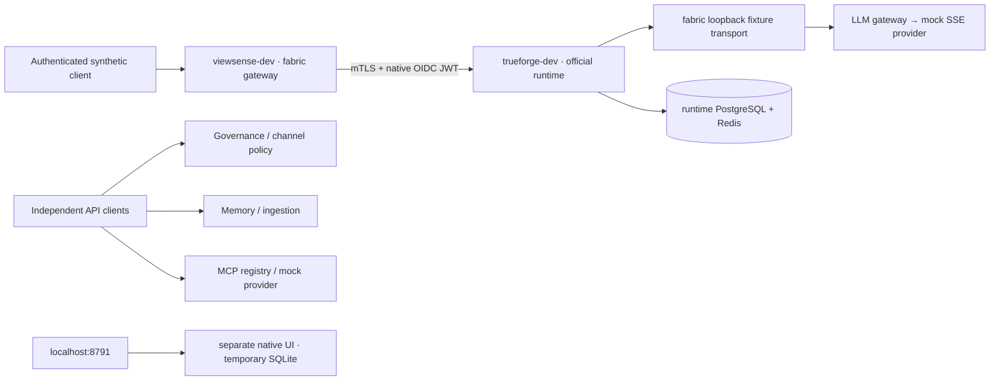

# ViewSense AI® Technical Guide

The retained `aiops-fabric` tier owns identity, policy, provider credentials, memory, integrations
and evidence. The agent-runtime backend is an official unmodified TrueForge release. All customer
customization stays in fabric through supported APIs/SDKs and documented values; no source/chart
patch, fork, vendored internals or customized upstream image is permitted.

## Runtime administration access

From the implementation checkout, run `make trueforge-ui`, then open
**[http://localhost:8791](http://localhost:8791)**. This is a separate native standalone preview,
with no browser certificate/login and temporary SQLite/configuration data discarded on stop.
Use `make trueforge-ui-status` or `make trueforge-ui-stop` to inspect or remove it.
[Agent runtime access](deploy/trueforge-access.md) is the canonical access/troubleshooting guide.

The optional fabric management console on port 8787 observes safe preview configuration through supported runtime APIs; model/connector edits belong in runtime administration. The hosted runtime
in Kubernetes remains protected by mTLS/OIDC; its port 8790 is not a configured browser login.

## Current architecture



The hosted adapter accepts only the fixed synthetic `/v1/runtime-check` fixture. The retired
`/v1/responses` returns authenticated HTTP 410; manual agent-run endpoints/storage are removed.
Runtime transcripts do not replace governed memory or safe evidence. No service reads another
service's database or receives another adapter's provider credentials.

## Retained capabilities

- Development mTLS/scoped JWT/Trust Envelope, product-neutral OIDC verification and local SSO examples.
- Channel policy drafts, independent review/publication, AuthZ pilot, provider passports/admission and safe evidence APIs.
- LLM boundary with deterministic mock SSE; credential-owning OpenAI and Ollama adapters retain their narrower protocol contracts.
- Memory gateway, PostgreSQL/pgvector profiles and bounded backfill; Mem0 adapter boundary.
- Synchronous ingestion, MCP registry/provider API, certificate metadata and networking management contracts.
- Optional detachable management console, source/Helm catalogs, release and documentation publishing tooling.

These are different capability and maturity scopes. The runtime pair is not production business
execution. Native governed MCP, real model/tool compatibility, fresh per-call authority, PII,
atomic budgets, immutable evidence, no-retention execution, idempotency/recovery, HA/restore,
mesh-v2 and integrated browser identity remain qualification gates. See
[Implementation Conformance](design/high-level/00-implementation-conformance.md).

## Build and deploy

Follow the [quick start](QUICKSTART.md), then:

```bash
make unit
make lint
make profile-check
make k8s-deploy
make k8s-test
```

The development renderer explicitly targets `viewsense-dev` / `trueforge-dev` on `k3d-cks`, pins
official runtime artifacts and generates private trust/resources under ignored `.viewsense/rebuild`.
The fabric chart/Compose foundations remain independent packaging choices. They do not implicitly
install the backend runtime or supply production providers. The obsolete single-namespace overlay and mesh
POC installers are removed; use current profile tooling and owner-managed integration qualification.

See the [test guide](tests/README.md), [product/module catalog](fabric/README.md),
[architecture](design/high-level/design_01.md), [namespace design](design/high-level/20-deployment/03-trueforge-namespace-integration.md)
and [cleanup record](design/high-level/40-ops/04-cleanup-record.md).
