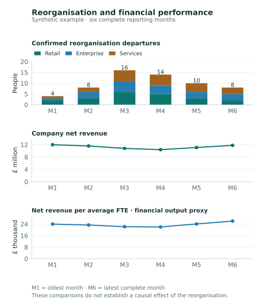

# Reorganisation and business performance

A senior manager asks one question across HR, department and finance systems. ViewSense AI®
combines permitted facts into a six-month management report, with charts, departmental comparisons
and an evidence-backed explanation prepared by ViewSense.

> **Proposed workflow.** The HR, organisation, finance and operational connectors and governed
> report delivery still require implementation and acceptance. The figures below are entirely
> synthetic. See [current capabilities](../design/high-level/00-implementation-conformance.md).

## The senior manager's question

> How many people left the organisation as part of the reorganisation in the last six months?
> Break this down by department and compare it with company sales, costs and departmental output.
> Show the trends in charts and explain what the figures support and what remains uncertain.

This is a management-analysis workflow. The HR system supplies confirmed reorganisation exits;
Finance supplies approved financial measures; departmental systems supply their own output and
quality measures. AI helps explain the combined evidence. It does not invent departure reasons,
calculate authoritative financial figures or decide that a reorganisation succeeded.

## The workflow at a glance

1. **Connect HR, departments and Finance**

    Read approved departure, organisation, staffing, financial and operational facts for the same period.

2. **Compare on a common basis**

    Calculate validated aggregates, then use the analysis agent to explain the trends and the limits of the evidence.

3. **Deliver a management evidence pack**

    Give authorized leaders charts, department comparisons, definitions, source references and open questions.

## What the manager receives

The result combines an executive summary, aligned monthly charts and a department table. This
example uses six complete reporting months: **M1 is the oldest and M6 is the most recent**.
A real run resolves and records the actual reporting boundaries and data cut-off.

[Open the chart at full size](../assets/images/reorganisation-performance.svg) ·
[View the synthetic source data](../assets/data/reorganisation-performance-example.csv)

All three panels use the same monthly window and separate, explicitly labelled units. People,
pounds and per-FTE ratios are not plotted on one ambiguous scale. The example calls the approved
financial measure **net revenue**; a real implementation must confirm whether “sales” means
bookings, invoiced sales, recognized net revenue or another Finance-owned definition.

| Executive measure | Synthetic result | Interpretation |
|---|---|---|
| Confirmed reorganisation departures | 60 distinct people over the six-month window | HR-classified organisation exits, not all turnover or internal transfers |
| Company net revenue | £67.7m across the six months | The sum of the three reporting departments in this complete fictional company |
| Monthly net revenue, M1 → M6 | £12.0m → £11.8m, down 1.7% | The latest month remains below the first, despite recovering from the M4 low |
| Average monthly FTE, M1 → M6 | 500 → 452, down 9.6% | A staffing-exposure measure, distinct from the number of people who exited |
| Net revenue per average FTE, M1 → M6 | £24.0k → £26.1k, up 8.8% | A descriptive financial-output proxy, not a direct measure of individual productivity |

FTE means full-time equivalent. Departures count people, while average FTE reflects staffing over
a period. Hiring, working hours and other movements affect FTE; do not infer a hiring count by
subtracting the 60 departures from the FTE change.

### Department comparison

In this fixture, Retail, Enterprise and Services are three reporting departments with approved,
non-overlapping revenue and payroll attribution. All amounts below cover the same six months.
The supplied HR counts assume the qualifying cohort has already been deduplicated by its owner.

| Reporting department | Reorganisation departures | Net revenue | Recurring payroll cost |
|---|---:|---:|---:|
| Retail | 21 | £25.10m | £6.77m |
| Enterprise | 19 | £28.30m | £9.17m |
| Services | 20 | £14.30m | £5.12m |
| **Company total** | **60** | **£67.70m** | **£21.06m** |

Revenue attribution must be approved by Finance. Do not assign fictitious revenue to a cost centre
such as internal IT merely to populate a chart. Such departments need their own relevant output,
service-quality and cost measures. Payroll is only one cost category; these figures exclude
severance and other restructuring costs and establish no net savings or profit improvement.

### Example executive narrative

> Sixty people left under HR-confirmed reorganisation classifications during the reporting window.
> Company net revenue totaled £67.7m. Monthly revenue fell to £10.4m in M4 and recovered to £11.8m
> in M6, still 1.7% below M1. Revenue per average FTE increased by 8.8% between M1 and M6 as the
> staffing denominator fell. These observations do not show that the reorganisation improved
> productivity or caused the revenue change. Department output, service quality, seasonality,
> demand, pricing and restructuring costs need further examination.

**Sales is a business-performance measure, not a complete definition of productivity.** The report
should distinguish total financial output, output per staffing unit and each department's own
operational measures. Customer retention, quality, backlog and sustainable capacity may move
in different directions. Operational-output and quality data are absent from this fixture and
must be labelled unavailable, not invented. Six monthly observations support this descriptive
comparison; they do not establish a causal effect of the reorganisation.

## How the system combines the sources

| Source | Facts needed | Authoritative owner |
|---|---|---|
| HR / workforce system | Confirmed exit date and reason classification, stable person identity for deduplication, department at exit, staffing/FTE measures | HR owns the reorganisation cohort and workforce definitions |
| Organisation / department directory | Effective-dated department hierarchy, approved predecessor/successor mapping, cost-centre relationships | Organisation and Finance owners approve the reporting structure |
| Finance / sales systems | Approved net revenue, payroll costs, posting periods, currency, consolidation and allocation rules | Finance owns the measures, reconciliations and permitted disclosure |
| Department operational systems | Relevant output and quality measures, such as completed service work, throughput, backlog or customer outcomes | Each department owns the meaning and coverage of its measures |
| Enterprise identity and policy | Requester's current organisation/department scope, permitted purpose, accessible fields and report recipients | Identity and governance integrations establish the business grants |

The connectors use approved APIs or governed MCP tools; the model does not receive database
credentials or unrestricted query access. ViewSense resolves permitted integrations, binds the scope
and gathers versioned facts. ViewSense prepares the agent-assisted explanation from the allowed
fact set. Deterministic calculations and charts use validated source aggregates, not numbers
extracted from unconstrained model prose.

## Rules that make the comparison meaningful

1. **Resolve the reporting contract.** Confirm the six complete months, the reporting organisation,
   data cut-off, comparison baseline and Finance-approved meaning of sales. Record the chosen
   measures, units, source versions and completeness. Comparing M1 and M6 is not a before/after
   causal evaluation or a seasonally adjusted year-on-year comparison.
2. **Count the right people.** Filter to HR-confirmed reorganisation exits with effective departure
   dates in the window. Exclude cancelled exits, internal transfers and unrelated turnover. Apply
   the HR-approved rule for duplicate events and repeat employment spells so the report answers
   “how many people” without silently counting event rows instead.
3. **Align changing departments.** Join through approved, effective-dated organisation and cost-centre
   mappings. Declare a consistent reporting perimeter when departments merge, split or move.
   Retain unmapped facts as visible exceptions instead of silently dropping them.
4. **Aggregate before joining.** Build HR and financial facts at the approved month/department grain,
   then combine them. Joining employee records directly to invoice or ledger lines can multiply
   both headcount and money. Allocation weights and company totals must reconcile to owner systems.
5. **Calculate consistently.** Use the same currency, financial basis, department scope and reporting
   period. Net revenue per average FTE is the validated revenue divided by the approved average FTE
   for that same month. Company ratios use company totals, not an unweighted average of department
   ratios. Missing or zero denominators produce an unavailable result, not zero or infinity.
6. **Apply access before analysis.** Seniority alone grants no HR/Finance access. Verify the person's
   business grants and purpose. Apply field minimization and small-cohort/disclosure controls
   before model context and report delivery, including protection against inferring suppressed
   values from totals. A chart is a data disclosure too.
7. **Report uncertainty honestly.** Missing operational data, late finance adjustments or incomplete
   departmental coverage remain visible. Separate observations, plausible explanations and further
   questions. The report supports review; it performs no personnel, budget or system changes.

## Who receives which view

| Recipient | Permitted view in this example |
|---|---|
| Senior manager with approved company-wide scope | Authorized company and department aggregates, comparative charts, methodology and open questions |
| Department head | Their permitted department analysis, with company benchmarks only when separately authorized |
| HR analyst | Cohort definitions and workforce reconciliation within their HR scope; financial details only with the required grant |
| Finance reviewer | Authorized financial totals, attribution and reconciliation exceptions; no automatic employee-level HR access |

These are business grants, not the console's shipped Admin/Operations/Sales profiles. A shared
privileged agent session must not expose one audience's context to another. Recheck recipients
before delivery and keep personnel details out of shared-room notifications and ordinary logs.

## ViewSense responsibilities

ViewSense supplies the analysis workflow, customer connections, access controls, fact reconciliation,
validated calculation, chart rendering and authorized delivery. Its configured agent runtime handles
model and agent execution. Department definitions and financial rules remain owned by the enterprise.

Models, the saved analysis agent, skills and supported runtime connectors are configured through
[runtime administration](../deploy/trueforge-access.md). The backend remains an independently
maintained, unmodified dependency; customer integration and policy belong in ViewSense.

The administration interface and workflow must address the same approved runtime instance. The
local preview and secured hosted runtime currently have separate state. Hosted access and real
model/tool qualification remain prerequisites; preview configuration does not establish that this
management workflow runs today.

“Source → analysis → report” describes the business flow. Existing Input/Output Channel APIs
retain their current meanings: HR and Finance are application resource boundaries, business
entry context establishes request permissions, and final report delivery has its own recipient
binding. See the [channel design](../design/high-level/10-overall/07-input-output-channels.md).

## A practical first delivery slice

1. Use the synthetic monthly HR/department/Finance fixture, one approved model connected to the agent runtime and a
   scoped ViewSense report view. Reproduce the counts, ratios and chart independently of the model.
2. Qualify read-only HR, organisation and Finance connectors and their common reporting contract.
   Test rehires/duplicates, department changes, missing mappings, suppressed cohorts, currency and
   period mismatches, late adjustments and unavailable denominators before real-data use.
3. Add departmental operational measures with owner-approved definitions. Test missing coverage,
   conflicting evidence, unsupported causal claims, model failure and cross-role disclosure denial.
4. Qualify one delivery destination, current recipient authorization, safe persistence/retention,
   evidence correlation and idempotent retry. No personnel or financial write-back is part of this slice.

This example adds no new platform service or model-management interface. Memory/vector search
or a durable workflow provider is optional and must serve an actual requirement. Real company
information requires the [enterprise controls](../design/high-level/60-enterprise/01-enterprise-integration-controls.md)
and [adoption gates](adoption-and-governance.md) to pass first.

The chart is generated from the linked synthetic CSV by `scripts/render-reorganisation-example.py`
in the documentation repository, using optional Matplotlib. The checked-in SVG is served by the
normal docs build; chart tooling adds no runtime or documentation-build dependency.

Browse [Detailed examples](examples/index.md), compare the
[deployment-failure walkthrough](deployment-failure-investigation.md), or return to the
[value and use-case tables](value-and-use-cases.md).
