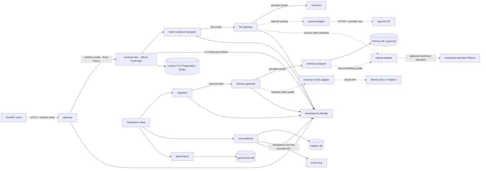
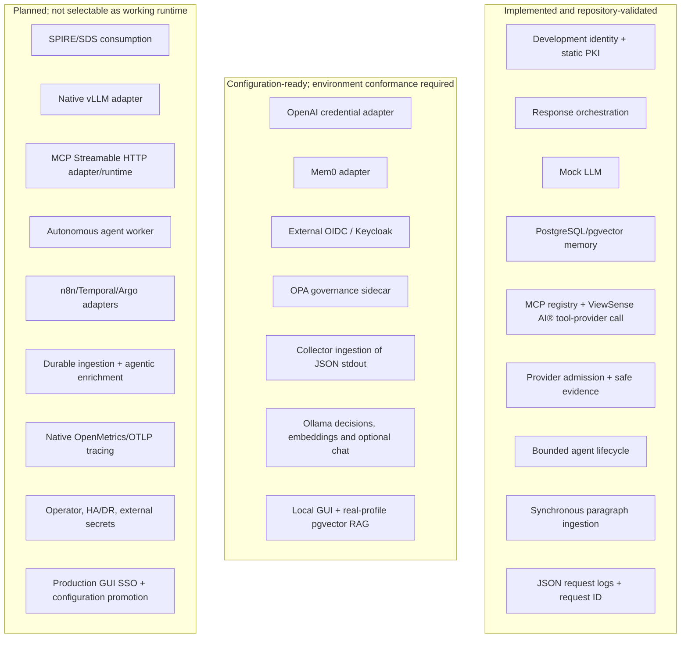
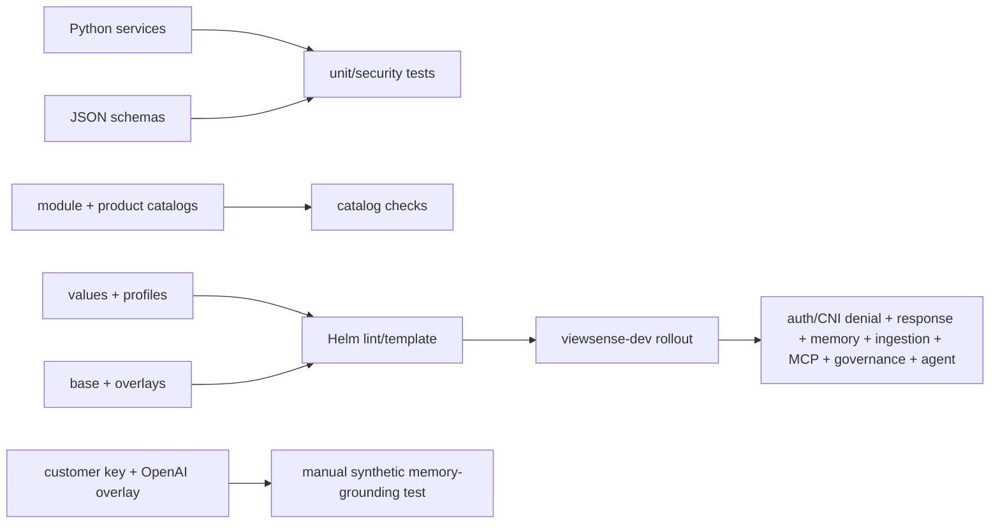

# ViewSense AI® Implementation Conformance

This is the truth map between architecture intent and the repository as shipped. The labels are:

- **implemented:** code, packaging, and an automated repository test exist;
- **configuration-ready:** the ViewSense AI® boundary exists, but an enterprise product or credential is required;
- **planned:** design or selection intent exists, but no executable adapter is shipped.

For a source assessment and the next delivery slice toward an enterprise harness for local AI,
see the [project status and local AI integration plan](01-project-status-and-local-ai-plan.md).
This map describes repository capability, not the configuration or health of a live installation.

## TrueForge adoption and clean-state decommission (major)

The owner selected `aiops-fabric` as the retained implementation and explicitly authorized an
empty development rebuild **without backups**. This supersedes the earlier preserve-and-migrate
sequence for the three named development/evaluation namespaces only. No production or unrelated
namespace is covered. The source assessment remains a historical baseline; this section defines
the current implementation.

**TrueForge remains strictly unmodified upstream.** Official chart/image releases are pinned;
all identity bridges, model transport, routing, topology and customer policy live in the fabric.
No source/chart patch, injected runtime hook, fork or customized TrueForge image is permitted.

| Capability / disposition | State | Evidence / boundary |
|---|---|---|
| Independent namespace pair | implemented development profile | `scripts/runtime/render.py` and `deploy.sh`: `viewsense-dev` + `trueforge-dev`; official Helm release `trueforge`; controller disabled |
| Unmodified runtime | pinned official artifacts | Chart `0.3.0`, image `0.3.0-ebbf6c0` pinned by digest; supported chart values only; no upstream checkout changes |
| Namespace-qualified network topology | implemented v2 CNI generator | Endpoint namespace/workload/service-account metadata, exact namespace+pod peers, default deny and scoped DNS; mesh v2 integration remains planned |
| Identity bridge | implemented synthetic cell | Fabric mTLS token issuer + public-key TLS discovery; stock runtime OIDC; distinct issuer-qualified subjects; bootstrap admin separated from gateway |
| Runtime adapter | implemented synthetic fixture only | Authenticated `POST /v1/runtime-check`, empty extra-forbidden body, fixed tenant/fixture/model, no arbitrary prompt, no legacy fallback |
| Model transport | implemented synthetic fixture only | Loopback fabric sidecar configured through supported chart values; mTLS/scoped JWT to fabric LLM gateway and mock SSE provider; real model/tool protocol qualification remains planned |
| Legacy orchestration and manual kernel | retired | Source, schema, workload, datastore, credentials/grants and packaging references removed; no replacement manual checkpoint API is claimed |
| Legacy response contract | explicitly retired | Authenticated `POST /v1/responses` returns HTTP 410; `/v1/agent-runs` service removed; this is an authorized fresh-state breaking change |
| Previous namespace data | deleted without backup | Old dev and blue/green evaluation namespaces removed with UID preconditions; fresh dev namespace recreated; no data migration or restore claim |
| Business execution / native MCP / shared sessions | disabled or planned | No end-to-end PII, hard budget, immutable evidence, idempotent creation, no-retention or delivery acceptance; existing governed registry API remains separate |
| Production operations | planned | HA, rotation/reload, SSO entitlement refresh, restore, mesh v2 and offline paired release packaging require qualification |

The [clean-state record](40-ops/03-clean-state-rebuild.md) documents exact scope, commands,
validation and remaining gaps. Current verification passed all **231** tests, lint, Helm/Kustomize,
strict three-version documentation publication and live synthetic turn/authentication/subject
isolation plus allowed/denied CNI probes; all selected workloads/stores are ready. The [adoption backlog](03-trueforge-adoption-decommission.md)
continues to govern future business enablement. M00/M01 and limited synthetic M02 have executable
foundations; M03–M06 are not complete. Authorized development retirement of D01–D03 does not imply
that the replacement has achieved business feature parity.

The remaining historical sections below describe their stated release/source baselines. Where
they mention running legacy services, old release namespaces or preserved data, this section and
the clean-state record supersede those current-deployment claims.

## Channel policy consoles and canonical identity assertions (major)

### POC console roles

The console implements separate server-bound **ViewSense Admin**, **Operations**, **Sales** and
**SIEM** identities. `GET /api/console-roles` exposes the canonical workspace matrix to Admin and
Operations. `GET /api/session` adds canonical roles, narrowed scopes and permitted `workspaces`.
Only Admin sees all workspaces, model tests and test history. Operations sees Overview & suites,
Certificates, Identity & access and both Channel pages. Sales and SIEM see the separate Channel
playground and approved Internal AI destination list. Non-admin configuration access is read-only;
Sales/SIEM cannot read management catalogs. Scoped playground policy checks and chat are permitted.
Hidden navigation, overview links, startup calls and direct configuration mutations obey the same
policy; denied API calls return 403 before any downstream call.

Local credentials bind to distinct least-privilege workload clients. Selecting another identity,
forging a role field/header or changing a URL cannot promote the credential. Named POC identities
also encounter the workspace ceiling at the edge. For SSO, operator-approved external role mappings
produce `console.role.<canonical-role>` scopes; unknown external roles provide no console access.
Legacy headless clients retain their existing scope contracts. Business framework grants remain a
separate governance policy and are never implied by a console profile. No new state owner, service
or network edge was introduced by the original role revision. The later playground revision below
adds explicit internal policy/generation paths. Evidence is recorded in the operator guide.
The coordinated role revision passed all **203** tests. Live API acceptance and browser checks
verified every profile, credential/role spoof rejection, read-only denials, hidden links and
forbidden URL fallback. Lint, JavaScript syntax, Kustomize and strict docs checks passed; Kubernetes
smoke and network denial probes passed on the existing Cilium cluster. POC role credentials remain
private local state, while the original Admin credential and all persisted policy data are retained.

The application now ships an implemented **control-plane pilot**, not full business execution.
Governance owns tenant-scoped drafts, immutable frozen candidates/reviews, active snapshots,
emergency disables/epochs and a bounded safe journal in `channel_policy_state`. PostgreSQL row
locking serialises writes; whole-draft optimistic revisions prevent lost updates. Independent
review precedes atomic publication. The edge and optional console are explicit owner API clients;
they hold no grant state and query no governance database. Gateway → governance is a new scoped
mTLS runtime edge, reflected in base/Helm NetworkPolicy and the topology catalog. Unused
orchestrator ingress on MCP is removed to align both declared boundaries with the absent runtime edge.

| Capability | State | Evidence / boundary |
|---|---|---|
| Input/Output workspaces, role/mapping/binding/profile/grant/route forms | implemented pilot | Detachable console, authenticated/CSRF-protected facades, typed owner API updates and safe empty/error/conflict states |
| Policy validation/freeze/review/activation/disable | implemented pilot | PostgreSQL snapshots, immutable review, denied self-approval, epoch and optimistic concurrency; tenant-wide operator scopes only |
| Product-neutral identity adapter | implemented pilot | Strict v2 OIDC approved-source extraction after token validation; v1 legacy scope policy preserved; two independent signed claim-shape fixtures |
| Canonical AuthZ decisions and own-access summaries | implemented pilot | Built-in complete-grant evaluator, deny precedence, exact issuer/audience/source/revision mapping, strict role-age bound and narrowing obligations |
| Synthetic Sales opportunity preview | implemented fixture | Explicit non-executing sample facts with field/result ceilings; no CRM queries, outbound model calls, outreach or permissions granted |
| Authoritative membership refresh and external AuthZ provider | planned | Current token snapshots expire at the configured bound; no live directory/revocation feed or external evaluator equivalence evidence |
| CRM/Oracle, Teams and Tool-Sense channel execution | planned | Every pilot decision has `execution_authority: false`; connector enforcement/delegation/reply binding are still required |
| Runtime PII egress, hard costs and production immutable evidence | planned | Legacy inference routes do not enforce these new policies; catalog fields do not supply wire-level privacy or spend guarantees |

Implemented governance surfaces (explicit edge facades retain management paths; console equivalents
use `/api/`):

- `/v1/channels/input`, `/v1/channels/output`: GET lists, PUT `/{identifier}`, POST `/{identifier}:disable`.
- `/v1/framework-roles`, `/v1/idp-role-mappings`, `/v1/input-role-bindings`,
  `/v1/output-capability-profiles`, `/v1/output-role-grants`, `/v1/channel-routes`: same bounded
  list/update/disable operations.
- `/v1/access-policy-draft`, `/v1/access-policy-draft:seed`, `/v1/access-policy-revisions`,
  `/v1/access-policy-revisions:validate`, `/v1/access-policy-revisions/{revision}:review`,
  `/v1/access-policy-revisions/{revision}:activate`.
- `/v1/authorization:simulate`, `/v1/authorization:sales-example`, `/v1/authorization-providers`.
- `/v1/authorization:decide`, `/v1/authorization:access`: internal trusted-edge assertions only.
- Edge `/v1/auth/channel-access` and `/v1/authorization:decide`: own access/selection decisions
  from verified identities, never caller-supplied roles. Console `/api/auth/channel-access`.

Contracts: `channel-policy-v1`, `identity-assertion-v1`, `channel-selection-v1`,
`channel-decision-request-v1`, `channel-decision-response-v1`, `channel-preview-request-v1`, and
`oidc-provider-v2`; generated owner OpenAPI includes typed resource bodies. Existing provider
files remain compatible. Fixed-tenant development clients cannot delegate another subject.
The local harness adds governance port 8847 and a separate retained governance database at port
15433, using its own user/password. No new Kubernetes service/database domain is introduced.

The [operator guide](../../fabric/governance/channel-console.md) documents lifecycle, scope
boundaries, pilot capacities and opt-in acceptance. Source baselines are application `bbb5f23`
and documentation `359158f`; coordinated edits remain uncommitted for the owner's manual handoff.
The initial pilot validation passed all **191** unit/design/catalog/security tests and lint. Base
Kustomize rendering and the strict documentation build passed. Opt-in local acceptance exercised
session/CSRF boundaries, the three synthetic Sales facts, denied writes, independent review,
publication, concurrent PUT rejection and draft isolation. Browser checks covered the empty state,
Input/Output/Identity forms, stale-edit error, denied/stale preview, keyboard focus and narrow-screen
navigation. Installed TEV1 decision and EmbeddingGemma 768-dimension tests passed; synthetic memory
retrieval/isolation, safe history/log checks and restart persistence passed. After restart the
governance database retained draft revision 4, active revision 1, epoch 1 and its review evidence.

End-to-end Kubernetes smoke and all positive/negative NetworkPolicy probes passed on the existing
`viewsense-network` cluster with Cilium, including gateway → governance allowed and orchestrator →
MCP denied. The existing `k3d-cks` cluster passed smoke and other probes but unexpectedly allowed
orchestrator → MCP even with the tightened policies applied. That installation has unresolved
network enforcement evidence and must not be promoted on these results. These tests validate the
control-plane pilot; they do not validate Oracle/Teams execution or external PII/budget guarantees.
GUI evidence is linked in the [operator guide](../../fabric/governance/channel-console.md#verified-local-evidence).

The earlier design-only
assessments below retain their original baselines; this section supersedes their planned
control-plane rows while their runtime/production gaps remain in force.

## Product-neutral identity and policy providers (major, design-only)

The [AuthN/AuthZ contract design](10-overall/08-channel-consoles-role-mapping.md#provider-neutral-authentication-and-authorisation)
separates Authentication and Identity Provider, Identity Entitlement Adapter and Authorisation
Policy Provider capabilities. Governance continues to own framework roles, mappings, channel
grants and policy revisions. Canonical identity/entitlement assertions and resource decisions
isolate provider claim layouts, administration APIs and policy syntax from console/CRM code.
Keycloak and OPA are implementation examples, not mandatory dependencies. Existing POC evidence
below remains product-specific evidence, not proof of provider-neutral replacement acceptance.

These normalised adapter contracts, console provider views, identity-linkage migration and
two-adapter conformance gates are planned. Current generic OIDC verification and the governance
OPA admission boundary are foundations, not the complete channel AuthN/AuthZ contract. No
runtime schema, API, trust configuration, provider, grant, deployment or data owner changes in
this documentation revision. Source baselines are application `58243f5` and docs `d42ad05`;
changes remain in the working tree for the owner's manual paired-change handoff.

Validation: all 148 unit/design/catalog/security tests passed; `make lint`, base Kustomize
rendering, the strict delegated documentation build and whitespace checks passed. No provider
configuration changed. Provider replacement, live entitlement revocation and canonical decision
conformance tests remain implementation acceptance work.

## Channel consoles, framework roles and AI egress governance (major, design-only)

The [console/role design](10-overall/08-channel-consoles-role-mapping.md) adds planned Input/Output
workspaces, Identity role/mapping tabs, exact IdP-to-framework mapping, Input entry bindings and
qualified Output capability grants. CRM restrictions belong to the Output grant; the Input page
displays derived access. Governance owns role/policy resources, while the selected identity system owns external
user/group role assignments. The existing OIDC verifier maps recognised external roles directly
to broad platform scopes; `/v1/auth/roles` is static configuration, not a framework role catalog.

The [enterprise AI governance design](10-overall/09-enterprise-ai-governance-egress.md) defines the
layer's role between enterprise users/apps and approved models/services. It requires policy before
external dispatch, assembled-context PII inspection, final wire-payload/endpoint validation,
provider-neutral contracts/adapters, safe model swaps and budget/evidence controls.

| Capability | Current state | Missing implementation / evidence |
|---|---|---|
| Input/Output console and Identity framework-role pages | planned | Headless APIs, forms, scoped mutations, safe preview, atomic draft/review/activation and UI tests |
| Qualified external mapping and channel/resource grants | planned | Schemas, verified role-source extraction separate from legacy `role_scopes`, tenant/resource enforcement and direct-tool negative tests |
| Current role freshness/revocation | planned | Authoritative role refresh/feed, configured 60-second pilot assertion-age bound, monotonic deny epoch and mid-run/delivery tests; existing POC changes wait for token reissue/expiry |
| Canonical provider API foundation | implemented subset | FastAPI OpenAPI and mock/OpenAI/Ollama translations exist; full capability discovery, snapshots, semantic replaceability and provider conformance remain gaps |
| Company-boundary and PII egress enforcement | planned | Local inspection/minimisation, payload-bound decision and final adapter enforcement, bypass prevention and actual-wire canary tests across all outbound capabilities |
| Runtime admission, guardrail and channel policy enforcement | planned extension | Governance admission APIs exist but runtime model/tool routes do not enforce this full policy chain |
| Hard cost limits | planned | Governance budget ledger/reservations, trusted usage/pricing reconciliation, concurrency/retry/idempotency and uncertain-call evidence |
| Production auditability | partial foundation | Safe append-only evidence API exists; complete acknowledged dispatch/outcome delivery and independent immutable export remain gaps |

This revision changes narrative design and navigation only: no executable schema, route, scope,
manifest, grant, provider configuration, Keycloak assignment, deployment or database changes.
No PII containment, hard-spend or model-equivalence guarantee is claimed from documentation.
A local-only Sales pilot is the implementation starting point until external egress gates pass.

Source pairing: application baseline `9e561e0df65f9e9f42dd9fc6b5a2b5f0d0adf241`, documentation
parent `7d3be8481785741f5ae6db62ff5c0034be7a63d0`; the documentation commit containing this
section is the paired design revision. Runtime, identity-provider role freshness, PII and console
acceptance remain pending; no new application commit is required for this design-only revision.

Design-revision validation: all 148 unit/design/catalog/security tests passed; `make lint`, base
Kustomize rendering, strict delegated documentation build and whitespace checks passed. New
designs are included in published navigation and balanced Mermaid checks. Runtime deployment,
external identity role mutation, wire-level PII tests, hard-cost enforcement and new-page browser QA are
not claimed by these source checks and remain implementation acceptance work.

## Input and Output Channels (major, design-only)

The [channel design](10-overall/07-input-output-channels.md) introduces planned tenant-scoped
Input Channels (business requester context), Output Channels (enterprise integration targets),
versioned routes, authenticated narrowed execution context, and verified entry-session replies.
The practical target is Sales → CRM-Logistics1 through Tool-Sense, with a read-only Oracle
connector and evidence-based opportunity rules. Governance is the proposed channel/route metadata
owner; MCP owns tool bindings; CRM retains its database and business-data ownership.

| Capability | Current state | Missing evidence / implementation |
|---|---|---|
| Input/Output Channel and route resources | planned | Schemas, governance administration/resolution, scoped policy and revision/revocation enforcement |
| Channel-aware delegation and account/field controls | planned | Versioned authenticated context and negative identity/account/field tests; Trust Envelope v1 is insufficient for channel grants |
| Chat → Tool-Sense → Output routing | planned | Orchestrator/governance/MCP integration, configuration, grants, network rules and grounded-response validation |
| CRM-Logistics1 / Oracle opportunities | planned | Credential-isolated adapter, owner-approved query mappings/rules and live read-only correctness/isolation evidence |
| Teams entry and authorised delivery | planned | User mapping, replay protection, private/shared recipient checks and headless equivalence |
| Agent/workflow/ingestion channel integration | planned | Context propagation, resume/callback reauthorisation and source/ACL/freshness controls |

No runtime route, contract schema, deployment resource, permission or database is changed by this
documentation revision. Existing executable diagrams and HTTP surfaces below remain the reference
truth: the orchestrator calls memory/LLM only; orchestrator-to-MCP network access remains denied.
Do not infer routing from arbitrary request metadata or native MCP support from Tool-Sense naming.
The pilot must disable CRM conversation persistence until channel/account ACL and retention tests
exist; current `remember` defaults and memory owner filters are not that implementation.

Source pairing: this design-only revision is assessed against application commit
`9e561e0df65f9e9f42dd9fc6b5a2b5f0d0adf241` and documentation parent
`67a377dee4141109073b4aaf8738300ec695e605`. The documentation commit containing this section is
the paired design revision; no implementation commit is needed until the planned slice changes
executable assets. Documentation validation evidence is recorded with that revision; none is live
CRM, Teams or channel acceptance. Existing production gaps remain.

Validation of the design revision: `make unit` passed all 148 tests, including route/conformance
and balanced-design-diagram checks; `make lint`, base Kustomize rendering and the strict delegated
documentation build passed. These are source/documentation checks. Live Kubernetes deployment,
channel policy, Oracle business queries and Teams delivery are not exercised by this design-only
change and remain acceptance work for the implementation slice.

## Manual release automation (major)

The application `.github/workflows/release.yml` accepts a plain three-part version and an immutable
documentation commit through required `workflow_dispatch` inputs. It runs only in the canonical
application repository on an explicit manual `main` dispatch; no push, tag or merge event triggers
packaging. CI ignores the legacy `release-trigger.json` and its enabled flag. It preserves
operator branch ownership and does not automatically edit sources. The request job uses an
application contents-write token to list drafts; it performs no release or tag writes. Read-only
build jobs run existing tests, profiles, Kustomize and docs checks, then package both node architectures.
The requested version is applied to a temporary chart copy and image/archive metadata.
The build job first runs `package.py --check-only` after paired checkout and before Docker setup.
It requires `docs/releases/<version>.md` in the selected documentation commit and clean source
checkouts. The 1.0.2 notes are prepared for review; publication and live acceptance remain pending.

A separate contents-write upload job verifies outer archives and extracted bundle checksums and
binds their clean source commits to the requested application/docs checkouts before creating paired
tags. Docs access uses a repository-scoped `RELEASE_DOCS_TOKEN`; checkout credentials are not
persisted. Actions are pinned to commit SHAs. Completed drafts and published versions are skipped;
existing tags cannot move and retries add only missing byte-matching draft attachments. Draft
publication remains an explicit operator step. Retained build artifacts support failed-job retry
for 14 days; a new build cannot overwrite an existing attachment with different bytes.

Draft discovery uses the authenticated, paginated release list matched by `tag_name`; final
verification uses the release ID. The published-release tag endpoint cannot verify a draft.
Duplicate matches and API failures stop processing before creating another draft. Regression
tests cover draft creation/verification, pagination, completed-version detection and safe retries.
Remote execution of this correction remains unverified; the reported upload run created a draft
but its former final tag lookup returned HTTP 404.

Correction validation: 136 tests passed both locally and through `make unit`, including 31
release CI tests. `make lint`, actionlint, base Kustomize rendering and the strict documentation
build passed. No release was rebuilt, retried or published during this correction.

Manual-dispatch validation: `make unit` passed 145 tests, including 40 release CI tests. Tests
verify explicit inputs work without a trigger file, ignore a disabled legacy flag without
editing it, and reject invalid/incomplete metadata. `make lint`, actionlint, Kustomize rendering
and the strict documentation build passed. No remote dispatch or release build was performed.

Release prerequisite correction (minor): `make unit` passed 148 tests, including 43 release CI
tests. New cases reject missing version notes and dirty sources, and verify successful preflight
does not stage charts or build artifacts. `make lint`, actionlint, base Kustomize rendering and
the strict documentation build passed. The 1.0.2 notes and navigation are added for review;
no 1.0.2 package, remote dispatch or live Kubernetes acceptance is claimed.

The workflow does not deploy, switch traffic, generate SBOM/signatures or prove Kubernetes CNI,
model quality or production admission. Configuration and a real remote Actions run remain required;
no GitHub upload is claimed from local validation. See the
[trigger operator guide](../../releases/installation.md#manually-build-a-release).

## Detachable release preview GUI (major)

The follow-up source-checkout utility `scripts/release/console.py` is implemented. It verifies
bundle checksums and release namespace ownership, reads the existing smoke credentials/TLS into
private temporary host files, and starts twelve loopback-only forwards plus the existing GUI.
No Kubernetes resources or identity grants are changed. The selected context/namespace/version
are visible; service health is observed over mTLS. Existing ingestion, memory write and search
APIs use their original audience/scopes and fixed tenant. A mock response preview uses the
existing gateway `api.invoke` grant and disables conversation writes. The UI distinguishes absent
Tev1/Ollama capabilities from the running LLM gateway and deterministic evaluation embeddings;
completed/failed health requests never leave missing capabilities checking. Other administration operations are
rejected in preview mode. Browser Host/Origin/session/CSRF protections remain intact.

The original 1.0.1 download assets are unchanged and remain headless. Preview tests cover anonymous
and CSRF rejection, exact namespace routing/scopes, unsupported-operation rejection and nonlocal
URL refusal. Live Green validation includes ingestion/search and owner isolation; the GUI labels
deterministic vectors and does not claim real-model or production administration acceptance.
Validation: 105 unit/security/design tests, Ruff and strict documentation build passed. Green
headless Helm smoke/CNI checks passed with the preview attached; browser ingestion and search
returned the synthetic document. The mock response path and explicit component labels were
verified in the browser. The utility is separate from the original local Ollama harness
and `viewsense-dev` recovery.

## Release 1.0.1 packaging and environment replacement (major)

The versioned Helm chart, architecture-specific offline image/download packager, checksummed
installer and draft GitHub Release uploader are implemented. The installer requires an explicit
context and a new namespace identifying the release, such as `viewsense-release-1-0-1-blue`.
Independent PKI/signing/client/database material is generated outside existing development
directories. All four state owners remain namespaced and separate. Owned namespace deletion
has a UID precondition; reset recreates fresh state. Git checkout metadata, host credentials
and development runtime directories are excluded; Python runtime assets remain in the image.

The default full mock chart includes a Helm test Pod; selected external/partial profiles omit
that hook and need their own acceptance. The shared CNI probe script pairs allowed and denied
mTLS HTTP transfers. Negative unit tests cover namespace protection, existing-namespace refusal,
ownership checks and artifact corruption. Paired clean source commits are recorded in artifacts,
and draft upload verifies matching application/documentation tags.

Parallel whole-suite environments and state-safe promotion are defined in the
[replacement design](../../releases/parallel-environments.md). A stable cross-namespace or
cross-cluster traffic switcher is not shipped: ingress/trust, shared identity, state replication,
writer fencing and drain remain product-specific integration work. The default release is an
evaluation distribution, not a production admission decision. Static seven-day certificates,
mock inference/tools, deterministic embeddings, single-replica stores and existing enterprise
security/HA/telemetry gaps remain explicit.

### Release validation evidence

- Docker unit/security/design tests: 100 passed; source, tests and release-script Ruff checks passed.
  Helm lint/template for every profile, base Kustomize rendering, Kubernetes server-side dry run,
  strict documentation build and documentation release-publishing tests passed.
- ARM64 `k3d-cks`, Kubernetes `v1.31.5+k3s1` and Helm `v4.1.4`: independent blue and green
  release namespaces were installed with separate Secrets and four bound PVCs each. Green was
  deleted and recreated with a different namespace UID and new PVCs; end-to-end smoke passed.
- Green's gateway → orchestrator and orchestrator → memory-gateway mTLS transfers succeeded;
  gateway → ingestion and orchestrator → MCP gateway transfers were denied. Cross-namespace
  gateway → peer identity and orchestrator → peer memory gateway deny/allow-control/deny probes
  passed, with temporary policies removed. These are representative CNI checks, not complete
  production or Istio-ambient acceptance.
- The local server's CNI chain had no pod firewall rules after Docker resumed; restarting the
  server restored rule programming and the denial checks above. A successful API/readiness
  check alone must not be interpreted as CNI enforcement. Cluster resume/recovery still requires
  live policy probes. The release installer never disables policy to get a passing smoke test.
- Image imports on the small local runtime triggered transient disk pressure. Rebuildable unused
  Docker build cache was reclaimed; namespace lifecycle/data stayed scoped to release-test
  resources. The installer now refuses imports without disk headroom, waits for pressure to clear,
  and supports reusing preloaded images for parallel environments.

AMD64 image builds are supported by the packager; the local Kubernetes evidence is ARM64.
The original download baseline has no claimed GitHub publication. Manual paired tags/upload
remain supported; the follow-up trigger workflow above automates tags and draft attachments after
repository configuration, while publication remains operator-owned.

## Executable reference topology

Solid arrows are calls made by the current code. No arrow means no runtime dependency, even when a
future design allows one.

All solid internal ViewSense AI® service-to-service calls above use TLS with a client certificate plus
a short-lived audience/scoped token. Calls from provider adapters to external vendor APIs instead
use the vendor's HTTPS authentication contract. The development CA proves encrypted, authenticated
transport; it does not provide SPIFFE identity binding. Tenant context is carried in the signed
Trust Envelope.

## Capability maturity

## Implemented HTTP surface

Every service also exposes an unauthenticated, payload-free `GET /healthz` over required mTLS.
FastAPI supplies runtime OpenAPI for the routes below; committed OpenAPI snapshots are not yet
shipped.

| Service | Implemented routes | State owner |
|---|---|---|
| identity | `POST /oauth2/token` | development client file and signing key |
| gateway | `POST /v1/responses` (retired, HTTP 410), `POST /v1/runtime-check` (fixed synthetic fixture only) | none |
| llm-gateway | `POST /v1/chat/completions` | static route configuration |
| mock-llm, openai-adapter | `POST /v1/chat/completions` | adapter configuration/credential only |
| ollama-adapter | `POST /v1/chat/completions`, `POST /v1/decisions`, `POST /v1/embeddings`, `GET /v1/provider-status`, `PUT /v1/configuration` (opt-in development administration) | model configuration; no memory |
| memory-gateway | `POST /v1/memories`, `POST /v1/memories/search`, `POST /v1/memories:reembed` (requires `memory.admin`) | none |
| memory-postgres, memory-mem0 | same provider contract as memory gateway | provider-owned memory |
| mcp-gateway | `PUT /v1/servers/{name}`, `POST /v1/tools/call` | MCP registry PostgreSQL |
| mock-mcp | `POST /v1/tools/call` | none |
| governance | `PUT /v1/provider-passports/{name}`, `GET /v1/provider-passports/{name}`, `POST /v1/provider-passports/{name}/evaluations`, `POST /v1/provider-passports/{name}:admit`, `POST /v1/evidence-events`, `GET /v1/evidence-events` | governance PostgreSQL |
| ingestion | `POST /v1/documents:ingest` | no durable job state; writes chunks through memory API |

## Alignment decisions

| Architecture claim | Repository evidence | Status |
|---|---|---|
| replaceable model provider | static LLM gateway route; mock, OpenAI and Ollama adapters | mock implemented; real providers configuration-ready |
| local model runtime | Ollama adapter implements decision, embedding and optional chat protocols | configuration-ready; local development decision/embedding/RAG path verified; vLLM still planned |
| embedding model | optional authenticated embedding client; model-digest profiles and separate variable-dimension vector table with resumable owner backfill | real integration configuration-ready; deterministic 64-d reference remains default base profile |
| management GUI | loopback console owns sessions and calls provider/memory APIs; local model selections, component drilldowns and live tests | implemented development console; production SSO/admin control plane planned |
| replaceable memory | gateway plus PostgreSQL and Mem0 adapters | PostgreSQL implemented; Mem0 configuration-ready |
| MCP hosting | registry and custom tool-provider invocation exist | native MCP transport/runtime planned |
| agentic execution | durable manual lifecycle and approval transitions | autonomous planner/tool worker planned |
| workflow integration | values and design intent only | planned |
| enterprise SSO | generic OIDC verifier at gateway | configuration-ready; no IdP is installed |
| workload identity | static development certificates plus scoped JWTs | SPIFFE/SPIRE consumption planned |
| policy | built-in admission and optional OPA sidecar | implemented/configuration-ready |
| observability | JSON stdout, request ID propagation, inbound `traceparent` logging | native metrics, trace propagation, and OTLP export planned |
| audit/evidence | payload-minimized append-only API semantics in PostgreSQL | implemented reference; immutable export planned |
| Kubernetes isolation | ServiceAccounts, restricted contexts, default-deny NetworkPolicy manifests | manifests implemented; recorded local runtime probe failed: gateway could reach ingestion; cluster enforcement gate remains failed |

### Local AI and embedding profiles

The AI endpoint exists. The Ollama adapter now accepts the internal mTLS/JWT boundary; the OpenAI
adapter remains pinned to its cloud host. Tev1 decisions use a separate `/v1/decisions` contract,
not chat completion. The local console invokes this directly as a fixed-tenant development client.
Optional chat can be selected through the existing LLM gateway after configuring a chat model.
Decision verification compares native and console probabilities: the ungrounded green-sky
example incorrectly favored true. The GUI separates question identifiers from answers and provides
a visible reference/agreement default; this does not add retrieval or deterministic factual checks.

Ollama chat translation uses native `/api/chat` with `stream:false` and returns the internal
`choices[].message.content` envelope. A short synthetic Qwen policy question completed locally;
a longer prompt hit an upstream MLX threadgroup limit. This is connection evidence, not
long-generation stability or response-quality certification. The console chat preview has a 240-second provider deadline
and 260-second hop timeout for the local Qwen model, plus visible elapsed time. Existing public
gateway/orchestrator budgets are shorter and must be configured before certifying that slow route.

`VS_EMBEDDING_PROVIDER_URL` enables real-profile writes/queries. `memory_embeddings` stores vectors,
model/revision/dimensions and a profile keyed by memory ID; the legacy `memories.embedding vector(64)`
is retained for development rollback. Search returns 409 if the tenant/owner has records missing the
current profile. `/v1/memories:reembed` backfills bounded batches without deleting old vectors.
The provider owns all SQL; the console and gateways use only APIs. Mem0 upstream embedding
configuration remains separate. Vector ANN indexing and production migration job orchestration
remain future work; current semantic queries perform exact cosine ordering.

### Isolated development console

`make console` runs the browser surface at `http://127.0.0.1:8787`, separate local identity,
Ollama adapter, memory provider/gateway and ingestion APIs on ports 8840–8844, and a Docker-managed
pgvector volume on loopback port 15432. Internal service calls retain mTLS/JWT. The browser uses an
HttpOnly session, same-origin JSON and CSRF verification; local bootstrap credentials never become
provider keys. This development console is not installed in the production Helm topology.

| Console routes | Purpose |
|---|---|
| `GET /`, `/static/*` | browser UI/assets |
| `POST/GET/DELETE /api/session` | development session bootstrap, recovery, logout |
| `GET /api/components`, `GET /api/history` | observed health and payload-free test history |
| `GET/PUT /api/configuration` | inspect/update installed local model selections via adapter API |
| `POST /api/tests/decision`, `POST /api/tests/embedding` | real local model tests |
| `POST /api/tests/model` | admin-authorized selected-model decision/embedding/chat preview without changing saved defaults |
| `POST /api/tests/memory`, `POST /api/tests/search`, `POST /api/tests/reembed` | store/search/backfill through memory gateway |
| `POST /api/tests/ingestion`, `POST /api/tests/rag` | document chunking and store/retrieve/optional decision on context |
| `POST /api/tests/response` | release-preview-only mock gateway response; scoped `api.invoke`, fixed backend model route, conversation writes disabled |

See [local console design](10-overall/06-local-ai-console.md) for trust boundaries and production
gaps. The base Kubernetes mock regression does not prove Ollama networking, GPU sizing or local
console behavior; those need their separate provider/live/browser suites.

`POST /v1/model-tests` is an opt-in `provider.admin` adapter route for installed-model previews.
Dropdown selection does not modify pinned inference or persistent memory profiles. The GUI enables
Save as default after a successful preview and carries discovered embedding dimensions into the
explicit configuration update. Full module lifecycle control and production model admission remain gaps.

## Verification map

This file must be updated when a route, service edge, state owner, product readiness level, or test
gate changes. Target-state diagrams elsewhere must link back here and must not be described as
currently deployed.

The local harness supports API-only startup and an independently attached GUI, with direct mTLS/
scoped-token component tests and additive binary decision probabilities. See the
[detachable API harness contract](10-overall/06-local-ai-console.md#detachable-local-api-harness).

The [platform-wide headless API requirement](design_01.md#platform-wide-headless-api-requirement)
applies to all modules, including roles, policy and observability. Those management/export/query
surfaces are explicit backend gaps, not GUI-owned substitutes. The optional console and the
Kubernetes API suite are independently replaceable clients/runtimes.

## Enterprise SSO / certificate redesign (major)

New boundaries: provider registry at the edge, browser code/PKCE login in the optional console,
verified user role mapping and per-operation scope enforcement, edge-to-component narrowed
workload delegation, certificate service public-file / namespaced cert-manager inventory and
status-only renewal. New APIs: `/v1/auth/providers`, `/v1/auth/me`, `/v1/auth/roles`, component
facades, `/v1/certificates`, certificate detail/renewal and authenticated certificate metrics.
OpenAPI remains served by each backend; GUI `/api` routes are client conveniences.

Implementation and live acceptance evidence are recorded below.
Keycloak and cert-manager are separately packaged POC integrations. Existing development PKI,
provider configuration promotion, session HA/backchannel logout, Okta acceptance, workload TLS
hot reload, trust distribution and durable security audit export are production gaps.

Console routes: `/auth/providers`, `/auth/login/{provider_id}`, `/auth/callback`, `/api/auth/me`,
`/api/auth/roles`, `/api/certificates`, `/api/certificates/{namespace}/{name}:renew`.
Certificate routes: `/v1/certificates/{namespace}/{name}`, `/v1/certificates/{namespace}/{name}:renew`,
`/metrics` (requires certificates.read). Platform routes: `/v1/platform/catalog`,
`/v1/platform/suites`, `/v1/platform/status`, `/v1/platform/suite-plans`;
GUI client routes `/api/platform/catalog`, `/api/platform/suites`, `/api/platform/status`,
`/api/platform/suite-plans`. Suite plans are inspection output, not a cluster deployment API.

The edge additionally exposes `/v1/models` as installed inventory, and the local AI component
facades retain `/v1/provider-status`, `/v1/configuration`, `/v1/model-tests`, `/v1/decisions`,
`/v1/embeddings`, `/v1/chat/completions`, `/v1/memories`, `/v1/memories/search`,
`/v1/memories:reembed`, `/v1/documents:ingest`. These facades are configured in the isolated local
SSO runtime; the canonical reference cluster retains its existing orchestrator/component edges.
Missing provider deployments or workload grants fail closed and are not created by suite selection.

An optional development certificate bridge combines local and Kubernetes inventory by calling
both certificate APIs. It uses a separate certificate-only broker client and the cluster's TLS
trust material; it does not reuse local tokens across issuers. User subject and tenant are delegated
through the signed workload envelope. Each inventory item identifies its environment, and only
cert-manager resources with both the configured renewable name and renewal approval label support
the renewal action.

### Management POC evidence

- `make unit`: 80 passed; `make lint`, `make profile-check`, base Kustomize render and
  `make docs-build`: passed. The certificate controller Helm path rejects missing explicit egress.
- `make k8s-deploy`: passed. Separate Keycloak pod is Ready; certificate API and three cert-manager
  controller pods run independently. Legacy cert-manager is an explicit upstream-EOL POC exception.
- `scripts/test-enterprise-poc.py --renew-canary`: passed headless OIDC/scopes, four suite plans,
  three installed models, complete 29-item public inventory across both environments, canary
  revision 1 → 2, stale renewal 409 and root renewal 403.
- `scripts/test-management-browser.py`: passed browser code/PKCE SSO, all five management pages,
  suite plan/download, mobile layout, viewer denials for renewal/planning/write, same-tenant RAG
  read and cross-tenant RAG isolation. Desktop/mobile screenshots are in
  `artifacts/management-console`. Test credentials and tokens are not in those artifacts.
- Certificate ServiceAccount RBAC: Secret get denied, named canary status patch allowed,
  root status patch denied.
- `make k8s-test`: application smoke passed, NetworkPolicy negative connectivity failed:
  gateway → ingestion returned probe status 0 despite the denial policy. This existing local CNI
  regression blocks production security acceptance; manifest rendering does not prove enforcement.

Production acceptance for that SSO/certificate POC remains incomplete. The historical CNI failure
has subsequent representative recovery evidence in the release 1.0.1 section above. Product
suite selection is a plan; deployment apply, Okta live acceptance, HA identity/sessions, native OTLP,
immutable audit export and coordinated workload/trust rotation are not implemented by this POC.

## Networking / mesh implementation — runtime acceptance pending (major)

The replaceable CNI/mesh reference, neutral allowed-flow contract, strict Istio policy adapter,
headless networking metadata/evidence/plan APIs and GUI page are implemented in source. The portable
base and Helm packaging preserve distinct database ServiceAccounts through redeployment. Runtime
acceptance is incomplete; no installed chart or manifest alone establishes enforcement. Existing
cks was non-compliant at that networking baseline and its data is not migrated by creating the
networking acceptance cluster. The release 1.0.1 evidence above records subsequent local CNI
recovery and representative checks; full mesh acceptance is still incomplete.

Networking routes: `GET /v1/networking/providers`, `GET /v1/networking/topology`,
`GET /v1/networking/status`, `POST /v1/networking/plans`. Inspection requires `platform.inspect`;
planning requires `platform.plan`. Console client routes: `/api/networking/{operation}`
(only providers/topology/status) and `/api/networking/plans`. Evidence reports its cluster,
topology/provider-profile hashes and timestamp; stale, failed or mismatched evidence cannot imply current health.

### Networking evidence

- Independent two-node `k3d-viewsense-network` created with Kubernetes `v1.35.8+k3s1`,
  Flannel and the competing k3s policy controller disabled. Cilium 1.20.2 and Istio ambient 1.31.1
  upstream releases installed successfully. Cilium, DNS and storage were healthy before mesh install.
  Hubble relay has TLS; no GUI cluster credentials were introduced.
- The empty initial networking cluster was rebuilt to remove an incorrect shared BPF mount between
  Docker nodes. No application PVCs existed there; the original cks cluster was preserved.
- Local Python validation: 89 unit tests passed; Ruff source/tests/operator-script checks, all
  Helm profiles, JavaScript and shell syntax, and base Kustomize rendering passed.
- The Docker unit run initially failed on a missing operator-script path in the test image;
  its Dockerfile copy is corrected and the local catalog tests pass. Required Docker `make unit` /
  `make lint` reruns and the application deployment/test commands were prevented from starting by
  automatic approval review timeouts, including after explicit user permission.
- Application mesh enrollment, cross-node CNI/identity/plaintext denials, encrypted database traffic,
  restart/recovery acceptance and the new Networking browser page have **not** passed live acceptance.
  No successful networking verification report was fabricated. Run the operator guide's deployment
  and acceptance targets when execution access is restored. Existing GUI/API processes also need
  restarting to load the new routes; source changes alone do not update a running process.
- The evidence producer publishes only public metadata into a namespaced ConfigMap. The application
  gateway mounts it read-only; status is `unverified` until complete matching checks exist, becomes
  `stale` after ten minutes, and always reports `live_health:not_monitored`.

Design sync for that networking/mesh baseline is **FAIL** pending its full runtime/browser
acceptance. Release 1.0.1's Docker checks and representative local CNI recovery do not establish
acceptance for the independent Cilium/Istio stack. This reference is not production-ready: persistent-data cutover, provider
overlays beyond the base flow graph, HA/load tests, approved mesh trust/rotation, ingress/egress
gateways and durable protected telemetry remain deployment work.

## Health badges and certificate explanations — minor presentation change

The capability inventory, selected component and Observability reachability rows share
non-interactive status badges: green reachable/ready, amber checking/degraded/unknown, red
unavailable/failed and neutral outside the local stack. Light/dark foreground/background tokens
retain the status text and dot; sampled badge contrast is at least 5.35:1 in light and 7.25:1 in dark.
The certificate table has a Reason column explaining the existing API expiry state and public
readiness/not-before/issuance metadata. Warning is within seven days, critical within 24 hours,
expired after not-after, and unknown when expiry metadata is unavailable. No API, authorization,
classification policy, ownership, deployment resources or SLO changes were introduced.

Evidence: `make unit` passed (89 tests), `make lint` passed, base Kustomize rendering,
JavaScript syntax and `make docs-build` passed. Browser previews using the actual UI assets and
explicit synthetic data verified health states, dark/light colors, all five expiry explanations,
issuance/readiness context and no document overflow at the desktop viewport. Screenshots are in
`artifacts/status-preview`. Live SSO browser QA encountered the POC CA trust error; no browser
certificate warning was bypassed and no trust settings were changed. The separate networking
runtime acceptance above remains pending; Docker unit/lint execution has since succeeded.

## Documentation repository ownership (minor)

All maintained narrative documentation, design/conformance records, module/integration
and operations/test guides, governance prompts, diagrams, and documentation screenshots
are owned by `aiops-fabric-docs`. The implementation repository retains only its root README
and agent guidance as pointers; executable schemas, catalogs, deployment resources, and
runtime source remain in `aiops-fabric`. This migration changes documentation ownership,
publishing, and verification paths; it adds no runtime route, data owner, trust boundary,
deployment resource, or SLO change.

The dedicated repo owns Zensical configuration, the ViewSense AI® theme, and the sole Pages
workflow. Implementation Make targets delegate docs builds/previews to `DOCS_REPO` and mount
its `docs/` read-only for Docker unit/catalog checks. Direct pytest uses `VS_DOCS_DIR` or the
sibling checkout. Design-contract entries in module catalogs reference sibling docs-repo
source paths; machine-readable schema entries stay implementation-relative. All existing
Markdown sources and documentation assets were moved, preserving working-tree design edits.

See the [publishing and migration record](../../publishing.md#migration-record)
and [repository instructions](../../engineering/repository-instructions.md#documentation-ownership)
for the layout and coordinated merge rules. Existing networking/production acceptance gaps
recorded above are unchanged by this documentation migration.

Migration validation: the strict Zensical build and delegated implementation `make docs-build`
passed; all 53 current Markdown pages appear in navigation; 89 Docker unit tests passed;
`make lint`, base Kustomize rendering, Python/shell syntax, and whitespace checks passed.
Migrated documentation assets and unrelated working-tree console edits were verified unchanged.
The generated executable HTML console preview remains private with the implementation.

## Portable documentation hosting (minor)

The site configuration uses build-time placeholders for its hosting base and documentation
repository identity. GitHub Actions reads the configured Pages URL before building; local
builds default to the preview server or accept `DOCS_SITE_URL`. Repository links derive from
Actions metadata or the local Git origin. No hosting account or domain is fixed in the sources.
Markdown and asset links remain relative, including navigation from nested pages.

Implementation module catalogs reference Markdown contracts using
`../aiops-fabric-docs/docs/...`. Catalog validation resolves these through `VS_DOCS_DIR`
for alternate checkouts and Docker mounts; machine-readable schemas remain relative to the
implementation repository. Runtime APIs, trust boundaries, data owners, deployment topology,
and SLOs are unchanged.

Evidence: a strict build for a different domain with a nested URL prefix passed; all 53 pages'
canonical URLs, sitemap entries, stylesheet paths, and derived repository links were verified.
The local/delegated strict build, 89 Docker unit tests, lint, and base Kustomize rendering passed.
Existing production/runtime acceptance gaps above remain unchanged. See the
[build-time hosting guide](../../publishing.md#build-time-hosting-base).

## Release documentation and date-free writing (minor)

Documentation headings and prose use descriptive names without calendar dates. Existing dated
headings and their internal links were updated; fixed timestamp examples now use a format
placeholder or a value generated at execution time. Versions and paired commit references identify
release baselines while Git retains change history.

The site header uses Zensical's release dropdown, backed by a generated `versions.json` catalog.
Latest documentation lives under `latest/`; `vMAJOR.MINOR.PATCH` tags in the documentation repo
snapshot the content, navigation, and assets for matching application releases. Every Pages build
includes all tagged snapshots alongside latest, using the configured hosting base and current
pinned toolchain. Old unversioned URLs redirect to latest while retaining query strings/headings.
Version switching retains equivalent pages when available and otherwise opens the selected
release homepage. Search is scoped to each snapshot. No private-application access is required.

Tag-triggered builds use main's publisher and latest documentation; deployments are serialized.
Release-content preservation across repeat builds, version ordering, alternate-domain/nested-base
URLs, and selector metadata are covered by isolated Git-fixture publishing tests. The strict site
build and browser navigation verify the selector. Runtime APIs, trust boundaries, data owners,
application deployment topology, and SLOs are unchanged; existing production acceptance gaps remain.

Validation: 89 application unit tests, lint, and base Kustomize rendering passed. Release publishing
tests verified version ordering and unchanged release content across repeated builds; a missing
homepage left the previous artifact intact. Browser checks using clearly labelled sample releases
verified page/heading/query preservation, missing-page fallback, redirects under a nested hosting
base, and the dropdown's styling and availability after scrolling. The actual repository has no
release tags yet and offers Latest until a reviewed release snapshot is tagged.

Follow the [application-release documentation workflow](../../publishing.md#documentation-per-application-release)
when recording paired implementation/documentation release commits.

## Business documentation and management diagrams (minor)

The dedicated Business navigation section expands the executive overview and adds compatibility,
value/use-case, and adoption/governance guides. Its compatibility labels translate the product
matrix's validated, configuration-ready, and planned states into business decisions; they do not
claim vendor certification or production readiness. The guides distinguish manually driven agent
lifecycle tests from planned autonomous execution and retain the existing network/operations gaps.

Management Mermaid diagrams use four or five boxes, larger labels, accessible titles/descriptions,
and navy/teal colours. The Business pages omit the secondary contents sidebar to give diagrams and
tables more room. Diagram containers scroll horizontally on narrow screens without shrinking the
labels or widening the page. The section uses relative links and the existing release snapshot
pipeline; historical documentation tags keep their original content.

Validation: strict documentation build and release publishing tests passed; all 56 Markdown pages
appear once in navigation. Browser previews verified all four diagrams, light/dark contrast,
Business navigation, and horizontal scrolling at a narrow viewport without page overflow.
Application unit tests passed (89), lint passed, and base Kustomize rendering passed.
There are no changes to application APIs, trust boundaries, data owners, runtime configuration,
deployment topology, or SLOs. Existing production acceptance gaps remain as recorded above.

## User playground and policy engine (major)

The [playground slice](10-overall/10-user-playground-policy-engine.md) implements end-user source/destination selection, single-turn Internal AI generation and deny-by-default external/unknown destinations. The governance policy file binds tenant, console role and approved model; decision metadata is durably recorded before generation. Credentials block both routes; optional internal TEV assessment fails closed when enabled. Sales/SIEM lose direct management-catalog access and gain only edge `playground.use`. Canonical schemas, negative API tests and local GUI acceptance cover this slice. Teams, actual CRM execution, external adapter final-wire enforcement, budgets and immutable execution audit remain planned. Existing OpenAI/legacy inference routes do not inherit playground guarantees.

Playground routes: `GET /api/playground/options`, `POST /api/playground/policy-check`, `POST /api/playground/chat`, edge equivalents `/v1/playground/options`, `/v1/playground/policy-check`, `/v1/playground/chat`, governance `POST /v1/playground/options:resolve` and internal provider `POST /v1/playground/generate`.

The playground revision passed **224** unit tests, JavaScript syntax, lint, strict documentation build and Helm/Kustomize rendering. Live local role/policy acceptance and real Internal AI generation/optional TEV assessment passed. Kubernetes baseline smoke and Cilium network probes are separate evidence; an in-cluster Internal AI runtime and playground policy still require operator provisioning. Baseline source references for the owner’s manual paired handoff: implementation `bc5626f`, documentation `bcf0a12`.
