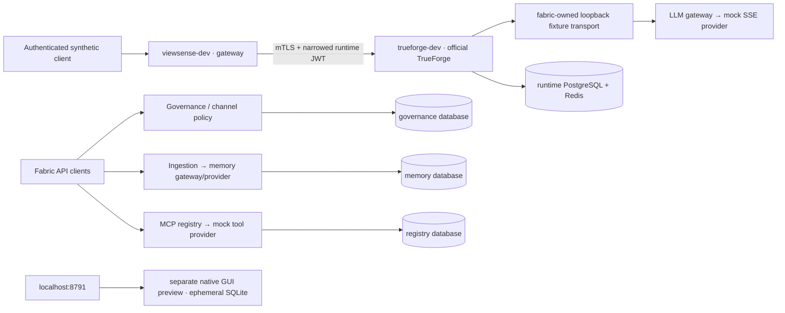

# ViewSense AI® Implementation Conformance

This is the truth map between architecture intent and the repository as shipped. The labels are:

- **implemented:** code, packaging, and an automated repository test exist;
- **configuration-ready:** the ViewSense AI® boundary exists, but an enterprise product or credential is required;
- **planned:** design or selection intent exists, but no executable adapter is shipped.

For a source assessment and the next delivery slice toward an enterprise harness for local AI,
see the [project status and local AI integration plan](01-project-status-and-local-ai-plan.md).
This map describes repository capability, not the configuration or health of a live installation.

## TrueForge adoption and clean-state decommission (major)

The owner selected `aiops-fabric` as the retained implementation and explicitly authorized an
empty development rebuild **without backups**. This supersedes the earlier preserve-and-migrate
sequence for the three named development/evaluation namespaces only. No production or unrelated
namespace is covered. The source assessment remains a historical baseline; this section defines
the current implementation.

**TrueForge remains strictly unmodified upstream.** Official chart/image releases are pinned;
all identity bridges, model transport, routing, topology and customer policy live in the fabric.
No source/chart patch, injected runtime hook, fork or customized TrueForge image is permitted.

| Capability / disposition | State | Evidence / boundary |
|---|---|---|
| Independent namespace pair | implemented development profile | `scripts/runtime/render.py` and `deploy.sh`: `viewsense-dev` + `trueforge-dev`; official Helm release `trueforge`; controller disabled |
| Unmodified runtime | pinned official artifacts | Chart `0.3.0`, image `0.3.0-ebbf6c0` pinned by digest; supported chart values only; no upstream checkout changes |
| Namespace-qualified network topology | implemented v2 CNI generator | Endpoint namespace/workload/service-account metadata, exact namespace+pod peers, default deny and scoped DNS; mesh v2 integration remains planned |
| Identity bridge | implemented synthetic cell | Fabric mTLS token issuer + public-key TLS discovery; stock runtime OIDC; distinct issuer-qualified subjects; bootstrap admin separated from gateway |
| Runtime adapter | implemented synthetic fixture only | Authenticated `POST /v1/runtime-check`, empty extra-forbidden body, fixed tenant/fixture/model, no arbitrary prompt, no legacy fallback |
| Model transport | implemented synthetic fixture only | Loopback fabric sidecar configured through supported chart values; mTLS/scoped JWT to fabric LLM gateway and mock SSE provider; real model/tool protocol qualification remains planned |
| Legacy orchestration and manual kernel | retired | Source, schema, workload, datastore, credentials/grants and packaging references removed; no replacement manual checkpoint API is claimed |
| Legacy response contract | explicitly retired | Authenticated `POST /v1/responses` returns HTTP 410; `/v1/agent-runs` service removed; this is an authorized fresh-state breaking change |
| Previous namespace data | deleted without backup | Old dev and blue/green evaluation namespaces removed with UID preconditions; fresh dev namespace recreated; no data migration or restore claim |
| Business execution / native MCP / shared sessions | disabled or planned | No end-to-end PII, hard budget, immutable evidence, idempotent creation, no-retention or delivery acceptance; existing governed registry API remains separate |
| Native GUI standalone preview | implemented development tooling | `make trueforge-ui` opens the stock official image on localhost:8791; ephemeral independent SQLite, no fabric credentials; integrated Kubernetes browser login remains unimplemented |
| Production operations | planned | HA, rotation/reload, SSO entitlement refresh, restore, mesh v2 and offline paired release packaging require qualification |

The [clean-state record](40-ops/03-clean-state-rebuild.md) documents exact scope, commands,
validation and remaining gaps. The reset/preview operation record retains its baseline verification. The cleanup removes a
duplicate-default test; current suite results and live regression evidence belong in the coordinated
cleanup Design Sync Report, with the same synthetic-only readiness boundary. The [adoption backlog](03-trueforge-adoption-decommission.md)
continues to govern future business enablement. M00/M01 and limited synthetic M02 have executable
foundations; M03–M06 are not complete. Authorized development retirement of D01–D03 does not imply
that the replacement has achieved business feature parity.

The current map below replaces the accumulated historical implementation journal. Earlier test
counts, retired POC walkthroughs and release-specific observations remain in Git and published
release snapshots; they are not instructions for the current namespace pair.

## Executable reference topology

The preview is independent of the hosted state and has no fabric credentials. The hosted runtime
controller, sandbox, web search, child agents, compaction and ordinary customer execution remain
disabled in this profile. There is no orchestrator/manual-kernel service or agent database.

## Retained capability maturity

| Capability | Current implementation | Limits / remaining acceptance |
|---|---|---|
| Workload identity | Development mTLS issuer, audience/scoped JWT and signed tenant Trust Envelope | Static short-lived PKI; production renewable workload identity and certificate/JWT binding remain planned |
| Runtime identity | Stock OIDC via fabric-owned TLS discovery/JWKS, fixed tenant per cell, issuer-qualified subjects | Interactive hosted browser login and shared multi-customer runtime isolation remain unimplemented |
| Native GUI | Official standalone image, localhost-only port, non-root/read-only process, ephemeral SQLite | Separate preview, no hosted data; no enterprise policy, PII, budget or evidence guarantees |
| Fabric management console | Authenticated local sessions, CSRF and role ceilings; read-only safe TrueForge preview inventory at `/api/integrations/trueforge`, live refresh; duplicate model editor/test facade retired | Preview configuration observation only; hosted settings/browser identity not connected; retained fabric memory/ingestion tests do not execute agents |
| Channel policy / AuthZ | Tenant-scoped drafts, immutable candidates/review, publication/disable epoch, canonical identity assertions and complete-grant evaluator | Previews have `execution_authority: false`; authoritative entitlement refresh and business connectors remain planned |
| User playground | Server-selected approved internal generation, narrowed role ceilings, mandatory safe decision record | Dedicated optional local harness; not general governed TrueForge business execution |
| Provider governance | Passports, evaluation records, OPA admission boundary and safe evidence API | Catalog admission is not fresh per-dispatch policy; immutable export and atomic hard spend limits remain planned |
| LLM transport | Mock OpenAI-compatible fixture including SSE; vendor credentials stay in dedicated adapters | Real OpenAI/Ollama adapters retain their documented narrower protocols; tool/streaming parity and production egress qualification remain required |
| Memory | Canonical gateway; PostgreSQL/pgvector, profile-aware real embeddings, bounded owner backfill; Mem0 adapter boundary | Runtime transcript is separate; owner/account authorization, deletion/export and production lifecycle acceptance remain required |
| Ingestion | Synchronous paragraph chunking through the memory API | No durable jobs, exactly-once writes or resumable partial-write recovery |
| Tools / MCP | Fabric-owned registry and `/v1/tools/call`, deterministic mock provider | This JSON API is not native MCP; governed native server transport and live tools remain planned |
| Certificates | Public inventory/status/metrics and bounded renewal interface; independent cert-manager integration assets | No Secret-read permission in the management API; runtime profile uses static development PKI, without renewal/rotation qualification |
| Networking | Namespace-qualified topology-v2 CNI policies and live denials; v1 management contracts/planner retained | Removed incompatible single-namespace POC installers; mesh-v2 deployment/recovery remains planned |
| Workflow engines | Capability descriptors and design only | No n8n/Temporal/Argo execution adapter; TrueForge schedules do not replace business workflows |
| Observability | Structured hosted application logs, request IDs and safe metadata; collector integration configuration | Native application OTLP/OpenMetrics coverage and production correlation/export remain incomplete; standalone upstream logs use local format |
| Packaging | Fabric chart/profiles, independent official runtime release, release build/upload tooling | Historical bundles are not namespace-pair distributions; new offline paired packaging and HA/restore/upgrade qualification remain planned |

## Input and Output Channels

The [value and use-case tables](../../business/value-and-use-cases.md) and
[detailed walkthroughs](../../business/examples/index.md) use source → workflow → destination to explain
target outcomes. They are planned use cases, not shipped HR/organisation/Finance/CI/Kubernetes investigation connectors.
The supplier-renewal walkthrough likewise adds no supplier/contract/assurance connector, risk
acceptance, contract approval or delivery implementation. Department example tables describe
proposed outcomes rather than installed integrations.
The ITSM service-impact example and additional MCP-based product-suite examples are likewise
design illustrations. No ServiceNow/ITSM connector, dependency traversal, service-health correlation,
impact calculation or ITSM update capability is added by these pages or their synthetic diagram.
Existing channel APIs and grants retain their current semantics. Real-model business processing,
governed native tools, recipient-specific delivery and production remediation remain unimplemented.

The control-plane pilot owns policy and canonical grants; it does not authorize business execution.
Identity providers own identities/membership. Governance owns framework roles, qualified mappings,
Input bindings, Output capability profiles/grants, route drafts, reviewed revisions and emergency
disables. The edge derives verified identity and calls owner APIs; GUI and agent output never grant
permissions. Synthetic Sales examples do not query CRM, deliver Teams messages or perform writes.
See the [channel design](10-overall/07-input-output-channels.md),
[role/provider contracts](10-overall/08-channel-consoles-role-mapping.md) and
[egress requirements](10-overall/09-enterprise-ai-governance-egress.md).

## Implemented HTTP surface

The inventory below identifies source-owned routes, including optional local/SSO/console surfaces.
It does not mean every optional service is installed in the current Kubernetes cell. FastAPI emits
live OpenAPI; the official runtime supplies its own `/api/v1` API and bundled UI. Common service
health routes are omitted for readability. Variable resource families declared through governance
routers retain their owner schema/contract; native runtime routes are not redefined by the fabric.

| Fabric package | Declared routes |
|---|---|
| `viewsense_certificates` | `GET /metrics`, `GET /v1/certificates`, `GET /v1/certificates/{namespace}/{name}`, `POST /v1/certificates/{namespace}/{name}:renew` |
| `viewsense_console` | `GET /`, `GET /api/auth/channel-access`, `GET /api/auth/me`, `GET /api/auth/roles`, `GET /api/certificates`, `POST /api/certificates/{namespace}/{name}:renew`, `GET /api/components`, `GET /api/console-roles`, `GET /api/history`, `GET /api/integrations/trueforge`, `POST /api/networking/plans`, `GET /api/networking/{operation}`, `GET /api/platform/catalog`, `GET /api/platform/status`, `POST /api/platform/suite-plans`, `GET /api/platform/suites`, `POST /api/playground/chat`, `GET /api/playground/options`, `POST /api/playground/policy-check`, `DELETE /api/session`, `GET /api/session`, `POST /api/session`, `POST /api/tests/ingestion`, `POST /api/tests/memory`, `POST /api/tests/reembed`, `POST /api/tests/search`, `GET /auth/callback`, `GET /auth/login/{provider_id}`, `GET /auth/providers` |
| `viewsense_gateway` | `GET /v1/auth/channel-access`, `GET /v1/auth/me`, `GET /v1/auth/providers`, `GET /v1/auth/roles`, `POST /v1/authorization:decide`, `GET /v1/certificates/{namespace}/{name}`, `POST /v1/certificates/{namespace}/{name}:renew`, `GET /v1/models`, `POST /v1/networking/plans`, `GET /v1/networking/providers`, `GET /v1/networking/status`, `GET /v1/networking/topology`, `GET /v1/platform/catalog`, `GET /v1/platform/status`, `POST /v1/platform/suite-plans`, `GET /v1/platform/suites`, `POST /v1/playground/chat`, `GET /v1/playground/options`, `POST /v1/playground/policy-check`, `POST /v1/responses` |
| `viewsense_governance` | `GET /v1/access-policy-draft`, `POST /v1/access-policy-draft:seed`, `POST /v1/access-policy-revisions`, `POST /v1/access-policy-revisions/{revision}:activate`, `POST /v1/access-policy-revisions/{revision}:review`, `POST /v1/access-policy-revisions:validate`, `GET /v1/authorization-providers`, `POST /v1/authorization:access`, `POST /v1/authorization:decide`, `POST /v1/authorization:sales-example`, `POST /v1/authorization:simulate`, `GET /v1/evidence-events`, `POST /v1/evidence-events`, `POST /v1/playground/options:resolve`, `POST /v1/playground/policy-check`, `GET /v1/provider-passports/{name}`, `PUT /v1/provider-passports/{name}`, `POST /v1/provider-passports/{name}/evaluations`, `POST /v1/provider-passports/{name}:admit` |
| `viewsense_identity` | `GET /.well-known/openid-configuration`, `GET /jwks`, `POST /oauth2/token` |
| `viewsense_ingestion` | `POST /v1/documents:ingest` |
| `viewsense_llm_gateway` | `POST /v1/chat/completions` |
| `viewsense_mcp_gateway` | `PUT /v1/servers/{name}`, `POST /v1/tools/call` |
| `viewsense_memory_gateway` | `POST /v1/memories`, `POST /v1/memories/search`, `POST /v1/memories:reembed` |
| `viewsense_memory_mem0` | `POST /v1/memories`, `POST /v1/memories/search` |
| `viewsense_memory_postgres` | `POST /v1/memories`, `POST /v1/memories/search`, `POST /v1/memories:reembed` |
| `viewsense_mock_llm` | `POST /v1/chat/completions` |
| `viewsense_mock_mcp` | `POST /v1/tools/call` |
| `viewsense_ollama_adapter` | `POST /v1/chat/completions`, `PUT /v1/configuration`, `POST /v1/decisions`, `POST /v1/embeddings`, `POST /v1/model-tests`, `POST /v1/playground/generate`, `GET /v1/provider-status` |
| `viewsense_openai_adapter` | `POST /v1/chat/completions` |
| `viewsense_runtime` | `POST /v1/chat/completions`, `POST /v1/runtime-check` |

`POST /v1/responses` is an authenticated HTTP 410 retirement marker, not an inference endpoint.
The old manual agent-run API is removed. The release-console response facade/button is removed;
only independent foundation operations remain. Runtime discovery is public-key-only TLS, not a
browser authorization-code issuer. The `/v1/runtime-check` body is exactly `{}` and never accepts
caller prompts, roles, models or tenant overrides.

## Verification and cleanup

Use [Agent runtime access](../../deploy/trueforge-access.md) for GUI access and the
[current test guide](../../tests/README.md) for supported checks. `make k8s-test` covers retained
fabric smoke, one fixed hosted turn, JWT/mTLS and subject isolation, private database denials and
an untrusted workload denied from previously reachable identity/runtime listeners. CNI probes
include both known-allowed and known-denied transfers; manifests alone are not evidence.

The [cleanup record](40-ops/04-cleanup-record.md) lists removed source/assets/instructions and
retained provider/control-plane designs. The [reset record](40-ops/03-clean-state-rebuild.md)
records the explicit no-backup development reset. The old networking/OpenAI overlay launchers are
removed because they reapply the single-namespace base or switch a route outside the namespace-pair
profile. They are not migration paths. Production qualification remains gated as described above;
passing synthetic tests must not be presented as customer readiness.

Current cleanup validation passed 230 tests, lint, profile/Kustomize/JS, strict publication and
hosted/security regressions. The first live run exposed an empty worker policy chain; only after
the owner-approved worker restart did the same-node denial pass. All 24 nonterminal worker pods
were Ready after recovery. The cleanup record preserves this failure/recovery and the remaining
per-node monitoring gap; this is development evidence, not production certification.

## TrueForge management ownership

The former AI/model editor and direct model/decision/embedding/RAG console routes are removed.
Runtime configuration is owned by TrueForge; fabric reads names/types/model names through supported
GET settings APIs with no credentials/manifests in browser responses. Local development enables
only the fixed standalone preview connection. SSO/release profiles and production disable it.
A visible-page refresh rereads upstream state; failures clear the displayed inventory. The hosted
runtime is separately marked not observed. This adds one server-to-loopback development read edge,
no workload grant to hosted settings, no new datastore and no upstream customization.
See [console contract](10-overall/06-local-ai-console.md) and its negative/security tests in
`tests/unit/test_trueforge_console.py`. Configuration discovery is not provider health/admission.
