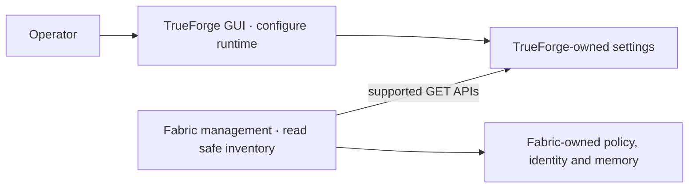

# ViewSense AI® Project Status and Integration Plan

The [implementation conformance map](00-implementation-conformance.md) is the current route and
maturity inventory. Retain `aiops-fabric` for enterprise controls and use unmodified official
TrueForge for execution. No `keepview_harness` application is required. Earlier local model-editor
walkthroughs are superseded by the [management ownership contract](10-overall/06-local-ai-console.md).

## Enterprise harness for local AI

| Capability | Current state | Remaining work |
|---|---|---|
| Execution runtime | Independent official TrueForge in `trueforge-dev`; one fixed synthetic turn through fabric gateway/transport/LLM gateway/mock | Governed real models, native MCP, customer execution and full production acceptance |
| Fabric management | Local authenticated control plane; safe read-only preview inventory; duplicate model editor/test facades removed | Same-instance hosted browser/management identity and scoped administrative observation |
| Native GUI | Official standalone preview on 8791; independent temporary SQLite/configuration | Hosted interactive identity; preview state does not configure Kubernetes |
| Fabric capabilities | Identity, governance, channel policy, memory/ingestion, MCP registry and adapter boundaries | Live enterprise authorization/PII/budget/evidence/retention and recovery qualification |
| Optional local adapters | Separate decision/embedding/chat APIs and direct operator diagnostics | Real-provider quality/protocol/load/egress acceptance; no duplicate runtime editor |
| Memory | Profile-aware PostgreSQL/pgvector, tenant/owner isolation, bounded backfill | Scale/ANN, durable jobs, lifecycle and restore |
| Legacy execution | Generic orchestrator/manual agent kernel and their store removed; response route returns authenticated 410 | No old agent lifecycle or public business-execution parity is claimed |

## Executable local development flow



Run from the implementation checkout:

```bash
make trueforge-ui
make console
```

Open TrueForge on `http://localhost:8791` to configure runtime models/connectors. In the fabric
console on `http://127.0.0.1:8787`, sign in as ViewSense Admin and open **TrueForge integration**.
Refresh after configuration changes; visible pages also refresh every 15 seconds. Only safe
metadata is read back, with no second editable catalog or inference test. Provider configuration,
reachability, provider health and fabric admission are different states.

**Fabric capability tests** exercises ingest/store/search/backfill through fabric APIs. These do
not execute a TrueForge agent. Use `make k8s-test` for the hosted synthetic path. See
[Agent runtime access](../../deploy/trueforge-access.md) and [validation](../../tests/README.md).

## Embedding compatibility and migration

Fabric knowledge vectors remain owned by the memory provider. An embedding profile identifies
model/digest, dimensions and preprocessing. Writes and vectors are atomic; queries use exact
profile/tenant/owner and reject incomplete coverage with 409. A bounded owner backfill fills missing
vectors while retaining older profiles. A TrueForge chat-model change never switches vector spaces.
Profile administration remains an explicit direct operator API action; the console offers no
runtime model-selection editor. Production migration jobs, restore and quality evidence remain gates.

## Management console, SSO and certificate POC

Admin/Operations/Sales/SIEM role ceilings, same-origin browser sessions and CSRF are implemented.
Only Admin can read the TrueForge preview inventory. SSO/release profiles disable preview
observation and cannot fall back from hosted authentication. Identity, channel policy, certificate
inventory/renewal and networking plans retain their independent owner APIs. Production enterprise
membership refresh, renewable identities, durable sessions/audit and controlled promotion remain work.

## Networking status

The development namespace pair has topology-v2 deny-by-default CNI rules and executable positive/
negative probes. The approved shared-worker recovery and initial enforcement failure remain in
[the cleanup evidence](40-ops/04-cleanup-record.md). Mesh-v2, per-node policy monitoring, production
rotation/availability and recovery are separate acceptance requirements.

## Evidence and next gates

`tests/unit/test_trueforge_console.py` covers read-only GETs, metadata minimization, changed/removed
upstream configuration, error/outage clearing, redirects/response bounds and admission. The
namespace-pair tests qualify only fixed synthetic execution. Installing a provider or observing its
settings does not qualify tools, account/data permissions, PII containment, hard spending or durable
immutable evidence. Follow the [adoption gates](03-trueforge-adoption-decommission.md) and
[enterprise controls](60-enterprise/01-enterprise-integration-controls.md).

The next management milestone connects both native GUI and fabric reader to the same secured
hosted instance through supported identity/APIs, with no TrueForge patches. The next execution
milestone qualifies governed real-model/native-tool dispatch. Neither is implied by preview status.
