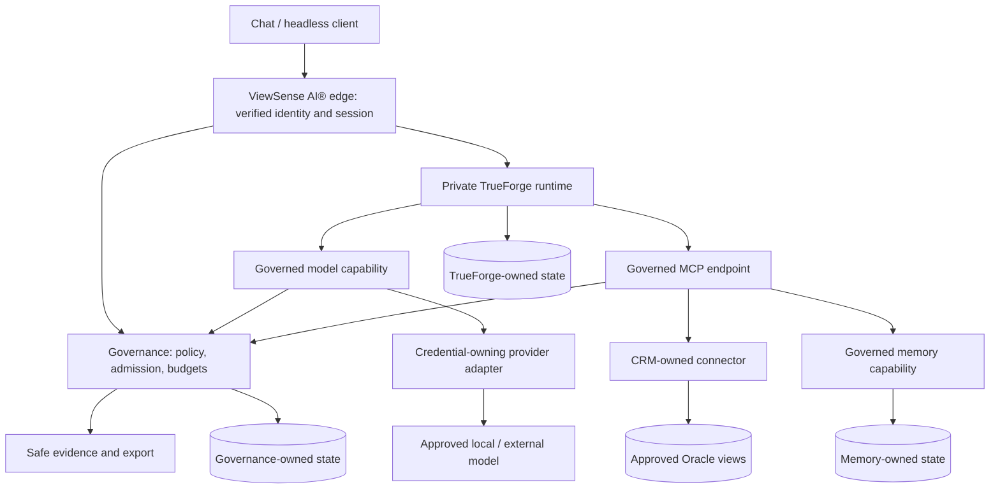

# TrueForge Source Assessment for ViewSense AI®

The selected direction is to retain `aiops-fabric` and use TrueForge as its execution runtime. The
[adoption and decommission plan](03-trueforge-adoption-decommission.md) supersedes this assessment's
earlier separate-project proposal. `keepview_harness` is not required. The fabric retains enterprise
policy, business integrations and operational controls; overlapping execution components are removed
only after replacement acceptance. Source findings below remain relevant.

This document is an analysis and proposed implementation direction. It does not change the deployed architecture, enable a provider, or certify either codebase for production. Statements about existing behavior are grounded in the source baselines below; proposed components and contracts are explicitly described as proposals.

## Scope and evidence

| Checkout | Examined baseline | Role in the assessment |
|---|---|---|
| `trueforge` | `e3fed89fc99df9fe5b8335d9ae59c525c068d7dd` | Execution runtime, server, storage, authentication, MCP, sandbox, SDK, UI, tests and packaging |
| `aiops-fabric` | `87a1efc8b2c07f64163135d497091b9175051247` | Retained implementation; candidate contracts, policy logic, adapters and acceptance assets |
| `aiops-fabric-docs` | `5ee2a5f3304f7100485effdfbf67026cbc0708e8` | Canonical principles, conformance statements, channel/security/enterprise/operations designs |
| `keepview_harness` | Initial repository containing `.gitignore` and a two-line README | No application, runtime extension, policy integration or tests exist yet |

The tracked inventories contain 3,166 TrueForge files, 210 fabric implementation files and 98 documentation files. TrueForge includes substantial generated TypeScript/Python SDK code. Review covered the repository/package layout and test surface, with detailed reads of execution and trust boundaries, policy evaluation/publication, provider calls, memory, ingestion, UI extension contracts and deployment. Generated client methods and every presentation component were not individually audited. This is an architecture and reuse assessment, not an exhaustive security audit or an executed end-to-end certification.

The upstream [introduction](https://trueforge.dev/introduction) and [repository overview](https://github.com/truefoundry/trueforge) were also checked. They support using TrueForge as an execution backbone. Local source is the authority for specific behavior in this assessment; the live website is not a versioned specification for the checked-out commit.

Source references below use checkout-relative paths in code formatting. They are review locators, not links to a private implementation repository. The final source map identifies the most important symbols.

## Recommended ownership split

Use TrueForge for model/tool iteration, context management, session/turn persistence, interactive approval mechanics, streaming, sandbox integration and reusable chat components. Use ViewSense AI® for verified customer context, authorization, approved routes, credential-owning capability adapters, governed memory, customer connectors, budget enforcement, safe evidence and deployment profiles.

Keep the existing design documents as architectural requirements, but revise their implementation mapping when migration is actually implemented. Preserve invariants rather than every old service name, Python package or development port. A versioned API boundary can be fulfilled by an existing upstream service; it does not require rebuilding the same capability behind another service.

| Capability | Canonical owner after migration | Avoid |
|---|---|---|
| Agent loop, threads, turns, compaction and interactive execution state | TrueForge runtime | A second ViewSense AI® plan/act/observe engine |
| Verified tenant/user identity, business context and public product API | ViewSense AI® edge and identity adapters | Caller-selected tenant or a single shared service user standing in for every employee |
| Roles, mappings, channels, grants, route revisions, admission and budget policy | ViewSense AI® governance | Duplicate permission copies in UI, agent prompts or customer manifests |
| Model credentials, provider translation and final outbound checks | Isolated model/provider adapter | Provider keys in TrueForge's runtime database or agent configuration |
| Business credentials, query semantics and account/field enforcement | Data-owner connector | Direct Oracle access from TrueForge or arbitrary SQL generated by a model |
| Long-term memory, knowledge records and embeddings | Memory capability/provider | Treating chat history as governed RAG or the vector index as the business system of record |
| Durable business workflow state, when required | Selected workflow provider | Reusing the agent turn store as a general workflow engine |
| Audit ingestion and export delivery state | Governance/evidence capability | Exporting raw agent events as supposedly safe audit records |
| Customer deployment selection | Reviewed customer configuration and GitOps tooling | A customer-specific fork of the agent runtime |

## What TrueForge already provides

The core is substantially more complete than the fabric's runtime. `AgentThread`, `AgentThreadOrchestrator`, `SessionHandle` and `TurnHandle` implement real execution, dynamic child threads, context snapshots, tool invocation and event persistence. The old `viewsense_agent_runtime` persists a lifecycle operated through explicit API actions; it does not autonomously call a model or tool. Replacing that kernel with TrueForge removes real duplication without surrendering the governance requirements.

| Area | Existing TrueForge foundation | ViewSense AI® responsibility |
|---|---|---|
| Execution | Actual model/tool loop, iteration ceiling, cancellation and subagent concurrency bound | Aggregate budgets, business policy and authorization at each step |
| Context | Compaction, deferred tools, large-result offloading, capability state | Classification, provenance, policy-safe compaction and artifact retention |
| Sessions | Persistent sessions, turns, snapshots, events and previous-turn handling | Product session binding, customer data policy and controlled transcript access |
| Streaming | REST/SSE, reconnect/subscription support, hosted Redis coordination | Recipient authorization, response inspection and strict-route buffering |
| Models | Multiple native adapters and OpenAI-compatible custom endpoints | Admitted logical routes, adapter-owned secrets, residency and payload enforcement |
| Tools | Remote MCP, user OAuth, selectors, approval policy, Code Mode dispatch | Certified action schemas, data scope, current grants and connector isolation |
| Sandbox | Provider interface, hosted providers, standalone local sandbox support | Approved provider profile, egress, retention, artifact and supply-chain controls |
| Scheduling | Persisted schedules and controller dispatch | Explicit machine identity and fresh policy checks at dispatch and delivery |
| API clients | Generated TypeScript and Python clients | Stable ViewSense AI® contracts and a contained runtime adapter |
| UI | Embeddable React UI, theme/slot/custom server contracts | Customer workspace, policy/status screens and server-enforced capability ceilings |
| Operations | Hosted JSON logs, Prometheus metrics, chart resource/security settings | End-to-end OTel, evidence export, HA dependencies, restore and network acceptance |

TrueForge's package separation is useful: `trueforge-core` owns execution; the `trueforge` package wires HTTP routes, authentication and persistence; `trueforge-sdk` is a generated HTTP client; `trueforge-ui` and `assistant-ui-runtime` provide presentation/runtime integration; `frontend` is the bundled application. The TrueFoundry-specific stores and authentication are integration examples, not prerequisites for the open-source deployment.

The local core README explicitly disclaims backward compatibility guarantees. Its extension interfaces are valuable, but ViewSense AI® must pin exact compatible artifacts and test upgrades. Source package versions of `0.0.0` are build placeholders, not a useful compatibility baseline. Record the commit, lockfile and produced package/image digests.

## Important gaps and integration traps

### Identity and tenancy

`packages/trueforge/src/auth/claims.ts:58` maps verified OIDC users to `tenant_id: 'default'`. The stores accept tenant IDs, but ordinary OIDC configuration does not derive separate customer tenants. TrueFoundry mode has different identity/store wiring; enabling ordinary OIDC does not reproduce that behavior.

`TrueForgeAuthorizer` permits agent read/use generally within the surrounding tenant-scoped API path and reserves manage/delete for the creator. This is useful baseline product authorization. It is not the fabric's exact role-source mapping, complete channel grant, account policy, purpose, field restriction or current entitlement contract.

Start with one isolated customer installation per cell. Bind the real customer to trusted deployment identity; TrueForge's internal `default` can be a local namespace within that cell. This is deployment isolation, not proof of shared-service multi-tenancy. Governance and connectors still use a verified real tenant, and employee identities remain distinct. Shared multi-customer operation requires a deliberate authenticator/authorization integration and a full cross-tenant test suite.

A façade authenticating everybody to TrueForge as one service account would also collapse creator ownership, MCP OAuth identity and transcript permissions. Do not adopt that shortcut without an explicit, tested subject-binding mechanism. Trusted context must survive every hop, resume and delayed operation.

### Hooks are useful but are not complete policy enforcement

`AgentCapability` supports pre-send, pre-LLM, post-tool and response processing. `ILLM`, `IToolSet`, `ITurnResourceResolver`, sandbox provider interfaces and `AgentTracing` provide more substantial integration seams. These are good places to compose behavior when building against the core.

There are two material limitations:

1. `TurnResourceResolver` adds `rootCapabilities` only when `agent_info` is absent. A root policy capability is not inherited automatically by subagents. Child agents can request another catalog model, so model-resolution authorization matters too.
2. `ContextCompaction.processPreLLM` itself calls `modelClient.createNonStream`. Built-in capabilities are assembled before extra capabilities. A check appended after the compaction processor can run after a summarization request has already left the runtime. The ordinary model request is also transformed after pre-LLM processing.

Therefore enforce at every model client's streaming and non-streaming call boundary and at the credential-owning provider adapter. A capability can enrich context or improve user experience, but cannot alone guarantee final-payload governance. Direct and child model calls, summaries, transformations, retry attempts and provider-native serialization all need coverage.

The CLI/server is not currently a generic policy-plugin host. `main.ts` selects authenticators/authorizers and `apis/turns.ts` constructs `VercelAILLM` and `TurnResourceResolver` directly. The core supports custom wiring, but stock server configuration does not expose every core seam. Plan and test a small upstream-compatible integration change if those seams are required; do not claim that a YAML catalog can inject an arbitrary ViewSense AI® capability into the stock server.

### Tool selectors and approvals need an enterprise ceiling

`ToolSet.callTool` checks selectors during execution, not merely discovery. Code Mode routes through `IToolSet.callTool`, so the existing enforcement point is reusable. Keep it.

However, the default enabled selector is `@all`. Default approvals match `@write` and `@destructive`, which depend on provider annotations. `toolSelectors.ts` explicitly exempts unannotated tools unless named or covered by `@all` approval. A tool advertised as read-only is not automatically a safe business read either: it may return unauthorized rows or export sensitive fields.

ViewSense AI® must supply explicit approved tool names/schema revisions and connector-enforced actions. Unknown tools and missing/changed classifications deny. User-edited agent selectors and approval preferences can narrow authority but cannot expand the enterprise ceiling. A click approving a call never grants a missing CRM entitlement.

Do not assume `x-tfg-*` headers are a portable extension mechanism. Inline models/MCP/skills/tools have TrueFoundry-mode restrictions; ordinary `McpServerWithAuthStore.resolveInvokeHeaders` uses configured authentication/OAuth and does not consume arbitrary turn metadata to mint a fresh ViewSense AI® delegation. A secure dynamic identity bridge is a real integration requirement.

### Secrets are isolated from sandbox code, but remain in the harness

The default model manifest contains `auth.api_key`; `PostgresModelProviderStore` writes that manifest as JSON. `getModelDetails` passes the key into `VercelAILLM` in the runtime process. Responses redact secrets, but redaction is different from moving credentials out of the orchestrator.

The fabric design requires provider SDKs and credentials to stay in owning adapters. For ViewSense AI®, configure TrueForge against an internal governed endpoint and keep vendor credentials only in its provider adapter. Internal short-lived capability credentials may be required; they must be scoped and must not become vendor keys. Apply the same separation to MCP business connectors, web search, embedding services and sandbox credentials according to their capability roles.

### Application SSRF protection is not destination admission

The TrueForge URL guard includes DNS/IP checks and redirect handling. Its allowed-host list grants exceptions for otherwise blocked private hosts; it is not a deny-all-except-these-hosts policy. Other public destinations remain permitted when the guard is enabled. The chart's `networkPolicy` setting controls this application guard, not Kubernetes NetworkPolicy resources. The chart defaults that setting to false, while server configuration defaults it to true outside that chart override.

ViewSense AI® needs actual deny-by-default network policy and an approved egress path. Allow only the required internal capability endpoints from the runtime; public provider access belongs to the selected credential adapter. Include DNS, callbacks, telemetry, skill acquisition and sandbox paths in the graph. Enabling the URL guard or naming a host in `allowedHosts` does not establish company-boundary containment.

### Transcript persistence conflicts with a no-retention channel

TrueForge deliberately persists session input, model output, tool results and context. `TurnHandle.persistExecutionEvent` appends context and output events to the store. Large-result offloading can additionally put sensitive tool content in sandbox files. Neither compaction nor metadata-only logging removes historical payloads from all durable storage.

The old channel schema fixes retention to `none`; the playground is deliberately transient, single-turn and text-only. Feeding live CRM facts through normal persisted TrueForge turns would not preserve that promise automatically.

Decide before live data: either keep those payloads out of persisted turns through an approved ephemeral execution/storage path, or define and review a different retention profile with complete deletion, backup and artifact semantics. Until that exists, limit TrueForge experiments to synthetic/approved data. Do not silently reinterpret `none` as eventual session deletion.

### Metrics, evidence and hard budgets are separate

Token totals, latency and iteration limits are useful runtime controls. They do not provide atomic monetary reservation across parallel calls, compaction, retries and subagents. TrueForge's model transport has bounded retries; a lost response can still represent a charged request. Reserve budget at dispatch and retain uncertain charges until reconciliation.

The old fabric's agent kernel stores maximum tool/cost fields, but it does not execute or meter real model/tool work. Those fields are not a reusable hard-spend ledger.

The default core resolver returns no-op tracing. Hosted TrueForge does provide JSON logs, Prometheus metrics and tracing interfaces, so observability is not absent; end-to-end vendor-neutral tracing/export must still be integrated. The bundled frontend has configurable Sentry/PostHog integrations. Review telemetry configuration and error contents for each processing boundary instead of enabling external sinks by default.

Persisted TrueForge events are a transcript, not the fabric's payload-minimized Evidence Event contract. Conversely, an append-only PostgreSQL evidence API is not independently immutable audit. Use typed metadata allow-lists, durable dispatch/outcome recording, an outbox and an independently controlled export sink where required. A blacklist of sensitive key names cannot prevent a payload hidden under an innocent key.

### Persistence and schedules do not establish workflow recovery guarantees

TrueForge has useful persistent sessions, approval state and schedule-run deduplication. That does not prove arbitrary provider side effects execute exactly once across crashes. The schedule controller is documented to run as one replica per database. Redis stream coordination is not a replacement for durable business workflow semantics.

Authorize the machine principal at each dispatch, recheck entitlement and revocation after pauses, and bind approvals to the exact action/arguments and policy revision. Later writes need connector idempotency, reconciliation and explicit recovery/compensation semantics. Choose a workflow adapter only when a customer actually needs those semantics.

## Mapping the eight design principles

The authoritative principles are in [Objectives and Principles](10-overall/01-objective-principles.md). All eight remain requirements; none should be asserted as satisfied solely by adopting TrueForge.

| Principle | TrueForge fit | Required ViewSense AI® acceptance |
|---|---|---|
| API first | Strong REST/SSE/OpenAPI/SDK foundation | Versioned customer-facing capability APIs; headless parity; contract snapshots and safe errors |
| Replace through contracts | Model/tool/sandbox/resolver interfaces are useful; core API compatibility is not guaranteed | Contained runtime adapter; neutral provider capabilities; two implementations passing the same consumer and semantic tests |
| Zero implicit trust | OIDC and optional inbound mTLS exist | Per-hop workload identity, audience/scope checks and authenticated delegated context; no trusted-network shortcut |
| One owner per datum | Runtime owns its persistence | Separate governance, memory and connector ownership; API/event-only cross-service access and explicit replication |
| Tenant is derived identity | Tenant-aware stores; ordinary OIDC maps to `default` | Trusted customer-cell binding initially; verified tenant mapping and negative isolation tests before shared tenancy |
| Policy before execution | Tool selectors/approvals and processing hooks provide partial mechanics | Fresh deterministic identity/action/data/admission decisions at every dispatch and delivery, including child/summary paths |
| Portable core, optional accelerators | Compose, Helm and replaceable runtime integrations | Kubernetes deployment baseline; optional CNI/mesh/provider overlays; offline dependency and artifact inventory |
| Fail closed | Several unknown-resource/auth/selector errors already deny | Mandatory policy, evidence, admission, inspection, entitlement and budget outages block dispatch; no unsafe fallback |

## Enterprise-control coverage

This maps every domain in the [enterprise integration control matrix](60-enterprise/01-enterprise-integration-controls.md). “Foundation” means useful code exists; it is not a production readiness declaration.

| Domain | Existing foundation | ViewSense AI® work / evidence |
|---|---|---|
| SSO | OIDC verification and browser login | Tenant/source mapping, assurance, disabled-user/role-change/logout acceptance |
| Workload identity | Optional TLS listener/controller support | Renewable distinct service identity and exact peer authorization on every internal edge |
| Authorization | Agent/session ownership and selectors | Business resource ABAC, complete grants, freshness/revocation and outage denial |
| Secrets | Server-held/redacted configuration | Adapter-owned vendor secrets, external secret integration, rotation and revocation drills |
| API management | Typed routes, OpenAPI, body bounds | Tenant/user quotas, rate/concurrency limits, gateway policy and abuse tests |
| Logging | Hosted JSON and request/session/turn correlation | Stable vendor-neutral fields, redaction and canary tests across every container |
| SIEM | Logs can feed a collector | Selected collector/export adapter, independent access and alert drill |
| Metrics | Prometheus HTTP/agent/provider metrics | Bounded-cardinality tenant attribution, SLO dashboards and burn-rate alerts |
| Tracing | Tracing port and some W3C support | Complete propagated context, OTLP integration and payload-safe spans |
| Security audit | Transcript events; old safe evidence API | Typed security events, completeness, integrity, retention and acknowledged export |
| Data governance | Sessions plus old tenant/owner memory | Classification, purpose, ACL, retention/deletion/legal hold and residency enforcement |
| Privacy | Redaction utilities and old local-only checks | Assembled-context and actual-wire controls covering every outbound capability |
| Model governance | Catalogs and old passports/evaluations | Runtime admission/revocation, capability semantics, quality gates and audited route promotion |
| MCP governance | Native MCP, OAuth, selectors and approval mechanics | Certified schema/action registry, authoritative side-effect classes and constrained connectors |
| Supply chain | Build/release/image-scan workflows | Customer SBOM/signatures/provenance and enforced admission, including skills/sandbox artifacts |
| Resilience | Hosted Postgres/Redis, chart PDB/HPA options | HA state services, failure-zone tests, PITR/restore and upgrade/rollback drills |
| Operations | Health, chart/controller and metrics | Named ownership, SLOs/runbooks and alert-to-ticket/on-call integration |
| Cost | Runtime token accounting | Trusted pricing/usage export and aggregate stop-loss enforcement |
| Lifecycle | CRUD APIs | Complete onboarding/offboarding across credentials, policy, transcripts, memory and artifacts |
| Provider admission | Fabric passport/evaluation API | Fresh enforced traffic gate; admission bound to exact endpoint/config/artifact revision |
| Execution evidence | Runtime events and old evidence envelope | Reconstruct decisions/actions/outcomes using safe metadata and reliable delivery |
| Business channels | Fabric control-plane pilot | Actual CRM/tool/model/reply enforcement; headless/chat equivalence |
| Framework role mapping | Exact mapping and reviewed snapshots in fabric | Production entitlement adapter, execution delegation and external AuthZ conformance |
| Company-boundary/PII | Local-only playground denies external generation | Receiver-observed final-wire tests, bypass denial, unsupported-format handling and per-step inspection |
| Hard spend controls | No production ledger found | Durable atomic reservations, idempotency, concurrency/uncertainty and reconciliation |

## Reuse and retirement inventory

The retained implementation has useful assets beyond its runtime. Reuse means qualifying existing
boundaries in place and retiring overlap incrementally, rather than copying the repository into
a new backend.

| Existing area | Disposition | Reason / necessary adaptation |
|---|---|---|
| `viewsense_governance/channels.py` | Reuse policy semantics and lifecycle | Complete-grant evaluation, explicit denies, reviewed immutable candidates, atomic activation, emergency epoch and concurrency control are differentiated assets |
| `viewsense_common/channel_contracts.py` and channel schemas | Preserve as the initial contract reference | Strict resources and qualified identities are useful; current decisions explicitly forbid execution authority |
| `viewsense_governance/app.py` | Extract admission/evidence capability | Passports/evaluations and producer derivation are useful; runtime routing and immutable export are still missing |
| Governance and gateway playground modules | Reuse local-only failure/inspection/evidence patterns and tests | Bounded single-turn path is not directly suitable for multi-turn agents, tools, files or cloud egress |
| `viewsense_common/auth.py`, `tenant.py`, `sso.py`, `client.py` | Reuse contracts and selected adapter logic | Signed tenant context, qualified claims and audience/scope separation matter; replace development issuance/static PKI with production identity |
| `viewsense_memory_postgres` | Candidate independent memory provider | Tenant/owner filtering, embedding profiles and migration refusal are useful; add authorization, data lifecycle and measured indexing/scale |
| `viewsense_memory_mem0` | Candidate optional provider adapter | Credential isolation and tenant/owner namespacing exist; verify live selected-version semantics and full lifecycle, not only normalization fixtures |
| `viewsense_memory_gateway` | Retain capability boundary if memory is selected | Central policy/contract point; avoid duplicating provider state or creating an unneeded process initially |
| `viewsense_common/embeddings.py` | Reuse validation behavior | Vector count/dimension/numeric checks complement profile-aware model changes |
| `viewsense_ollama_adapter` | Retain decision/embedding integration selectively | Local configuration/status and real embeddings are useful; expand chat protocol before agent use |
| `viewsense_openai_adapter` | Reuse isolation and safe-error patterns | Current API is text-only and non-streaming; not a drop-in TrueForge agent backend |
| `viewsense_ingestion` and chunker | Reuse chunking/source metadata and fixtures | Current writes are sequential and synchronous; add idempotent jobs, progress, ACLs, deletion and partial-failure recovery |
| `viewsense_mcp_gateway` | Preserve admission/registry requirements; replace transport overlap | Old `/v1/tools/call` is a fabric-owned API, not native MCP; TrueForge already supplies native MCP client behavior |
| `viewsense_agent_runtime` | Retire from the execution path | A second lifecycle owner would conflict with TrueForge; translate any required public run facade through a runtime adapter |
| `viewsense_orchestrator` | Retire generic memory-to-LLM orchestration | Duplicates runtime capability and lacks the planned governed business tool path |
| `viewsense_llm_gateway` | Replace simple forwarding with a governed capability boundary | A static proxy adds little; payload/admission/budget enforcement is the missing value |
| `viewsense_gateway` | Reuse selected validation/delegation/facade patterns | Build a focused ViewSense AI® edge; avoid copying every legacy route and bypass |
| `viewsense_console` | Reuse role matrix and management workflows | Use TrueForge UI for chat; policy/network/certificate views remain optional API clients |
| Certificates, networking and module catalogs | Reuse declarative topology, maturity/evidence and operator patterns | Regenerate exact flows for the new topology; do not transplant ports, identities or database grants blindly |
| `viewsense_identity`, mocks and smoke service | Development/test fixtures only | Useful for deterministic acceptance; not production identity or model quality evidence |
| `fabric/workflows/module.json` | Contract/roadmap input only | Metadata is not a shipped workflow adapter |
| Unit, contract, network and release tests | Port behavior-oriented scenarios | Keep negative policy tests; replace source-path/string assertions with externally observable conformance tests |

There are important limits in the candidates:

- `channels.evaluate` always returns `execution_authority: false`; the schema fixes that field to false. This is intentional protection. Add a separately designed execution-delegation contract rather than flipping the flag and treating preview output as a token.
- The policy evaluator returns the first deterministic complete allow grant rather than combining grants. Preserve the no-scope-mixing rule; define explicit selection/refusal if future requested fields require choosing among several grants. Never synthesize broad account authority from one grant and field authority from another.
- Old memory records are filtered by tenant and supplied `owner_id`, but the legacy response path forwards user-selected `user_id`. That does not establish subject-to-owner/account authorization. Bind owner/data scope through verified policy before exposing the provider to employees.
- The old OpenAI adapter rejects streaming and roles other than system/user/assistant. It has no agent tool-result round trip. TrueForge's native OpenAI path uses the Responses API; the compatible-provider path has a different protocol. Choose and test an explicit contract rather than pointing either one at the old adapter and assuming compatibility.
- Ingestion can leave partial writes after a failure and has no durable operation resource. A successful chunker test is not ingestion recovery evidence.
- Existing conformance documents include superseded historical sections. The newer control-plane pilot and playground sections refine earlier “planned” statements, but neither claims working Oracle/Teams execution or platform-wide external PII containment.

## Integration approach

| Approach | Benefits | Costs and constraints | Recommended use |
|---|---|---|---|
| ViewSense AI® façade plus private hosted TrueForge over HTTP | Reuses most server/API/UI work; smaller upstream coupling | Needs real identity propagation, governed model/MCP endpoints, retention solution and complete bypass controls | Preferred initial integration, limited to a tested cell/profile |
| Custom host around pinned `trueforge-core` | Direct resolver, model/tool wrappers, tracing and storage control | Must own host lifecycle, routes/auth/persistence integration; core APIs can change | Use when required invariants cannot be met through stock server plus a small extension |
| Full customer fork of TrueForge | Immediate access to every internal function | Persistent merge burden and customer divergence | Avoid as the product model; keep any temporary patch small, generic and upstreamable |
| Prompt/skill/config-only customization | Fast behavior prototyping | Cannot establish tenancy, data authorization, hard budgets or egress containment | Synthetic demonstrations and approved instruction packs only |

Begin with HTTP composition and a short integration qualification phase. It must prove user/tenant binding, per-dispatch policy context, retention and model/tool enforcement before live customer payloads. If the stock server cannot carry fresh scoped delegation or preserve retention semantics, add a small generic resolver/authentication/storage extension or use a thin custom core host. Do not weaken those requirements to preserve a no-patch claim.

This qualification is a concrete engineering decision, not a choice between merely installing the CLI and rewriting all of TrueForge. Much of the UI/SDK/runtime can be reused under either host approach.

### Proposed topology

All arrows in this diagram are a proposed ViewSense AI® topology, not existing runtime evidence.



These are logical boundaries, not a requirement to create a separate Deployment for every box. Provider credentials and data-owner databases require real isolation; governance policy/admission/budget modules can start in one owned service. TrueForge's own controller/server persistence is one runtime ownership domain. ViewSense AI® must not independently query or mutate that database to implement policy.

ViewSense AI® may own a small binding/idempotency record mapping its public run/session IDs to TrueForge IDs. That record is integration state, not a duplicate transcript or parallel agent lifecycle. Read runtime state through runtime APIs. Lifecycle transitions, transcript cleanup and export need explicit owning APIs.

### Retained implementation layout

Keep `src/viewsense_*`, `contracts/`, `fabric/`, `deploy/`, `scripts/` and `tests/` in `aiops-fabric`.
Add the logical runtime adapter to the existing gateway, governed provider/MCP extensions to their
capability owners, and the opt-in namespace-pair profile to implementation deployment assets.
The [decommission register](03-trueforge-adoption-decommission.md#keep-adapt-and-decommission-register)
defines eventual removal of overlap. Narrative documentation remains here. No new application
repository, language rewrite or source scaffold is part of the decision.

The existing Python edge can use TrueForge's HTTP API or generated Python SDK; a TypeScript
bridge is required only if the selected core integration demands it. React UI components can be
integrated independently. Any language-specific bridge remains thin and owns no duplicate loop,
policy model or transcript. Generate cross-language contracts from one canonical boundary schema.

### Customer customization model

Customer requirements should normally select reviewed configuration and isolated connectors. A customer pack references approved identity sources, grants/routes, model aliases, tools, memory profile, retention, budgets, deployment region and UI options. Secrets are references resolved by the owning adapter. Customer configuration may narrow enterprise ceilings; it may not redefine them.

Illustrative proposed configuration, not a currently accepted schema:

```yaml
contract_version: "1"
customer_ref: example-customer
cell_ref: example-private-cell
identity_provider_ref: enterprise-oidc
policy_bundle_ref: reviewed-sales-policy
routes:
  - route_ref: sales-opportunities
    input_channel_ref: sales
    output_channel_ref: crm-logistics1
    action: sales.opportunities.list
    model_route_ref: approved-internal-summary
    retention_profile_ref: no-business-payload-retention
    budget_policy_ref: sales-read-budget
connector_ref: crm-logistics1-readonly
```

This file is not authorization. Verified identity, current entitlements, active policy and connector obligations determine execution. Validate referential integrity, configuration version, signature/provenance where required, forbidden capabilities and secret-free content before activation. Install only the modules the customer needs; a read-only CRM pilot does not require memory, an external model, a workflow engine or a Kubernetes operator.

## Contracts to establish before implementation

| Proposed contract | Owner | Critical bindings and semantics |
|---|---|---|
| Verified execution context | Edge/identity adapter | Real tenant; qualified subject/actor; auth assurance; purpose; session/reply binding; fresh entitlements; audience/expiry |
| Route decision | Governance | One complete grant; Input/Output/action; profile/account/field constraints; revisions, deny epoch, expiry and obligations |
| Execution delegation | Trusted issuer plus enforcement points | Authenticated narrowed authority for a specific capability/run/action; reject preview decisions and arbitrary metadata |
| Provider descriptor/admission | Governance/provider adapter | Capabilities, exact endpoint/model/artifact revision, residency/classification, evaluation and revocation |
| Inference | Model capability | Explicit supported text/tool/structured-output/streaming subset, safe errors, usage, limits and cancellation |
| Egress decision | Governance/inspection plus adapter | Assembled payload and final wire binding, transformations, exact destination/revision, budget, expiry and replay policy |
| Tool invocation/result | MCP capability/connector | Approved schema/version, argument/data restrictions, side-effect class, scope-bound cursors, source freshness/completeness |
| Memory/embedding profile | Memory capability | Authorized owner/ACL/purpose, classification, source revision, model digest/dimensions, retention and migration |
| Budget reservation/reconciliation | Governance ledger | Atomic pre-dispatch reserve, idempotency, aggregate limits, uncertain calls, versioned trusted measurements/pricing |
| Safe execution evidence | Governance/evidence | Typed allow-listed metadata, correlation and config/policy/route versions; durable ordering/deduplication/export acknowledgement |
| Runtime binding | ViewSense AI® runtime adapter | Public-to-runtime IDs, idempotent starts, resume/cancel semantics and stable safe error/event translation |

Do not place runtime secrets, JWTs or permanent entitlements in TrueForge metadata/capability state. They can be persisted and become stale. Persist references and revisions, then reacquire current authority through trusted services. Avoid exposing internal permit digests or identity material to vendor model requests.

## First useful customer slice

Implement the already-designed **Sales → CRM-Logistics1 read-only opportunities** flow. It has a clear business outcome and exercises the missing enterprise boundaries. It does not need a general autonomous planner.

1. Authenticate the employee and derive the real tenant and qualified subject. Resolve Sales entry plus one complete CRM opportunity grant against the active reviewed policy.
2. Issue a short-lived authenticated execution delegation to the approved connector capability. Recheck route/provider/entitlement state at use.
3. The CRM-owned connector queries only approved API resources or parameterized Oracle views, with read-only privileges, scoped rows/fields, bounded scan/result/time and explicit freshness.
4. Deterministic owner-approved rules produce typed opportunities and source evidence. The model may explain them on an approved internal route; it does not invent eligibility, SQL, pricing or savings.
5. Enforce no-retention semantics before passing business facts into runtime persistence. Initially keep the fixture demonstration synthetic until this gate is resolved.
6. Validate output claims and deliver only to the verified authorized recipient/session. Record safe policy/dispatch/outcome evidence. No customer outreach or CRM write follows from a read request.

Preserve the existing correctness cases: Silver1 with API disabled requires qualification; Gold licence headroom uses comparable finite-pool usage; Platinum with unlimited licensing does not justify a licence upsell. Linux migration savings require authoritative terms and compatibility inputs. Missing facts produce `needs_review`; partial/unavailable coverage is never presented as “no opportunities.”

TrueForge can contribute chat, tools, local explanation and later multi-step interaction. Keep a deterministic template/result path when generation is unavailable and policy permits it. Add governed knowledge/RAG only for a demonstrated need; do not ingest Oracle wholesale to support live contract/usage questions.

## Delivery order and acceptance gates

| Phase | Deliverable | Exit gate |
|---|---|---|
| 0. Baseline and integration qualification | Pin runtime/UI/SDK artifacts, synthetic customer cell, public adapter, identity/retention/dispatch design | Prove identity propagation and every required extension point; choose HTTP composition or thin host based on evidence |
| 1. Governed local runtime | Exact policy mappings, reviewed snapshots, scoped model/MCP dispatch, safe evidence, bounded calls | Direct API and bypass attempts deny; mandatory dependency outages cause zero unauthorized outbound calls |
| 2. Read-only Sales connector | Approved canonical facts, deterministic rules, bounded Oracle/API access and authorized reply | Account/field isolation, freshness/completeness and Silver/Gold/Platinum fixtures pass through API and chat |
| 3. Optional governed memory | Profile-aware embeddings, ingestion lifecycle and source/ACL/retention propagation | Cross-user/tenant denial, profile migration, deletion/tombstones and recovery tests |
| 4. External provider admission | Local inspection, final wire enforcement, budget ledger and acknowledged evidence | Controlled receiver confirms permitted bytes only; concurrency/uncertainty and bypass tests pass |
| 5. Additional channels/workflows | Teams or selected workflow engine, explicit machine identities and delayed delivery | Membership/reply visibility rechecked; replay, revocation, recovery and side-effect semantics demonstrated |
| 6. Production profile qualification | HA dependencies, secrets/identity rotation, telemetry, supply chain and DR | Measured load/failure/restore/upgrade acceptance against declared customer SLO/RPO/RTO |

Production qualification applies to the selected earlier phase as well; phase 6 is not permission to run earlier pilot slices with production claims. Do not promise delivery times or replica sizing from repository inspection alone. Workload sizes, selected model hardware, concurrency, source-system limits and customer availability/data policies are still inputs to capacity planning.

### Minimum acceptance suite

| Test family | Required observation |
|---|---|
| Tenant/user spoofing | Caller-selected tenant, forged role/source/account, guessed session and widened scope fail at public and direct internal boundaries |
| Policy lifecycle | Draft cannot execute; self-review denied; stale revisions conflict; active snapshot is atomic; emergency disable wins mid-run |
| Delegation | Wrong audience/workload, expiry, replay, modified arguments/payload and broader downstream scope deny |
| Model coverage | Root, child, compaction, non-streaming, retry and any auxiliary calls enforce current route/data/budget policy |
| Tool coverage | Direct, deferred and Code Mode dispatch enforce the same connector gate; unannotated/new tools are unavailable by default |
| Privacy | Synthetic canaries in prompt/history/RAG/tool/file/error/telemetry paths never reach a disallowed controlled receiver |
| Retention | Sensitive content absent from durable turns/events/sandbox artifacts/queues/backups for a no-retention profile |
| Cost | Parallel reserve exhaustion, duplicate measurements and uncertain dispatched calls cannot manufacture budget |
| Memory | Owner/account authorization precedes search; profile mismatch refuses; source revocation and deletion remove usable results |
| CRM semantics | Injection, unknown filters, cross-account cursors, duplicate joins, unlimited pools, stale facts and missing terms handled correctly |
| Delivery | Recipient and conversation permissions checked again after a pause; shared-room and forged reply-target requests do not leak |
| Network | Allowed and denied paths tested by pod IP and Service across nodes; DNS failure is not mistaken for successful denial |
| Resilience | Worker/controller loss, interrupted streams, provider timeout, partial ingestion, evidence outage and restore have declared outcomes |
| Replaceability | Same consumer suite against two selected implementations, plus quality/safety/cost/residency tests and rollback |
| Upgrade | Pinned runtime adapter, SSE/event mapping, UI peers and all negative policy tests pass before an upstream upgrade |

Disable unqualified features in the initial profile: dynamic subagents, external web search, arbitrary skills/code execution, public model routes, shared sessions and unattended business schedules. This is a bounded pilot configuration; turn features on independently when their authorization, persistence and egress paths pass the applicable gates. Preserve TrueForge's implementation rather than deleting upstream features.

## Operational and migration requirements

Coordinate the upstream runtime chart and retained fabric chart as separate namespace releases,
using the [namespace-pair design](20-deployment/03-trueforge-namespace-integration.md). Override the
publicly known development credentials, require the chosen authentication mode, use secret
references and verified TLS to state services, and add actual default-deny network resources.
The upstream chart already has useful non-root/read-only-filesystem settings, service-account
token control, probes, resource tiers, PDB and autoscaling options. Retain those strengths while
qualifying the database/Redis/controller topology.

The documented chart defaults include disabled OIDC, a placeholder service API key, a known bundled PostgreSQL password, unauthenticated bundled Redis and disabled mTLS. These are development defaults requiring explicit profile changes; the presence of a Helm chart is not a production security baseline. Certificate validation alone also does not authorize the exact service identity or business action.

For disconnected operation, include dependency/OCI artifacts, model weights, skills, trust roots, schema/policy bundles and upgrade/rollback assets. Runtime model calls staying local do not establish that builds, package resolution, skill downloads, image pulls, telemetry and sandbox provisioning can operate offline.

Keep old runtime databases read-only during any actual migration until retention and export decisions are approved. Do not silently discard memory, policy review evidence or user identities. Preserve semantic IDs where appropriate, explicitly map qualified subjects and schemas, and rehearse export/import/re-embedding and rollback. No migration of customer data is performed by this assessment.

Preserve upstream notices and dependency attribution when redistributing TrueForge; its local license is MIT. Keep customer code and secrets outside the upstream checkout. Avoid extracting large internals as undocumented copied source: use published contracts or a maintained generic patch, with clear ownership and tests.

No operator, A2A federation, multi-cluster control plane, privacy token vault or complete workflow suite is needed for the first customer slice. Those are valid future design options with their own trust/state/lifecycle requirements, not prerequisites justified by agent-harness adoption.

## Source map for the central findings

| Finding / reusable boundary | Source locator |
|---|---|
| Ordinary OIDC uses the default tenant | `trueforge/packages/trueforge/src/auth/claims.ts:58`, `toRequestContext` |
| Agent authorization baseline | `trueforge/packages/trueforge/src/auth/authorizer.ts:94`, `TrueForgeAuthorizer` |
| Server constructs model/resolver directly | `trueforge/packages/trueforge/src/apis/turns.ts:179`, `createTurnResolver`; `src/main.ts`, auth/store wiring |
| Resolver extension, root-only extras and no-op tracing | `trueforge/packages/trueforge-core/src/agent-session/TurnResourceResolver.ts:122` and `:192` |
| Core capability/model/tool contracts | `trueforge/packages/trueforge-core/src/core/capabilities/AgentCapability.ts`, `llm/ILLM.ts`, `mcp/IMCPServer.ts` |
| Compaction performs another model call | `trueforge/packages/trueforge-core/src/core/capabilities/builtins/ContextCompaction.ts:184` |
| Built-ins assembled before extra capabilities | `trueforge/packages/trueforge-core/src/agent-session/SessionHandle.ts`, thread construction; `builtinsFromSpec.ts` |
| Tool selector and annotation behavior | `trueforge/packages/trueforge-core/src/core/mcp/ToolSet.ts`, `toolSelectors.ts` |
| Code Mode uses the tool-set execution boundary | `trueforge/packages/trueforge-core/src/core/sandbox/codeMode/CodeModeDispatcher.ts` |
| Default provider credential storage/use | `trueforge/packages/trueforge/src/schemas/modelProvider.ts`, `db/postgres/model-provider-store/PostgresModelProviderStore.ts`, `runtime/sessionResources.ts` |
| Ordinary MCP credential resolution | `trueforge/packages/trueforge/src/db/McpServerWithAuthStore.ts:60` |
| Native OpenAI versus compatible protocol | `trueforge/packages/trueforge-core/src/core/llm/VercelAILLM.ts`, `buildLanguageModel` |
| Transcript/context durability | `trueforge/packages/trueforge-core/src/agent-session/TurnHandle.ts:450`, `persistExecutionEvent` |
| Outbound guard and retries | `trueforge/packages/trueforge-core/src/core/util/ssrfGuard.ts`, `outboundFetch.ts` |
| Chart security/network/controller defaults | `trueforge/charts/trueforge/values.yaml`; `templates/` |
| Reusable UI composition | `trueforge/packages/trueforge-ui/src/server/createTrueForgeServer.ts`, `docs/architecture.md`, `docs/compatibility.md` |
| Qualified grants and no execution authority | `aiops-fabric/src/viewsense_governance/channels.py:143`; `src/viewsense_common/channel_contracts.py` |
| Reviewed publication | `aiops-fabric/src/viewsense_governance/channels.py:309`, `:333`, `:347` |
| Safe local-only policy path | `aiops-fabric/src/viewsense_governance/playground.py:127`; `src/viewsense_gateway/playground.py` |
| Provider admission/evidence | `aiops-fabric/src/viewsense_governance/app.py`, `admit_provider`, `EvidenceEvent` |
| Embedding-profile refusal and tenant/owner filter | `aiops-fabric/src/viewsense_memory_postgres/app.py:191`, `search_memories` |
| Legacy supplied user/owner context | `aiops-fabric/src/viewsense_gateway/app.py`, `responses`; `src/viewsense_orchestrator/app.py`, `create_response` |
| Limited provider protocol | `aiops-fabric/src/viewsense_openai_adapter/app.py`, `normalize_request` |
| Synchronous ingestion and partial writes | `aiops-fabric/src/viewsense_ingestion/app.py`, `ingest` |
| Retired lifecycle lacks autonomous work | `aiops-fabric/src/viewsense_agent_runtime/app.py`; [agent design](70-agentic/01-agent-runtime-ingestion-workflows.md) |
| Reusable behavioral tests | `aiops-fabric/tests/unit/test_channels.py`, `test_playground.py`, `test_security_and_memory.py`, `test_local_ai.py`, `test_networking.py` |

## Validation and design sync

This assessment adds documentation and navigation only. It does not implement the proposed topology or alter the existing implementation conformance claims. Architecture implementation would be a major change under the [major-change policy](../../prompts/governance/major-change-policy.md); this report itself is a minor analysis/documentation change.

Source review and tracked inventory checks were completed. An attempt to run the existing fabric unit suite with `.venv-console/bin/python -m pytest -q -p no:cacheprovider` failed before collection because pytest is not installed there. Docker-based validation is unavailable because the configured Docker socket does not exist. TrueForge dependencies are not installed in the checkout, so its unit/type/build suites were not executed. Historical passing counts in conformance documents are prior evidence, not results from this assessment.

Validation completed for this documentation change:

- The strict documentation publication builder passed: one available version (`latest`), with “No issues found.” The ordinary `make docs-build` entry first failed because the existing Zensical launcher has a shebang pointing to the checkout's former directory. Running the same builder with its Zensical subprocess directed through the current virtual-environment interpreter succeeded; no toolchain source or environment file was changed.
- `kubectl kustomize deploy/kubernetes/base` rendered successfully. This verifies baseline manifest composition only, not cluster enforcement or the proposed ViewSense AI® topology.
- All 102 tracked fabric Python files parsed, all 44 tracked fabric JSON files parsed, and documentation navigation TOML parsed. These are syntax checks, not runtime behavior tests.
- Assessment-local Markdown links, explicit checkout source locators and balanced code fences were checked; `git diff --check` passed for tracked edits.
- The TrueForge, fabric implementation and ViewSense AI® working trees remain unchanged. Only this report and the documentation navigation/index are added or edited.

No live Kubernetes deployment, model call, Oracle connection, customer data migration, external message, staging, commit or push is part of this work.

```text
Design Sync Report
- Change Classification: minor (analysis and documentation only)
- Design Docs Updated: this assessment and design-library navigation
- Code Areas Updated: none
- Architecture Delta: proposed ownership and delivery plan; no implemented runtime delta
- Tests/Evidence: source baselines/boundary review; strict docs build; Kustomize render;
  Python/JSON/TOML syntax and report link checks; runtime suites unavailable as described above
- Known Production Gaps: identity/delegation, no-retention execution, enforced admission/egress,
  aggregate budgets, immutable evidence, provider conformance and operational qualification
- Sync Status: PASS for analysis scope; production conformance is not asserted
```
