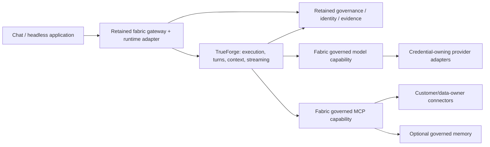
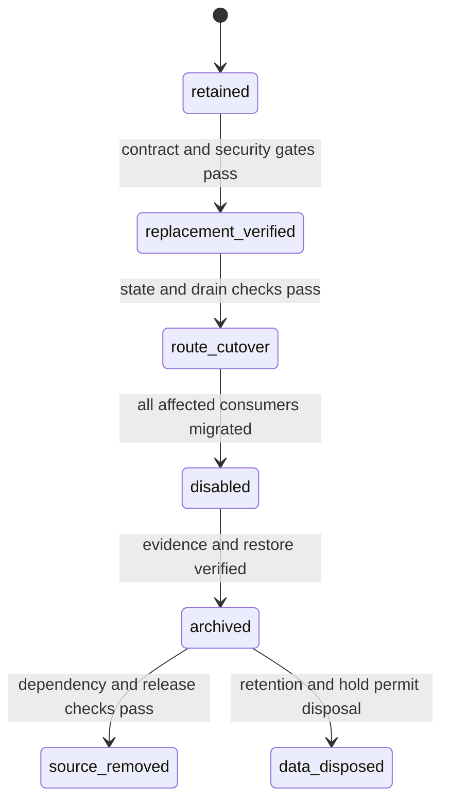

# ViewSense AI® TrueForge Adoption and Decommission Plan

## Decision and scope

Retain **`aiops-fabric` as the implementation repository** and **`aiops-fabric-docs` as the documentation repository**. TrueForge becomes the selected replaceable agent execution runtime. The retained fabric supplies enterprise identity, policy, governed model/tool/memory capabilities, customer integrations and operational evidence. `keepview_harness` has no role in this architecture and is not a migration destination. Do not rename the repositories or remove that unused checkout as part of the implementation reset.

This is a **major implementation and design change**. The authorized development reset below
retires overlapping execution and installs the separate official runtime. Business feature parity
and production migration gates remain incomplete; [Implementation Conformance](00-implementation-conformance.md)
distinguishes executable synthetic behavior from future enablement.

This decision supersedes the separate-project proposal in the [source assessment](02-trueforge-keepview-assessment.md). The source findings remain applicable. Reuse is substantial, but a percentage of production completion cannot be inferred from module count: enforcement, recovery and customer acceptance remain necessary.

## Authorized clean-state implementation

The owner explicitly authorized deletion of development/evaluation state without backups and
selected a fresh rebuild. For this operation, the existing `viewsense-dev`,
`viewsense-release-1-0-1-blue` and `viewsense-release-1-0-1-green` namespaces were deleted;
`viewsense-dev` was recreated beside `trueforge-dev`. D01/D02 legacy runtime source and D03
agent storage/configuration are retired. The public response route is explicitly deprecated
with authenticated HTTP 410, rather than silently changing its payload or retention semantics.
No historical manual-run checkpoint API is emulated. Existing external callers must migrate.

This is a development reset exception to the preservation gates below, not a production migration
or proof of feature parity. There is no backup or data-restore rollback for the discarded state.
The [operation record](40-ops/03-clean-state-rebuild.md) is authoritative for completed actions;
the remaining backlog continues to gate business execution. All customization stays in fabric.

## Target architecture

**Strict condition:** TrueForge remains unmodified upstream. All custom behavior and deployment
integration is owned by `aiops-fabric`, using supported APIs/SDKs and documented values. Do not
patch or fork its application/chart, vendor internals or build a customized TrueForge image.
Unsupported features stay disabled. Upgrades must not require replaying upstream changes.

This is the target, not the current request graph. TrueForge owns loop/thread/turn execution; fabric components enforce business authority and protect data before, during and after that execution. Governance owns policy, admission, budget and safe evidence. Data owners retain their credentials and databases. A namespace or an agent prompt grants no access.

The runtime adapter starts as a logical module in the existing edge process. It calls TrueForge APIs and translates stable fabric contracts; it must not implement another model/tool loop. A small integration record may bind public IDs and idempotency keys to runtime IDs. That is adapter-owned correlation state, never a second transcript or independently writable run state. If durable binding storage is needed, add an explicitly owned schema/credential/migration and document it before use; do not borrow another service's database.

Deployment placement and exact permitted connections are specified in [TrueForge Namespace Integration](20-deployment/03-trueforge-namespace-integration.md). Cutover, rollback and removal are specified in the [migration runbook](40-ops/02-trueforge-migration-runbook.md).

## Keep, adapt and decommission register

“Decommission candidate” is a target disposition, not permission to delete the component now. D01–D03 are retired under the authorized development reset above; other dispositions retain their gates. Paths are implementation-relative review locators.

| ID | Existing component/assets | Target disposition | Replacement or retained responsibility | Removal / acceptance gate |
|---|---|---|---|---|
| D01 | `src/viewsense_orchestrator/` | Decommission after cutover | TrueForge execution plus thin gateway runtime adapter | All response consumers migrated or explicitly version-deprecated; memory/remember semantics and errors qualified; no remaining route/config/caller |
| D02 | `src/viewsense_agent_runtime/` | Decommission execution kernel | TrueForge turns/approvals/cancellation; optional stable fabric run facade | Run API compatibility decision, legacy non-terminal run drain and evidence export; resume/cancel/idempotency tests; no competing state owner |
| D03 | `agent-db` StatefulSet/PVC, credentials, grants and backups | Retire live service after D02; preserve retained data | TrueForge-owned fresh runtime database; legacy archive governed separately | Verified export/restore, retention/legal-hold review and restore window; workload shutdown is separate from data destruction |
| D04 | `src/viewsense_llm_gateway/` | Adapt | Governed inference contract, admission, per-call inspection/budget/evidence | Retain the boundary; replace simple forwarding only when tool/stream/usage contracts and final adapter checks pass |
| D05 | `src/viewsense_mcp_gateway/` and `registry-db` | Adapt; no wholesale removal | Approved tool/provider registry, native MCP server boundary, deterministic grants and connector enforcement | TrueForge supplies the MCP client; new server transport and legacy `/v1/tools/call` compatibility need tests; registry remains owned here |
| D06 | `src/viewsense_gateway/` | Retain and extend | Public identity/session/tenant binding, reviewed route selection, runtime API adapter, authorized delivery | Reject unsupported legacy behavior explicitly; secure the direct runtime API; preserve the public contract until versioned migration |
| D07 | `src/viewsense_governance/` | Retain and extend | Qualified grants, reviewed snapshots, admission, reservations, safe evidence/export | Keep preview `execution_authority: false`; add separately authenticated execution authority and runtime checks |
| D08 | `src/viewsense_common/` | Retain selectively | Canonical contracts, delegated identity, safe transport/logging, embedding validation | Separate capability owners; remove helpers only with callers; add multi-namespace topology contract rather than weakening v1 |
| D09 | `src/viewsense_identity/` | Development fixture; replace production issuance | Production AuthN/entitlement/workload delegation adapters | Development issuer remains for isolated tests only; verify exact tenant/subject/audience and rotation before production |
| D10 | Memory gateway, PostgreSQL and Mem0 packages; `memory-db` | Retain as selected optional capability | Governed long-term memory and replaceable embeddings/providers | Bind owner/account access to verified policy; lifecycle/export/delete/profile and live provider tests |
| D11 | `src/viewsense_ollama_adapter/` | Retain decision/embedding operations; adapt chat | Local provider isolation and configuration | Agent-compatible tool messages/streaming must be implemented or explicitly refused; local inference still needs deployment/quality evidence |
| D12 | `src/viewsense_openai_adapter/` | Retain isolation; adapt protocol before runtime use | Vendor credential ownership, exact destination, safe errors and final wire enforcement | Existing non-streaming text-only adapter is insufficient; no external execution until egress/budget/evidence gates pass |
| D13 | `src/viewsense_ingestion/` | Retain if selected; improve independently | Source/ACL-aware ingestion into memory | Idempotent operations, partial-write recovery, progress, deletion and profile migration; not replaced by chat file upload |
| D14 | `src/viewsense_console/` | Retain management; replace duplicate chat integration selectively | Policy/identity/certificates/network/status APIs and TrueForge UI components | API parity, role ceilings, CSRF/auth, accessibility and no policy bypass; no admin controls exposed to ordinary users |
| D15 | Certificates and networking packages/manifests | Retain and extend | Workload trust, namespace/flow definitions and runtime enforcement evidence | New multi-namespace identity graph, exact policies and live positive/negative probes |
| D16 | Mock LLM/MCP and smoke package | Retain test-only assets | Deterministic regressions and contract fixtures | Production profiles exclude mocks; update acceptance to new topology before deleting old-only scenarios |
| D17 | Workflow module metadata | Retain planned capability; defer engine implementation | Optional durable business workflow contract | TrueForge schedules are not a general workflow engine; add a provider only for a qualified customer requirement |
| D18 | Helm/Kustomize/Compose, launchers, Docker build, product/module catalogs, CI and release scripts | Update with each component | Reproducible supported profiles, versions and correct maturity claims | Remove every retired service/port/image/secret/probe/flow dependency; validate baseline and new profile independently |
| D19 | Legacy tests, schemas and published guides | Preserve behavior; retire obsolete implementation assertions | Runtime adapter/contract/security suites and versioned compatibility | Replacement evidence first; retain historical release documentation and externally supported contract versions |

Do not remove governance, memory, identity/transport contracts or credential adapters merely because TrueForge has a similarly named feature. Runtime session history is not governed memory; UI approval is not business authorization; catalogs are not provider admission; usage totals are not atomic spend limits.

## Boundary contracts and compatibility

| Boundary | Required work before cutover |
|---|---|
| Retired public `/v1/responses` | Authenticated HTTP 410 in the authorized reset. A future versioned public session contract requires its own qualification; native runtime sessions/turns are not an automatic wire replacement |
| `user_id` / memory owner | Resolve requested owner under verified subject/account policy; never preserve the legacy owner-selection gap |
| `remember` / retrieval | Either implement equivalent governed behavior or reject unsupported requests before dispatch. No silent ignoring, automatic transcript-to-memory copying or unapproved retention |
| `/v1/agent-runs` | Document each legacy action against runtime semantics. Unsupported manual checkpoint/state actions require a versioned migration/deprecation, not invented successful responses |
| Public session and SSE | Authorize creator/collaborators and recipient, define event IDs/cursors/order/errors/disconnects; translate vendor events into a stable safe contract |
| Retry/idempotency | Bind key to tenant/actor/action/request digest; reject conflicting reuse; persist creation mapping before returning a durable accepted response; reconcile uncertain upstream creation instead of duplicate execution |
| Execution context | New versioned authenticated delegation binds real tenant, qualified actor/subject, input/output/action/purpose, session, revisions, expiry and narrowing obligations |
| Model capability | Explicit supported protocol subset, tool-call round trip, structured output, stream/non-stream, usage, cancellation and bounded limits; final wire authorization belongs in the credential adapter |
| Tool capability | Native MCP exposed by the governed server; exact schemas/actions/arguments and complete-grant/data enforcement at invocation, including Code Mode and future subagents |
| Evidence / budget | Safe durable pre-dispatch intent and reconciled outcome/reservation; no transcript dump and no unacknowledged regulated dispatch |
| Data lifecycle | Separate transcript, business facts, governed memory, sandbox artifacts, backups and evidence retention; preserve the current no-retention channel promise |

Machine-readable schemas, OpenAPI/event contracts and conformance tests will be authored in `aiops-fabric` in the implementation slice. The names/fields above are design requirements, not new APIs available today. Reuse one canonical schema owner and generate cross-language clients/types.

The production identity bridge is a prerequisite. Stock OIDC in the examined TrueForge baseline places users in internal tenant `default`; a shared fixed service user would collapse employee ownership. First deploy one customer/environment cell per namespace pair, keep real tenant/subjects in verified delegation and establish distinct runtime subjects. A fabric-owned issuer/identity bridge must use supported upstream authentication and verify tenant/subject narrowing before issuing credentials. No custom authenticator is installed inside TrueForge. Unsigned identity headers or a shared employee identity are insufficient.

Existing no-retention business channels cannot enter ordinary durable TrueForge turns with sensitive facts until an approved ephemeral execution/storage path is qualified. Synthetic data may use normal runtime storage under a separate explicit test retention policy. No unattended business scheduling, external model route, arbitrary skill, shared-session delivery or sandbox is enabled by the initial adoption profile.

## Ordered implementation backlog

The table records the general gated migration sequence; the development reset supersedes its legacy preservation ordering. M00/M01 foundations and fixed synthetic M02 are implemented, while business qualification remains planned. Its implementation change updates the conformance map, contracts, relevant domain documents and evidence; a source file or a healthy pod alone does not close it.

| Milestone | Dependencies | Concrete deliverable | Exit evidence |
|---|---|---|---|
| M00: freeze baseline | This design | Inventory consumers/state, pin TrueForge chart/image/SDK/core and record configuration digests, assign owners | Source/artifact manifest, contract inventory, data/retention and rollback decisions |
| M01: isolated runtime deployment | M00 | Add opt-in namespace-pair profile, independent releases, trust/secret references, default deny, quotas and synthetic probes | Render both namespaces; validate policies; runtime health and allowed/denied connectivity on enforcing CNI; old profile still works |
| M02: identity and runtime adapter | M01 | Gateway adapter, authenticated real-subject/tenant context, public/runtime ID and idempotency mapping, secure resume/cancel/history | Spoof/cross-subject tests, compatibility/error tests, duplicate/uncertain-start tests, no direct-runtime bypass |
| M03: governed provider and tool calls | M02 | Agent-compatible local inference, native governed MCP server, fresh per-dispatch policy/admission/budget/evidence | Root and summary calls covered; direct/deferred/Code Mode and later child paths enforce same ceilings; outage tests yield zero unauthorized dispatch |
| M04: retention and operations qualification | M02–M03 | Qualified storage profile, deletion/backup/artifact controls, export/outbox, SLO/deadline/recovery contracts | Sensitive canaries absent where retention is prohibited; restore, drain, interruption and evidence-loss tests |
| M05: bounded route pilot and cutover | M04 | Synthetic then owner-approved read-only Sales/local route through API and chat; enable live data only after every applicable gate | Qualified account/field scope, deterministic facts/rules, grounding, recipient and complete/partial coverage; old path disabled for this route |
| M06: optional features | M05 | Individually qualify memory, subagents, schedules, sandbox, external models or workflow integration as needed | Separate feature-specific contract/security/operations acceptance; no inherited permission from the pilot |
| M07: legacy shutdown | M05 plus closure for every affected consumer | Drain/deactivate D01/D02 and old routing only after all consumers migrate; revoke unused credentials/flows | No remaining caller/config/flow dependency, zero active old runs, rollback/restore and archive evidence |
| M08: source and resource cleanup | M07 | Delete retired source/config/manifests/tests and revise catalogs/release tooling; keep archives per retention | Full unit/lint/profile/package checks, live smoke/denials, no dangling imports/routes/ports/docs; old data deletion remains separately governed |

The implemented development slice provides M00/M01 foundations and a fixed synthetic M02 probe. The owner-authorized reset separately retires D01–D03 and the legacy response contract. M02–M04 business semantics remain real implementation work, not configuration already supplied by TrueForge.

## Decommission rules

Code removal and data disposal are separate transitions. Helm uninstall, PVC deletion, backup expiration or namespace deletion must never be hidden inside routine decommission tooling. Keep an operation record with component, implementation version, owner, affected contracts, acceptance references, active-run count, data disposition and rollback limitations. The repository owner records manual paired commits/PRs after review.

Never mirror a live prompt into both runtimes to compare output: that doubles processing, spend and potential side effects. Compare controlled fixtures or explicitly approved isolated evaluations. Cut over one reviewed route revision at a time and keep an in-flight request on its bound backend; do not move a live conversation or retry side effects across backends.

Rollback can restore an earlier implementation only if it enforces the current security/retention requirements. The legacy orchestrator does not enforce the new business-channel policy chain. When a safe rollback is unavailable, disable the route and preserve evidence/state; do not send traffic to a permissive legacy fallback.

## Design sync and maturity

The namespace pair, topology-v2 CNI generator, development OIDC bridge and fixed synthetic runtime
adapter are implemented. Legacy execution source and the named old namespace data are retired under
the explicit no-backup reset. Native governed MCP, real model/tool protocols, production identity,
no-retention execution, hard budget/evidence enforcement and operational recovery remain planned.
The [operation record](40-ops/03-clean-state-rebuild.md) and conformance map carry implementation
scope and actual evidence. The coordinated final Design Sync Report covers both repositories.
