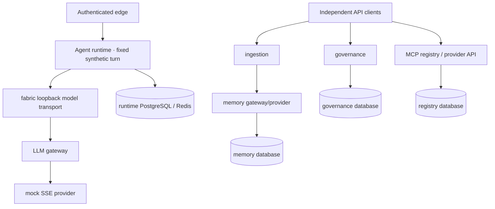
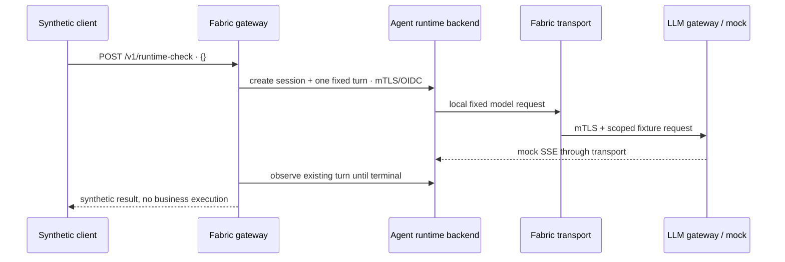

# ViewSense AI® Runtime Topology and Flows

## Current runtime topology

The retained fabric lives in `viewsense-dev`; the independent official TrueForge runtime and its
state live in `trueforge-dev`. The old request orchestrator/manual agent kernel and agent database
are removed. All adaptation remains in fabric through supported upstream interfaces.
[Agent runtime access](../../../deploy/trueforge-access.md) describes the separate native GUI preview;
it is not a browser client for the hosted runtime or its state.

Internal edges require encrypted transport, verified identity and explicit authority. Topology-v2
rules intersect namespace and workload selectors on both sides. Identity/token issuance and public
JWKS discovery use distinct protected listeners. Native MCP, policy dispatch, real providers and
business delivery remain gated; the diagram does not imply that those future edges are enabled.

## Implemented fixed verification flow

1. The edge authenticates `runtime.verify`, derives the signed tenant and rejects nonempty bodies.
2. It creates an inline session through the official runtime API, with a fixed model/instructions
   and disabled optional execution features. The runtime subject is issuer-qualified.
3. It creates one fixed synthetic turn and observes the same turn through bounded status reads;
   no automatic duplicate creation or legacy fallback follows a timeout.
4. The fabric loopback bridge accepts the exact fixture and recognized upstream clock definition,
   reconstructs a constant mock request and forwards no other runtime content or tool definitions.
5. The LLM gateway/mock provider use mTLS and audience/scoped JWT. The result returns with explicit
   `synthetic: true` and `business_execution: false`. Ordinary runtime storage contains the fixture.

`POST /v1/responses` is a retirement marker returning authenticated HTTP 410. Memory/remember
semantics and old manual checkpoints are not silently translated into TrueForge behavior. The
legacy response and manual lifecycle walkthroughs are removed from current operating guides.

## Target failure rules

### Planned channel request path

The [Input/Output Channel flow](07-input-output-channels.md#practical-sales-flow) adds verified
business context at the edge, governance route resolution, and bounded fabric-governed runtime-to-MCP tool
execution. For Sales, the CRM-Logistics1 connector queries its owner's Oracle views and returns
authorised evidence-backed opportunities; the final answer returns to the initiating verified
chat/API session. These calls are planned and require new explicit grants/network rules. Channel
selection is a policy decision, never a prompt-selected tenant, URL or tool. These edges remain disabled until their explicit profile and operation acceptance pass.

Resolve the [qualified role/grant decision](08-channel-consoles-role-mapping.md) before retrieval/
tool execution. Before each model/provider call, inspect the assembled authorised context and apply
[company-boundary/PII, cost and egress policy](09-enterprise-ai-governance-egress.md). The credential
adapter validates the final translated wire payload/endpoint, preventing transformations from
bypassing the decision. Runtime role/egress/cost enforcement edges remain planned; the existing
memory/LLM-only path does not enforce this new chain.

### Common dependency rules

The reference clients enforce bounded timeouts and do not silently fall back across providers.
Shared retry, jitter, circuit-breaker, and end-to-end deadline-budget behavior is not yet shipped.

- One end-to-end deadline is subdivided into retrieval, inference, and tool budgets.
- Retries are allowed only for operations documented as idempotent and are bounded with jitter.
- Streaming responses are never transparently retried after bytes have been emitted.
- Provider fallback must satisfy the same tenant policy, data residency, model capability, and safety class; otherwise fail closed.
- OpenAI authentication, rate-limit, timeout, and malformed-response failures are normalized and
  never include the upstream response body; no implicit fallback to the mock or another region occurs.
- Memory failure may degrade to no-memory only when tenant policy explicitly permits it.
- MCP failure never causes an unapproved alternate tool to execute.

## Target asynchronous flow

Long ingestion, evaluation, and workflow jobs will return `202 Accepted` plus an operation resource.
Events use CloudEvents 1.0 envelopes, carry tenant and trace context, and contain references rather
than sensitive prompt bodies by default. No event bus or long-operation API ships in the current
reference.

## Data ownership

| Owner | State | Access path |
|---|---|---|
| memory provider | canonical memory records and embeddings | memory provider contract through memory gateway |
| MCP gateway | server catalog, certification state, policy metadata | MCP administration API |
| workflow provider | durable workflow instances | workflow API (future slice) |
| identity system | clients, grants, keys | identity administration plane, never runtime APIs |

Direct cross-service SQL, shared writable volumes, and provider SDK calls from the generic runtime or edge are prohibited.
