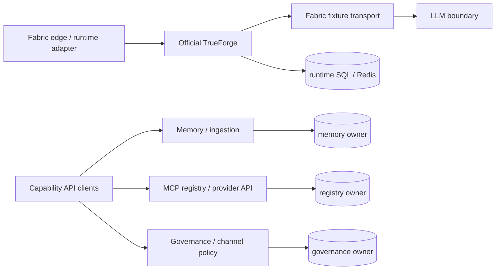

# ViewSense AI® Component Breakdown and Ownership

Retain fabric policy, identity, capability/credential and data owners around an independently
upgraded official TrueForge runtime. The legacy orchestrator/manual kernel is retired. All custom
behavior belongs in fabric; no upstream source/chart/image changes are permitted. See
[Agent runtime access](../../../deploy/trueforge-access.md) for native GUI access and the
[conformance map](../00-implementation-conformance.md) for exact current scope.

## Edge API and runtime adapter

The edge validates workload/external identity, derives tenant context and enforces route scope.
It exposes fabric management/policy APIs and a fixed synthetic `/v1/runtime-check`. It neither
runs an agent loop nor holds provider credentials. General business sessions, public identifiers,
idempotency/recovery, authorized delivery and enterprise API-management controls remain gated.
The retired public response endpoint returns HTTP 410.

## LLM gateway

The implemented LLM gateway is a stateless, deployment-configured proxy to one adapter. The mock
and OpenAI adapters are executable. Capability discovery, aliases, multi-route policy, usage
normalization, and native vLLM/Azure adapters are planned. The Ollama adapter adds distinct decision
and embedding APIs plus optional non-streaming chat; its upstream runtime is separately operated. Provider credentials belong only
to the owning adapter, not the LLM gateway. The gateway stores no conversation memory.

The bundled OpenAI adapter translates the internal mTLS/scoped-token request into an OpenAI Bearer
request. It owns the API key, exact upstream URL, configured model, outbound field minimization,
timeout, and safe error translation. It owns no memory: retrieved memory reaches it only as bounded
request context assembled by approved fabric clients.

## Memory gateway and providers

The gateway verifies tenant delegation and exposes canonical create/search records. Rich
purpose/classification/retention policy is planned. The reference provider uses PostgreSQL/pgvector
with deterministic development embeddings by default, or a configured real embedding adapter with
model-digest profiles and resumable owner backfill. The executable Mem0 adapter keeps its API key,
tenant/owner pseudonymization, upstream paths, and response normalization inside the provider
boundary; live conformance requires a selected Mem0 installation.

Memory is split conceptually into:

- episodic/user memory;
- governed knowledge/RAG documents;
- short-lived request/session context.

These have different retention and authorization and must not be merged into one unclassified vector collection.

## MCP gateway and runtime

The implemented gateway owns a PostgreSQL server registry, exact HTTPS host allow-list, scoped
registration/invocation APIs, and a ViewSense AI®-owned `/v1/tools/call` provider contract. The mock
provider proves isolation and invocation. Native MCP Streamable HTTP translation, certification,
per-tool policy, approval state, and immutable invocation audit are planned; the current registry
entry plus `enabled` flag is not production certification.

## Workflow provider (planned)

Durable workflow engines (Temporal, Argo Workflows, n8n, or an enterprise product) implement a workflow contract. The platform does not assume that a low-code engine is safe for autonomous tool loops. Workflow definitions are versioned artifacts with bounded execution and human approval points.

## Agent runtime and ingestion

Official unmodified TrueForge owns sessions, turns and execution mechanics. The fabric runtime
adapter and loopback transport currently support the fixed synthetic verification path only.
There is no bundled manual state machine or agent database. Full agentic business semantics,
secure tools, public session/idempotency contracts and retention remain separate integration gates.
Synchronous ingestion remains a fabric-owned memory client; durable ingestion/workflow engines
remain independent future capabilities.

## Identity and policy

Human identity federates through enterprise OIDC; the edge verifier supports generic OIDC and
Keycloak-compatible issuer/JWKS/claim mapping. Target workload identity uses SPIFFE/SPIRE, mesh
identity, or equivalent. The planned SPIRE integration consumes SVIDs through an SDS-capable
proxy/mesh rather than embedding SPIRE into application code. Provider admission uses
the built-in checks or a fail-closed OPA decision API; the chart can place OPA beside governance.
The repository's issuer and static PKI are development-only.

## Governance and evidence

The governance API owns provider passports, evaluation evidence, admission state, and safe
execution evidence. Providers cannot mark themselves admitted, and callers cannot choose an
evidence producer: both transitions are derived or enforced server-side. Its database is owned
and unreachable from other applications. Production policy engines, signature/transparency
verification, immutable evidence export, retention, and legal hold remain separate adapters and
maturity gates.

## Observability and audit

All application components emit JSON request/runtime logs and propagate `X-Request-ID`. Inbound
`traceparent` is recorded but not propagated across clients. Native OpenMetrics, distributed tracing,
OTLP export, audit delivery acknowledgement, and regulated fail-closed delivery are planned.
Governance evidence is payload-minimized and append-only at its API, but PostgreSQL is not an
immutable audit sink.

## Reference versus replaceable choices

| Capability | Reference slice | Replaceable examples |
|---|---|---|
| LLM provider | deterministic mock; OpenAI credential adapter | Ollama adapter now; vLLM and Azure OpenAI planned |
| memory provider | PostgreSQL + pgvector; Mem0 adapter | Qdrant adapter, managed vector service |
| agent runtime | external official TrueForge, fixed synthetic integration | alternative engines only through qualified external contracts |
| MCP provider | ViewSense AI® echo tool provider | planned native/certified enterprise MCP adapter |
| identity | local RSA token issuer | enterprise IdP + workload identity |
| governance/evidence | owned PostgreSQL reference | external policy and immutable evidence sinks |
| deployment | Kustomize development base | Helm/GitOps environment overlays |

## Repository module boundary

### Planned channel ownership

The [channel/module responsibility matrix](07-input-output-channels.md#integration-with-the-existing-modules)
extends existing owners: governance owns channel/route metadata in its current state domain;
identity owns memberships; edge verifies the Input and reply binding; fabric runtime adapter resolves the
route; Tool-Sense uses the MCP gateway's registered Output connector; the CRM owner owns Oracle
facts and semantic mappings. Only the connector holds Oracle credentials. No channel-specific
database or additional Tool-Sense service is introduced. These APIs and runtime calls are planned.
Memory, ingestion, agents and workflows must preserve channel/source/account policy and recheck
revocation; their current APIs do not yet provide this complete channel contract.

Governance also owns planned framework roles, external role mappings, Input entry bindings,
qualified Output grants and policy revisions. The selected AuthN Provider/authoritative identity
system owns assignment of external roles to identities; framework roles do not create another
user directory. Input/Output console pages are
API clients of these owners. See the [role ownership model](08-channel-consoles-role-mapping.md#resource-and-state-ownership).

The [provider-neutral contracts](08-channel-consoles-role-mapping.md#provider-neutral-authentication-and-authorisation)
separate AuthN/verified identity, current entitlement adapters and AuthZ/decision evaluation.
Governance retains framework catalog/revision ownership even when an external policy provider
evaluates decisions. Protocol/product translations live inside adapters. Keycloak and OPA are
example implementations, not prerequisites; one product implementing both capabilities still
must conform to both contracts and cannot redefine channel permissions.

Planned enterprise enforcement uses policy/inspection/budget decisions before dispatch and final
wire-payload checks inside credential-owning adapters. Governance owns budget-policy/reservation
metadata; adapters provide trusted usage. Any reversible privacy token mapping remains inside an
isolated privacy provider, requiring its own state/lifecycle design before implementation. No
generic gateway or generic runtime receives that provider's secrets. See
[enterprise governance and egress](09-enterprise-ai-governance-egress.md).

Runtime implementations remain small, independently deployable Python packages under `src/viewsense_*`; they are not nested inside deployment packaging. The `fabric/<capability>/` directories are the machine-readable installable catalog. Every capability directory contains a `module.json` descriptor and README that declare maturity, owned contracts, implementation paths, Helm selection paths, data ownership, and bundled/external provider choices. `fabric/module.schema.json` defines the descriptor format and the catalog conformance test rejects missing, undocumented, or dangling module entries.

This separation avoids coupling application source layout to Helm or a future operator while ensuring packaging folders are executable metadata rather than placeholders. A `contract-only` catalog entry is deliberately visible but cannot be represented as implemented; Helm and documentation must retain the same maturity statement.
