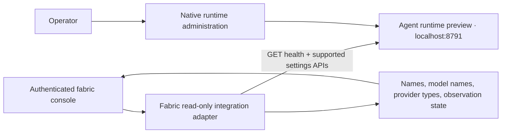

# ViewSense AI® Management Console and Runtime Integration

## Objective and ownership

The management console is the ViewSense control plane. **The agent backend owns runtime model/provider
configuration, connectors, skills, sandbox/web-search configuration and agent execution.**
Configure these in the native runtime interface. Fabric observes supported upstream APIs and
adds enterprise identity, authorization, admission, data/egress policy, evidence and operational
integration. The current backend is an official, unmodified TrueForge release. Never customize it
or copy its configuration into a second editable catalog.

The console runs on loopback at `http://127.0.0.1:8787`. Its runtime connection page retains
the bookmark `?page=ai`. It replaces the former AI/model editor and direct model test lab.
This is a single-tenant development surface, not a production administrative control plane.
See [enterprise acceptance](../60-enterprise/01-enterprise-integration-controls.md).

| Owner | Configuration and state |
|---|---|
| Agent runtime backend | Runtime providers/models, connectors, skills, sandbox/web-search settings, agents, sessions and turns |
| Fabric | Identity/delegation, channel grants, policy/admission, governed egress, budgets/evidence and integration status |
| Fabric memory provider | Knowledge records, embedding profile/digest/dimension, vector migration and retrieval |
| Model infrastructure operator | Hosting/GPU capacity and provider credentials at the approved runtime or credential-isolating boundary |

Memory embedding profiles are separate from a runtime chat-model selection. Changing a chat
model never migrates fabric vectors. The retained Ollama/OpenAI adapters are independent capability
and controlled-egress boundaries; their existence does not justify a duplicate runtime model editor.
The optional local channel playground and policy inspector remain separately scoped pilot features;
they are not a general fabric agent runtime or governed hosted customer-execution path.

## Proposed workflow management experience

The [detailed business examples](../../../business/examples/index.md) suggest four workspaces:
**Workflows**, **Integrations**, **Runs & outcomes** and **Access**. A workflow references its
sources, configured agent, review rules and destinations. One integration can support authorized
reads and writes across several workflows; it should not be duplicated solely because it is
used in different directions.

This is a proposed product organization, not implemented navigation. Existing Input/Output Channel
APIs retain their current meanings. The [reorganisation walkthrough](../../../business/hr-departure-workflow.md)
explains their relationship to source → workflow → destination. Model and agent configuration
remains in runtime administration; customer integrations and business controls remain in ViewSense.
Memory/vector search and durable workflow engines are optional requirements, not prerequisites
for every reporting or investigation workflow.

## Implemented read-only integration

`GET /api/integrations/trueforge` is admitted only for the existing ViewSense Admin role and
browser session. It reads `/healthz` and the supported `/api/v1/settings/` endpoints for
`model-providers`, `mcp-servers`, `skills`, `sandbox-providers` and `web-search-providers`.
Only names, model names, provider types, the supported connector authentication enum and collection observation state reach the browser.
Connector authorization URLs and full manifests, credentials, authorization headers, endpoint URLs, skill bodies and raw upstream
errors are excluded. The reader never invokes models, calls connectors, runs skills, writes
settings, reads databases or creates a second stored configuration copy.

The local launcher explicitly enables observation with `VS_CONSOLE_TRUEFORGE_PREVIEW=true` in
`VS_ENVIRONMENT=development`. The fixed upstream destination is `http://127.0.0.1:8791`;
browser input cannot select an address. HTTP is a local standalone preview exception only.
Redirects and environment proxies are disabled; response bytes and deadlines are bounded.
SSO and historical release-preview consoles disable this connection. There is no fallback
from hosted authentication to an unauthenticated preview.

The page refreshes every 15 seconds while visible, and offers **Refresh integration**. Every
request reads current upstream configuration. Changes/removals made in the runtime appear on
refresh. Observation failures replace the previous inventory with unavailable/denied state;
no stored snapshot is presented as current. A collection's `configured` state proves only that
the runtime reports configuration, not successful inference, connector health or fabric admission.
Empty sandbox/web-search settings return the upstream-defined 404 and display unconfigured;
unknown errors remain unavailable. Inventory display is bounded to 200 records/models per collection.

## Separate instances and hosted acceptance

The observed preview has temporary independent SQLite/configuration data. The secured runtime in
`trueforge-dev` is a different instance, with PostgreSQL/Redis and mTLS/OIDC. The console explicitly
shows that hosted settings are **not observed**; it must never reuse preview health as Kubernetes
integration evidence. `make k8s-test` qualifies the fixed synthetic hosted route separately.

A future hosted management integration must connect the native browser and fabric reader to the
**same** approved runtime/tenant. It needs interactive browser identity, supported settings
permission, narrowly constrained server-side credentials, TLS/mTLS, network rules and negative
authorization tests. Current upstream settings require admin authorization when authentication is
enabled; a read-only fabric facade alone cannot turn that credential into an upstream read-only
identity. Production least-privilege administration, revocation and audit remain acceptance gates.
Do not reuse the synthetic bootstrap identity, weaken hosted authentication or patch TrueForge.

## GUI workflow

1. Run `make trueforge-ui` and configure supported settings in the native interface on 8791.
2. Run `make console` and sign in as ViewSense Admin on 8787.
3. Open the runtime connection page (`?page=ai`), inspect the instance/version and collection states.
4. Configure an item in runtime administration; refresh the fabric page to see the resulting metadata.
5. Treat provider execution, governance admission and hosted-runtime tests as separate evidence.

The redundant console `/api/configuration` GET/PUT and `/api/tests/decision`, `/embedding`,
`/model`, `/rag` routes are removed (404 for an authenticated Admin). Their frontend controls and
model result renderers are removed. The optional direct component APIs remain available to the
separate development API client for adapter diagnostics and memory profile administration.
No provider setting or stored vector was deleted by this console change.

## Retained fabric capability tests

**Fabric capability tests** offers document ingestion, store/search memory and bounded profile
backfill. These call the fabric's own APIs and clearly state that they do not execute a hosted
agent. Credentials stay server-side; tenant/owner authorization, same-origin sessions and CSRF
remain enforced. Session history records operation/status/duration/request ID, never test bodies.
Memory source data is intentionally persisted by explicit writes; do not blindly retry partial writes.

The memory provider validates vector dimensions, finite values and exact model/digest profiles.
Changing a profile requires owner-bound backfill before incomplete retrieval can proceed. Older
vectors remain available for deliberate rollback. Chat selection in the runtime cannot silently
change this storage contract. Production ANN/scale, deletion/retention, durable jobs, backup/restore
and embedding route governance remain separate work.

## Detachable local API harness

`make harness` runs the independent fabric capability APIs without a GUI. `make gui` attaches the
optional management client; `make console` launches both. The runtime is independently operated with
`make trueforge-ui`. Stopping the GUI does not stop an independently launched harness or backend.

| Component | Local address | Contract |
|---|---|---|
| Identity | `https://127.0.0.1:8840` | scoped workload token API |
| Optional model adapter | `https://127.0.0.1:8841` | decision/embedding/chat capability APIs and direct operator diagnostics |
| Memory provider | `https://127.0.0.1:8842` | provider-owned storage; clients use memory gateway |
| Memory gateway | `https://127.0.0.1:8843` | memory write/search/backfill |
| Ingestion | `https://127.0.0.1:8844` | document ingestion |
| Fabric GUI | `http://127.0.0.1:8787` | authenticated browser control plane |
| Runtime administration/API | `http://127.0.0.1:8791` | independent official standalone preview |

Component APIs require mTLS and audience/scoped JWTs. The direct development `api-client` has
separate credentials and can test the adapter headlessly; the browser console's direct Ollama
grant is removed during bootstrap. Capability APIs never call console internals. Local credentials,
pgvector data and matching PKI are preserved on ordinary restart. GUI sessions/history are ephemeral.

## Platform management console design

Navigation contains Overview & suites, runtime connection status, Input/Output Channels, Identity &
access, Certificates, Networking, Observability, Fabric capability tests and Test history, subject
to the existing role ceiling. Operations/Sales/SIEM receive no new upstream settings access.
Channel policy editors retain their independent review/activation requirements. Suite selection
produces a deployment plan and never applies resources or changes live runtime settings.

Unknown Hosts/Origins and cross-site requests are rejected. Sessions use HttpOnly SameSite cookies,
mutations require CSRF, inputs are bounded and logs contain JSON metadata. Keep raw credentials,
prompts, tool payloads and settings bodies out of logs. No model configuration form or browser
identity substitutes for provider admission, fresh authorization, PII/egress enforcement, hard
budgets, durable immutable evidence, native governed MCP, HA or recovery acceptance.
