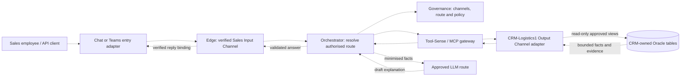

# ViewSense AI® Input and Output Channels

## Decision and implementation boundary

ViewSense AI® routes business requests through two first-class logical concepts:

- **Input Channel:** the authorised business context initiating a request, for example `Sales`.
- **Output Channel:** the enterprise application or resource boundary the platform accesses to
  fulfil that request, for example `CRM-Logistics1`.

An Output Channel is an outbound integration target. It can return data to the platform during a
read operation; it does not mean the destination of the final chat answer. The answer returns to
the verified initiating session through its reply binding. Teams, an LLM chat application, a web
console, and a headless API are entry surfaces for an Input Channel. A Teams conversation named
Sales is not evidence that its participants have Sales permissions.

This is a **major, design-only change**. Channel administration, channel-aware routing,
Tool-Sense execution from chat, the CRM/Oracle connector, and Teams integration are **planned**.
The shipped orchestrator calls memory and the LLM, but does not call the MCP gateway. Its existing
tool registry and manual agent lifecycle do not implement this design. See
[implementation conformance](../00-implementation-conformance.md#input-and-output-channels-major-design-only).

Tool-Sense is the logical capability for discovering and executing approved business tools through
the existing MCP gateway/provider boundary. It is not a new independent service or a claim that
native MCP transport ships. A CRM adapter can implement the ViewSense AI® tool-provider API first;
a later native MCP adapter must preserve the same channel policy.

## Channel model and ownership

Names are friendly labels; stable IDs such as `sales` and `crm-logistics1` are tenant-scoped keys.
Membership in Sales never changes the identity-derived tenant. One Input Channel can access many
Output Channels through separate authorised routes; one Output Channel can serve several Input
Channels with different actions, fields, account sets, and purposes. Departments are examples,
not a fixed taxonomy: Support, Finance, partner workflows, and machine clients use the same model.

| Resource | Required target metadata | Owner |
|---|---|---|
| Input Channel | ID, label, tenant binding, business owner, accepted entry adapters, IdP membership policy, allowed purposes, retention and reply policy, revision, enabled state | Governance channel catalog; membership remains IdP-owned |
| Output Channel | ID, label, tenant binding, application/data owner, approved connector/provider reference, capabilities and action schemas, classification/residency, freshness policy, revision, enabled state | Governance channel catalog; business data remains application-owned |
| Channel Route | ID, input/output IDs, intent, action allow-list, account/field policy references, rule-set version, budgets, admission and approval requirements, revision, enabled state | Governance route catalog |
| Input role binding | Framework role, Input ID, entry surfaces/purposes, revision/state | Governance; IdP assigns external roles to users/groups |
| Output role grant | Framework role, Output ID, allowed Inputs/routes, explicit capability profile and account/field policies, revision/state | Governance; CRM action restrictions live here |
| Entry adapter | Verified transport-to-user mapping, replay protection and reply binding | Entry integration; edge validates identity and membership |
| Tool binding | Output ID to admitted provider/tool/schema version | MCP gateway registry, referenced by route |
| CRM facts and approved query views | Accounts, contracts, entitlements, usage, assets and pricing terms | CRM owner; Oracle is outside the ViewSense AI® data plane |

Governance owns channel and route metadata in its existing state domain, exposed through APIs.
The MCP gateway continues to own provider/tool registration. Services never join these databases;
they resolve versioned references through owner APIs. Catalog objects contain secret references,
never credentials. This introduces metadata resources, not a fifth platform database or a
database per channel. Admission, user entitlement and enabled state are rechecked during execution;
a cached catalog revision cannot override a revocation.

The [channel consoles and role-mapping design](08-channel-consoles-role-mapping.md) defines the
Input/Output management pages and AuthN Provider/identity adapter → framework role → channel
binding/grant → AuthZ Provider decision chain. Keycloak is an example identity adapter only.
The **Sales CRM Logistics1** role gets entry rights on Sales and a qualified read-only opportunity
grant on CRM-Logistics1. Output grants own CRM action/data restrictions; the Input console shows
their derived effective access. The runtime requires both bindings plus route/data policy; no
Input membership or broad API scope alone grants CRM access. Provider calls also obey the
[enterprise AI governance and egress design](09-enterprise-ai-governance-egress.md), including
PII inspection before external dispatch, bounded cost and provider contract compatibility.

## Practical Sales flow

The employee asks **“give me sales opportunities”** in a private Teams conversation or an
integrated chat client. The route is:

`Sales → sales.opportunities → CRM-Logistics1 → sales.opportunities.list → authorised reply`

All dashed edges below belong to the planned channel path; they are not current runtime edges.



1. The entry adapter authenticates the transport and maps the sender to an enterprise subject.
   The edge verifies tenant, current Sales membership and allowed delivery context. App-only bot
   credentials do not confer unrestricted access to CRM accounts.
2. The edge resolves the requested Input Channel against authorised memberships. A user with
   several memberships selects an allowed channel; a prompt or request field cannot grant one.
3. The orchestrator resolves the intent to an enabled route. For the configured Sales pilot,
   `sales.opportunities` defaults to `CRM-Logistics1`. Where several authorised CRMs match, ask
   for selection or use an explicitly configured default; never fan out to every CRM silently.
4. Governance/policy checks subject, tenant, purpose, Input Channel, Output Channel, action,
   classification/residency, current account entitlement and admitted provider. The resulting
   execution context is authenticated, short-lived and bound to the route and revision.
   Resolve approved external roles to framework roles, requiring an Input binding and complete
   qualified Output grant. Read-only means the explicitly permitted actions, not every read tool.
5. Tool-Sense validates the allow-listed tool and typed arguments, repeats the policy check at
   the execution boundary, and calls only the registered CRM connector. The LLM can propose an
   intent or parameters, but cannot select a URL, Oracle schema, credential or arbitrary tool.
6. The connector intersects the requested account filter with authorised accounts, executes
   approved parameterised queries under a read-only database identity, and evaluates the
   versioned opportunity rules. Only authorised, bounded facts and evidence leave the connector.
7. The orchestrator passes minimised results to a classification/residency-approved LLM for
   explanation. It validates the structured answer against tool evidence; unsupported numeric
   claims or unrecognised accounts are rejected. If generation fails, it can return deterministic
   tool results when the route permits that behaviour.
   Inspect the assembled context, including user prompt/history, before any external model or
   embedding request. The adapter checks the final wire payload against an authenticated egress
   decision; missing/uncertain PII disposition denies external dispatch or uses an approved local
   route. Granting Sales access to CRM facts does not authorise disclosing them to an external LLM.
8. Delivery policy checks the current recipient and conversation visibility before replying.
   Private results must not be posted into a shared Teams room with unauthorised participants;
   deliver privately or return an access-controlled result reference. Report completeness and
   source freshness. No CRM write, customer contact or campaign is triggered by this read request.

A deterministic read-only workflow is sufficient for this use case. An autonomous agent loop is
optional and remains subject to exactly the same route, tool and data policies.

## Oracle integration and business rules

Prefer the CRM owner's API if it exposes the required governed facts. Where direct Oracle access
is necessary, deploy a CRM-owned connector approved by the application/data owner. It alone holds
the Oracle driver, database identity, credentials and schema mappings. Oracle transport must be
encrypted and server-authenticated. Neither the edge, LLM, orchestrator nor MCP gateway connects
directly to Oracle. Database privileges allow only the curated views or query procedures required
for opportunity reads; credentials cannot write tables or administer the database.

Logical entities below are illustrative, not assertions about an existing Oracle schema:

| Required fact | Example logical sources | Correctness requirement |
|---|---|---|
| Customer scope | accounts, account assignments | Tenant/account predicates applied before joins, ranking and aggregation |
| Current package and features | active subscriptions, package catalog, feature entitlements | Effective versions; distinguish unavailable, available but disabled, and already enabled |
| Licence headroom | licence allocations, measured usage, footprint | Comparable billable units and observation window; footprint alone is insufficient |
| Platform optimisation | asset inventory, OS support, contract/pricing terms | Supported migration path and authoritative terms; mark missing inputs explicitly |
| Sales eligibility | account status, owner-approved suppression/eligibility flags | Apply before emitting a recommendation; no personal contact details by default |

The owner supplies a semantic mapping from physical tables into a versioned canonical fact model.
Handle active-contract selection, nulls, unlimited pools, duplicate subscriptions, one-to-many
joins and differing measurement windows explicitly. Preaggregate usage at its declared grain
before joining entitlements so assets do not multiply licence counts. Read related facts from a
consistent snapshot or disclose source versions/skew. Do not run one unconstrained query per client.

All filters use bound parameters and approved query templates. Account scope comes from trusted
policy, never from a model-generated `WHERE` clause. Apply row and field controls before data
reaches an LLM or an aggregate. Enforce result, scan, execution-time and concurrency limits at the
connector/database boundary. Reject free-form SQL, DDL/DML, unknown filters and schema probing.

The Sales/product owner approves rule semantics and ranking weights. LLM prose does not define
package eligibility, licences, price arithmetic or savings. Version the mapping, query templates,
rule set and pricing source independently, recording all versions in the result.

| Client | Given facts | Candidate opportunity | Evidence needed before recommending |
|---|---|---|---|
| ClientA | Silver1; API not enabled | API enablement or eligible upgrade | Actual API entitlement, compatible offer and evidence of need; disabled API alone is a lead to qualify |
| ClientB | Gold; all features; footprint grown | Additional licences when measured demand approaches/exceeds the contracted finite pool | Licence limit, comparable usage/forecast, observation window and approved headroom threshold |
| ClientC | Platinum; unlimited pool; legacy Windows asset | Contract/cost optimisation through a supported Linux migration | OS/workload compatibility, support and migration constraints, authoritative revised terms and migration cost; no licence upsell from unlimited usage |

ClientC is a customer-value/retention opportunity, even if it reduces recurring revenue. Report
opportunity type separately from revenue impact. Without validated terms, say “review Linux
migration eligibility”; do not invent a discount or guaranteed saving. Missing data produces
`needs_review`, not zero usage or a fabricated offer. Optional monetary estimates must come from
approved calculations with currency, assumptions, source and gross/net distinction.

An evidence-based ranking can use eligibility, measured need, approved value and freshness, with
explainable owner-configured weights. A numerical LLM probability is never a factual-confidence,
eligibility or authorisation decision. Each result includes the supporting fact references,
rule-match reasons and a practical next step for the employee to review.

## Proposed headless contracts

These are **target API shapes**, not shipped routes or committed JSON schemas. Implementation must
add machine-readable channel, route, execution-context and opportunity contracts in the application
repository and validate them end to end before promotion.

| Owner | Target API | Semantics |
|---|---|---|
| Governance | `GET/PUT /v1/channels/input/{id}` and `/v1/channels/output/{id}`; filtered list APIs | Scoped metadata read/admin, optimistic revision checks, audited enable/disable; no secret values |
| Governance | `GET/PUT /v1/channel-routes/{id}` and `POST /v1/channel-routes:resolve` | Filtered discovery; deterministic policy resolution returning a revision-bound authorised route |
| Governance / edge | Framework roles, IdP mappings, Input bindings, Output grants, policy preview/decision APIs | Planned [qualified role contracts](08-channel-consoles-role-mapping.md#planned-headless-apis-and-contracts); all console operations are headless |
| Edge | Optional `channel_context` on `POST /v1/responses` | User-supplied IDs are selection hints; tenant, membership, permissions and reply binding are server-derived |
| MCP gateway/provider | Channel-aware extension of `POST /v1/tools/call` | Validated action and parameters plus authenticated route context; no raw external URL/SQL |
| CRM connector | `sales.opportunities.list` tool | Bounded read; typed account filter, limit/cursor, structured opportunities and completeness metadata |

Candidate public request, using friendly labels resolved to catalog IDs:

```json
{
  "input": "give me sales opportunities",
  "remember": false,
  "channel_context": {
    "input_channel_id": "sales",
    "output_channel_id": "crm-logistics1"
  }
}
```

The excerpt is not a complete current `/v1/responses` payload. It illustrates the future optional
channel selection fields only. Existing request requirements remain until a versioned migration
defines them. A typed field cannot be smuggled into current `metadata` to obtain routing privileges.

Internal context binds identity-derived tenant and subject, purpose, channel IDs, route ID and
revision, action, account/field-policy reference, decision ID, classification/residency, correlation
ID, expiry and deadline/budget. Include authorising framework-role/grant and mapping/policy
revisions plus entitlement freshness. Each hop obtains audience-specific credentials and narrows grants.
Use an explicitly versioned signed delegation extension or equally authenticated policy grant;
unsigned headers or echoed public fields are insufficient. Trust Envelope v1 does not currently
enforce these new channel fields. Large account entitlements use an integrity-bound policy
reference resolved by the connector rather than a caller-controlled account array.

Opportunity items carry `account_ref`, `opportunity_type`, `status` (`candidate` or `needs_review`),
matched rule/revision, current package, relevant entitlement/usage/asset facts, source evidence
references, observation/freshness metadata, missing inputs, explanation and suggested next step.
The response envelope carries verified channel and route IDs/revisions, request ID, source/mapping/
rule versions, queried scope, completeness (`complete`, `partial`, `unavailable`), truncation,
opaque scope-bound pagination cursor and safe dependency warnings. An empty complete result means
no matches in the declared authorised scope; failure or incomplete coverage never means no
opportunities. References and CRM deep links remain access-controlled and contain no credentials.

Read/write actions are distinct. A later `sales.opportunity.create` or outreach operation requires
a separate route/action policy, authorised actor, approval when policy requires it, idempotency,
audited writes and CRM-owner conflict/rollback semantics. Read permission cannot imply write access.

Compatibility: channel fields are opt-in and existing clients retain their memory/LLM path. Channel
IDs grant no permissions. An explicit unknown, disabled or denied channel fails safely; it must
not silently use the default CRM or answer from memory as though a CRM query succeeded. Breaking
changes require a new contract major version. Failure diagnostics avoid revealing inaccessible
channel names, account existence or provider internals.

## Integration with the existing modules

| Module | Channel responsibility in the target design |
|---|---|
| Core / edge / orchestrator | Verify Input context, resolve Output route, propagate bounded context, validate grounded results and deliver to the verified reply binding |
| Identity | Authenticate users/workloads; supply current membership and controlled tenant/subject delegation; no membership from chat names |
| Governance | Own channel/route resources and policy revisions; admit providers; record safe resolution, deny, execution and delivery evidence |
| Tool-Sense / MCP registry | Resolve an Output's approved tool binding; enforce per-tool action/argument/data policy before isolated connector execution |
| LLM | Interpret intent and explain authorised facts through an admitted route; hold no CRM credentials and grant no permissions |
| Memory | Provide separately authorised product knowledge/session context; never substitute cached conversations for current CRM facts; channel/account/classification filtering required before CRM retention |
| Ingestion | Optionally ingest approved catalog/support documents with Output/source lineage and ACLs; respect tombstones, source version, freshness and revalidation |
| Agents | Persist channel/route/policy references and budgets; reauthorise on resume, approval and each tool step; no durable credentials or unlimited grants |
| Workflows | Use machine Input identities with the same route rules for scheduled scans or approvals; callbacks authenticated and bound to tenant/run/context; recheck recipients at delivery |
| Certificates / networking / deployment | Independently secure entry and connector hops; allow only declared destinations/ports and connector-only Oracle egress/credentials |
| Observability | Attribute latency, failures and cost to pseudonymous channel/route/tool revisions without prompts, SQL, results or personal data |

Channel IDs supplement tenant, owner, purpose and classification; they do not replace any of them.
Existing memory filtering and default conversation persistence are insufficient for restricted
CRM results. The first pilot disables persistence of prompts/results; enabling it later requires
channel/account ACLs, retention, revocation/deletion and negative retrieval tests. Provider data
minimisation applies before every model call, including intent extraction. Ingested knowledge
cannot widen live CRM access.

## Failure, deployment and operational requirements

No channel resource creates a Kubernetes namespace, deployment or database automatically. Package
entry and CRM adapters separately with restricted pods, unique workload identity, probes, resource
limits, external secret references and encrypted transport. Oracle remains externally owned.
The new orchestrator-to-governance/MCP and MCP-to-CRM calls require explicit token grants, runtime
configuration and deny-by-default network rules. Existing manifests intentionally deny the
orchestrator-to-MCP edge; leave them unchanged until an executable slice is implemented and tested.

The interactive route has one bounded deadline covering resolution, Oracle query, rules, generation
and delivery. Choose measured pilot latency/freshness objectives with Sales and the CRM operator;
no production SLO is claimed by this design. Longer scans use a durable run/operation with rechecked
authorisation and cancellation, not an unbounded request handler. Bound retries to declared safe
reads; never fall back to another CRM, region or public LLM outside policy.

Distinguish identity/policy denial, disabled/revoked route, Oracle outage/timeout, schema/mapping
drift, stale/missing facts, result truncation and generation failure. On mandatory-source failure,
return unavailable; on policy-permitted partial coverage, label omissions explicitly. Preserve
independently verified items only when their rules do not depend on missing facts. On suspected
leakage, disable the route, revoke the connector identity and preserve payload-minimised evidence.

Record resolution/deny, tool start/outcome, source freshness/completeness, approved revision and
delivery decision under one request/trace correlation. Audit payloads contain identifiers and
policy/rule versions, not SQL, CRM rows, raw arguments, credentials or customer names. Production
requires reliable evidence delivery/retention; the existing append-only API is insufficient by
itself. Restore channel/route and tool catalogs through their owners; revalidate bindings and
admission before resuming restored runs. Roll back a route/rule revision independently, then disable
and remove connector grants/egress when retiring an integration. CRM backup/restore stays CRM-owned.

## Delivery slices and acceptance

1. Implement schemas and scoped channel/route administration/resolution with policy revision,
   authenticated delegation and headless tests; support enable/disable/revocation without a GUI.
2. Implement an isolated read-only CRM connector and approved Oracle semantic mapping. Test rules
   with synthetic Silver1, Gold, Platinum, missing, stale, duplicate and unlimited-pool fixtures.
3. Add the bounded orchestrator → Tool-Sense path, grounded response validation and authorised
   reply delivery. Keep old clients compatible; prove scopes/egress and credential isolation.
4. Add the Teams entry/reply adapter and private/shared conversation tests. Validate with the CRM
   and Sales owners in a limited pilot before any write, outreach or scheduled workflow extension.

Required evidence includes:

- Same authorised request from headless API and chat produces equivalent structured results;
  stopping the GUI has no effect. Unknown/ambiguous selections have safe deterministic behaviour.
- Forged Sales IDs, department changes, tenant spoofing, account-filter widening and disabled/
  revoked providers/routes fail closed, including mid-run/resume and expired decision cases.
- Oracle account/field predicates hold before joins/aggregates; SQL injection, arbitrary tools,
  unknown parameters, cross-account cursors, schema drift and connector policy outage are denied.
- ClientA requires qualification; ClientB uses comparable finite-pool usage; ClientC has no
  licence upsell and no savings claim without supported terms. Missing/null, unlimited, duplicate
  joins, window mismatch and stale/partial sources produce the specified review/completeness state.
- Retrieved CRM text cannot change routes, policy or executable SQL. Explanations and numeric
  claims remain traceable to approved facts/rules; generation failure has an explicit result.
- Shared-room unauthorised recipients, forged reply destinations and transport replays do not
  leak results. Revoked membership and conversation visibility are rechecked at delivery.
- Read routes cannot create leads, write CRM rows or contact customers. No Oracle credentials,
  SQL, CRM payload or personal-data canaries appear in callers, baseline logs or durable memory.
- Live allow/deny network probes, encrypted Oracle transport, credential rotation, query load/
  timeout/cancellation, telemetry/evidence completeness and rollback/recovery pass before promotion.

No acceptance above is satisfied solely by updating this document or rendering manifests.
