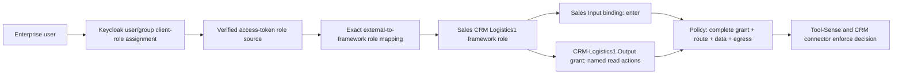

# ViewSense AI® Channel Consoles and Role Mapping

## Decision and maturity

Provide separate **Input Channels** and **Output Channels** management workspaces, and extend
**Identity & access** with framework roles and external role mappings. All are detachable clients
of authenticated headless APIs. This is a **major, design-only uplift** to the
[channel model](07-input-output-channels.md); the pages, catalogs, grants, administration APIs and
enforcement described here are **planned**, not existing controls.

Attach roles at both channel boundaries with distinct semantics:

- **Input role binding:** permits entry into a business context such as Sales, with permitted
  purposes and entry surfaces. It does not confer CRM access.
- **Output role grant:** permits named capabilities and data scope on CRM-Logistics1, restricted
  to explicitly allowed Input Channels/routes. It is the canonical owner of CRM read/write limits.

The Input page displays effective CRM access by reading these same Output grants. Do not maintain
a second copy of CRM permissions on the Input Channel. A route and Output capability catalog are
ceilings, not permissions automatically inherited by everyone in Sales.

## The Sales CRM Logistics1 role

| Mapping layer | Pilot configuration |
|---|---|
| Keycloak role | Client role `sales-crm-logistics1-reader` on API resource client `viewsense-api` |
| Framework role | ID `sales-crm-logistics1`; display name **Sales CRM Logistics1** |
| Input binding | Role may use `sales` through approved chat/API surfaces for `sales.opportunities` |
| Output grant | Role may use `crm-logistics1`, only from `sales` and its approved opportunity route |
| Capability profile | `sales-opportunity-reader`, with explicit action `sales.opportunities.list` |
| Data scope | Accounts currently assigned/otherwise entitled to the verified subject; only approved opportunity fact fields |
| Prohibited by omission | CRM writes, lead creation, customer contact, bulk export, arbitrary SQL, unrelated reads and another CRM |

**Read-only** is a UI label for a reviewed, versioned set of read actions. It is not a wildcard for
every present or future read tool. Adding account-summary reads requires a declared capability,
tool binding and reviewed profile/grant revision. Read permission is still subject to field
masking, purpose, freshness, export, retention and model-egress policy.



This is the target authorisation chain. None of its new edges is implementation evidence.

## Resource and state ownership

| Resource | Required metadata | Authoritative owner |
|---|---|---|
| Framework role | Tenant-scoped immutable ID, label, purpose, owner, enabled state, revision | Governance authorisation catalog |
| External role mapping | Tenant, pinned provider/role-source reference, exact external role value, target framework role, lifecycle/revision | Governance; provider trust and claim extraction remain operator-configured at the edge |
| Input role binding | Role and Input IDs, accepted purposes/surfaces, revision/state | Governance |
| Output capability/profile | Output ID, explicit action IDs, tool/schema versions, side-effect class, data ceiling, revision/state | Governance channel catalog; MCP owns executable tool registration |
| Output role grant | Role, Output, allowed Input/route IDs, profile revision, account/field policies, purpose, conditions, budgets and expiry | Governance |
| User/group role assignment | Identity, memberships, effective external roles and credential lifecycle | Keycloak or another enterprise IdP |
| Access policy revision | Consistent references to mappings, bindings, profiles, grants and route versions; review and activation evidence | Governance |

Framework roles are portable business authorisation objects, not a duplicate user directory.
Assign users/groups to external roles in the IdP; map those roles into framework roles in ViewSense
AI®. No framework API assigns a human to a role in the first slice. Machine identities require
explicit machine-role mappings and grants; a bot's transport identity cannot impersonate a user.
Governance uses its existing state domain, with tenant-keyed resources and owner APIs. Peers never
query that database. Role labels and client names are not globally unique authorisation keys.

## Keycloak role mapping

Keep these separate in operator language: Keycloak assigns roles to users/groups; its token
configuration determines which roles are emitted; ViewSense AI® maps verified external roles to
framework roles; Output grants define what a framework role can do. Keycloak does not need copies
of every CRM tool/field permission. See the official
[Keycloak role and token administration guide](https://www.keycloak.org/docs/latest/server_admin/index.html#_roles).

For the pilot, use a dedicated API resource client `viewsense-api` and a separate browser client.
Read the API client's role list at `resource_access.viewsense-api.roles`. Keycloak normally puts
client roles in `resource_access` and realm roles in `realm_access`; protocol mappers and client
role scope settings control token contents. Ensure the access token includes the API audience,
and evaluate effective token mappings against the installed Keycloak version. Explicitly scope
roles to the API client rather than accepting all realm/client roles. See
[token role mappings](https://www.keycloak.org/docs/latest/server_admin/index.html#_token_role_mappings)
and [audience configuration](https://www.keycloak.org/docs/latest/server_admin/index.html#_audience).

Target mapping example; this is not a payload accepted by the existing provider schema:

```json
{
  "id": "kc-sales-logistics1",
  "provider_id": "enterprise-keycloak",
  "role_source_ref": "viewsense-api-client-roles",
  "external_role": "sales-crm-logistics1-reader",
  "framework_role_id": "sales-crm-logistics1",
  "state": "draft",
  "revision": 1
}
```

The pinned role source binds configured provider/issuer, API audience, claim path, client-role
namespace and allowed tenant relationship. Tenant comes from verified identity, not this request.
The tuple `(tenant, provider, role source, exact role value)` selects a mapping. The same role
string from another issuer, realm-role list or client grants nothing. Reject malformed role claims,
unbounded lists, unregistered sources and duplicate/conflicting mappings. Do not use fuzzy matching,
case folding, display names or wildcard role values. Unknown roles map to no framework authority.
First-slice mappings have one target role; different external roles/providers can explicitly map
to the same framework role. Framework role inheritance is excluded from the first slice.

Keycloak can supply effective composite/group-assigned roles in tokens. ViewSense AI® uses only
roles emitted by the approved source; it does not expand Keycloak group trees or composites itself.
Review IdP composite changes as entitlement changes and test their effective claims. The first
release links operators to Keycloak for user/group/role assignment. Optional role discovery later
uses an isolated read-only IdP adapter, never Keycloak administrative credentials in a browser,
LLM, generic gateway or governance record. Keycloak mutations would require a separate audited
integration; no bidirectional role synchronisation is implied.

### Compatibility with the current verifier

Today `OIDCProvider.roles_claim` identifies one claim array; `role_scopes` allow-lists external
role names and maps them directly to platform API scopes. `/v1/auth/me` returns those recognised
external roles; `/v1/auth/roles` reports static configuration. These do not create framework roles,
channel bindings or resource grants. A new role omitted from `role_scopes` is currently excluded
from `principal.roles`, even when present in a valid token.

Implementation must extract approved role sources from **verified** claims independently of the
legacy scope mapper, then resolve framework roles through the authorisation catalog. Retain
legacy external role/scopes fields and add explicitly named `framework_roles`, mapping/policy
revisions and entitlement-freshness metadata. A new provider-role-source schema/configuration
version must preserve existing v1 provider configuration; v1 currently forbids unknown fields.
Existing broad scopes such as `api.invoke` are transport permission, not CRM permission. Neither
raw OAuth scopes nor `role_scopes` may bypass the new resource decision on a channel route.

## Effective authorisation and enforcement

Evaluate the request against one complete qualified Output grant at a time:

```text
ALLOW requires valid subject/tenant and approved external-to-framework mapping
  AND an enabled Input binding for that subject's mapped role and requested context
  AND an enabled Output grant matching that role, Input, Output, route, purpose and action
  AND route/profile/provider capability ceilings and required approval
  AND account/field, classification, residency, PII-egress and delivery policies
  AND current revisions/revocation state, freshness, expiry and remaining budget.
```

An explicit deny, missing required decision or unavailable mandatory policy source wins over any
allow. Several roles may supply alternative complete grants; do not combine a write action from
one grant with broader accounts from another, or entry rights from an unrelated role with a grant
whose Input constraint fails. First-slice execution selects one authorising grant; multi-grant
aggregation requires a separate reviewed rule. Result pagination binds subject, grant, route and
policy revision. UI visibility and capability discovery are filtered by this same backend policy.

Edge resolves current mapped roles and Input entry. Governance returns a short-lived,
audience-bound decision/grant tied to the subject, tenant, qualified resource tuple, policy
revisions, account/field-policy reference, permitted action, payload-policy result and budgets.
Orchestrator cannot widen it. Tool-Sense validates the decision and tool/arguments; the connector
enforces trusted account predicates and field allow-lists before query aggregation/model exposure.
The provider adapter checks the actual outbound payload against its egress decision. Recheck
revocation on execution, resume, approval and delivery. Direct calls to tool APIs require equivalent
authorisation; choosing a server name or holding `mcp.invoke` cannot bypass Output grants.

JWT role claims are a snapshot. Removing a Keycloak assignment does not by itself rewrite an
already issued token. Target channel policy defines `max_role_age_seconds`; the pilot maximum is
60 seconds, with authoritative entitlement revalidation or a supported revocation feed required
once the assertion exceeds that age. Measure age from the verified assertion/revalidation time,
never from each request/cache read. Policy changes and emergency role/mapping/grant disables
invalidate decisions through a monotonic authorisation epoch before another protected operation.
IdP removal is bounded by the validated feed/refresh interval, not claimed instantaneous.

If current entitlement cannot be established within that bound, deny the protected action.
Introspection validity alone is not proof of updated role membership. Implement and test a
provider-specific entitlement adapter or freshness mechanism before enabling this strict route;
short token lifetime alone is insufficient if it exceeds the configured bound. Long-running
operations require refresh/recheck, including final delivery; in-flight external bytes cannot be
recalled. Emergency disable blocks subsequent dispatch/delivery and cancels work where supported.

## Console pages

Keep persistent verified tenant/environment context. Add shareable `?page=input-channels` and
`?page=output-channels` workspaces to the management console; add **Framework roles** and
**IdP mappings** tabs under `?page=identity`. IDs in URLs are selection only, not tenant overrides.
These pages manage configuration; ordinary employees select permitted channels in chat/API clients.

| Workspace | List view | Detail tabs and actions |
|---|---|---|
| Input Channels | Name, owner, accepted surfaces, attached role count, route count, policy revision, enabled state | Overview; Entry roles; Output access; Routes; Delivery/retention; Audit |
| Output Channels | Name, application owner, connector, capability profile count, granted role count, catalog state, separately observed health | Overview; Capabilities; Role grants; Data/egress policy; Connector status; Audit |
| Framework roles | Role name/ID, owner, mapped IdP sources, Input bindings, Output grants, revision/state | Overview; External mappings; Channel access; Policy preview; Audit |
| IdP mappings | Provider/role source, external role, framework role, active revision and validation status | Select configured provider/source; exact role value; target role; validate, preview and draft lifecycle |

Input **Entry roles** attaches a framework role to Sales with purposes/surfaces. **Output access**
shows a derived matrix: `Sales CRM Logistics1 | CRM-Logistics1 | Read-only: opportunity list |
assigned accounts | sales.opportunities route | grant revision`. Edit links open the single
authoritative grant editor in the Output workspace; no duplicate permission checkbox is stored.

Output **Capabilities** lists exact actions, read/write/destructive class, tool/schema revision,
required fields and conditions. **Role grants** selects the framework role, allowed Inputs/routes,
explicit profile revision, dynamic account-policy and field-policy references, purpose, limits and
approval requirements. **Data/egress policy** shows model destinations, PII handling, allowed
regions and retention ceiling. A role grant can narrow, never relax, Output or enterprise ceilings.

Target grant example; all referenced resources must exist in the same identity-derived tenant,
with matching Output/action schemas and reviewed immutable revisions:

```json
{
  "id": "sales-logistics1-opportunity-read",
  "framework_role_id": "sales-crm-logistics1",
  "output_channel_id": "crm-logistics1",
  "allowed_input_channel_ids": ["sales"],
  "allowed_route_ids": ["sales-logistics1-opportunities"],
  "capability_profile_ref": {"id": "sales-opportunity-reader", "revision": 1},
  "account_policy_ref": "crm-assigned-accounts",
  "field_policy_ref": "crm-opportunity-facts",
  "purpose": "sales.opportunities",
  "state": "draft",
  "revision": 1
}
```

The referenced profile lists `sales.opportunities.list` explicitly. Dynamic account assignments
are enforced against current CRM-owner entitlements at query time, not copied into a role JWT.
Effective budgets/limits narrow to the strictest applicable enterprise, tenant, route and grant
ceiling; role union never adds budget. Cross-tenant references fail validation before publication.

For CRM-Logistics1 the grant editor shows **Sales CRM Logistics1**, Input **Sales**, profile
**Read-only — Sales opportunities**, action **List sales opportunities**, account scope
**Assigned accounts**, and the permitted fact fields. Creation/contact/export actions remain
outside this grant. Buttons use business labels; protocol/connector details sit in operator
detail panels. Saving a grant does not test Oracle, activate a provider or create Keycloak roles.

Every detail page distinguishes draft/active/disabled configuration, mapping validation, provider
admission and live connector health. An unavailable API has an unavailable state and no fabricated
data/success. API errors retain safe request IDs. Revision conflicts require refresh/review.
Keyboard-accessible forms, labelled controls and readable permission tables are acceptance gates.
URL filters and displayed role names must be escaped; restricted resource names are not exposed
to unauthorised users.

### Administration and publication

Separate metadata editing, capability/profile management, role/mapping/grant management, review/
activation and audit viewing. Proposed scopes are `channels.read`, `channels.admin`, `authz.read`,
`authz.admin`, `authz.review` and `authz.simulate`, each further constrained by tenant, resource and
operation policy. They are not existing scopes. Channel administration does not grant business
data access or permission to administer Keycloak; role admins cannot approve their own expansion.
Initial admin authority comes from explicitly provisioned operator identities, not from a role a
user creates in the console.

Edit a draft, validate references and safety ceilings, simulate effects, review the before/after
diff, then publish an immutable policy revision atomically. Privilege expansion requires an
independent authorised reviewer and recorded approval; editing the draft never affects execution.
Enable only when required schema/tool mappings, source validation and tests are satisfied. A
protected emergency disable is immediate and audited without waiting for a publication review.
Rollbacks create a new reviewed revision and cannot re-enable a revoked identity/provider.
Referenced profiles are immutable revisions; registering a new tool cannot expand a live profile.

**Policy preview** reports allowed/denied actions, reason codes and the exact mapping/binding/
grant/route/egress policy revisions. Synthetic subjects are available to authorised policy admins
only; actual-user lookup requires separate permission. Preview evaluates no CRM query, creates no
execution token and cannot impersonate the tested subject. Standard users can inspect only their
own safe effective permissions. Full token paste/upload and raw CRM payloads are excluded.

## Planned headless APIs and contracts

| Backend owner | Target surface | Contract requirement |
|---|---|---|
| Governance | `/v1/framework-roles`, `/v1/idp-role-mappings`, `/v1/input-role-bindings`, `/v1/output-capability-profiles`, `/v1/output-role-grants` | Filtered list/detail and draft create/update APIs; stable tenant-scoped IDs, authenticated tenancy, pagination and optimistic revisions |
| Governance | `/v1/access-policy-revisions`, `/{id}:validate`, `/{id}:activate`; resource `:disable` operations | Atomic activation of reviewed references; safe disable, revocation epoch, immutable history and audit |
| Governance | `POST /v1/authorization:simulate`, `POST /v1/authorization:decide` | Non-executing scoped preview versus authenticated narrowed execution decision; no caller-supplied roles treated as authority |
| Edge | `GET /v1/auth/channel-access`; additive `/v1/auth/me` fields | Own effective Input/Output/action summary and framework-role provenance; no administrator catalog leakage |
| Edge facade | Explicit authorised proxies for the above management APIs | Same owner contracts and delegated human identity; no generic URL/path proxy |

CRUD verbs and schemas must be frozen during the contract slice, including `If-Match`/revision
conflicts, idempotent draft creates, review evidence and disable semantics. Schema families cover
framework roles, qualified external mappings, Input bindings, capability profiles, Output grants,
policy snapshots, decisions and safe effective-access summaries. Machine-readable assets belong
in the implementation repository; none is shipped by this design. Console calls these backend
APIs and owns no grant database or policy algorithm. Existing `/v1/auth/roles` remains a legacy
scope-policy view; it is not silently renamed or treated as the new framework-role catalog.

## Delivery and acceptance gates

1. Implement versioned resource/decision schemas, governance APIs, atomic revisions, scoped
   administration and exact external-role extraction/mapping. Preserve old IdP/client behaviour.
2. Implement qualified-grant evaluation, current entitlement/freshness/revocation, narrowed
   delegation and connector enforcement; verify allow/deny headlessly before attaching a GUI.
3. Implement Input/Output pages and Identity role/mapping tabs on the same APIs, then pilot the
   Sales reader path with the existing CRM/channel delivery requirements.

Required evidence: correct Keycloak client role permits Sales opportunity reads for assigned
accounts; realm/unrelated-client/issuer/tenant collisions, malformed claims and unknown roles grant
nothing. Missing Input binding or Output grant denies; Support cannot reuse a Sales-only grant;
another CRM, unlisted read, write, export and outreach deny. Multiple roles cannot manufacture
action/account combinations. Disabled mappings/grants, role removal, stale claims, feed outage,
mid-run revision changes and scoped cursors follow the documented bounds.

Test denied admin/self-approval/tenant changes, draft isolation, stale updates, atomic activation,
profile immutability, safe previews and disable/rollback. Prove direct MCP calls enforce the same
policy. Headless and console permission matrices must match; hiding a button cannot authorise a
backend operation. Test navigation, inaccessible deep links, empty/error/loading states, keyboard
operation, separate configuration/health and GUI removal. Demonstrate secret/PII-free logs and
safe lineage showing external source → framework role → Input binding → Output grant → decision.

All runtime, IdP freshness, UI and CRM evidence remains pending implementation.
