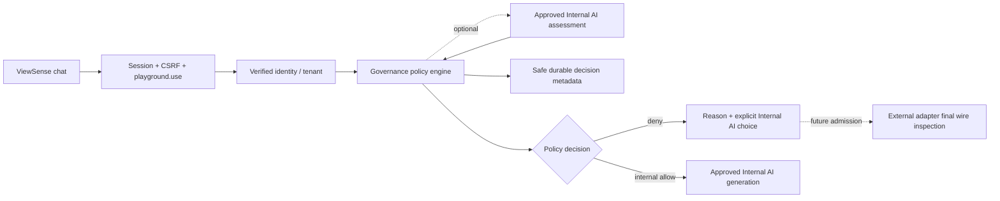

# ViewSense AI® User Playground and Internal Policy Engine

## Scope and ownership

This is a major runtime and user-experience uplift. End users use Input Channels as a chat
playground and Output Channels as an approved AI destination list. Admin and Operations retain
channel policy management/inspection. Console admission and the new `playground.use` capability
allow bounded general chat only; they do not grant CRM queries, memory retrieval or business tools.
An AI Output destination and a CRM Output capability are separate resources. A future composed
Sales workflow must independently authorise its CRM facts and its AI processing destination.

The first source is ViewSense chat. Teams and other entry/reply integrations remain a subsequent
adapter slice with verified membership, recipient binding and enterprise processing-boundary review.
Users select approved options; provider credentials, URLs, models, policy and role mappings remain
operator-owned. No connection is represented as live merely because its option is present.

## Executable request path

Governance owns an operator-provisioned, tenant-bound playground policy file and safe decisions in
its PostgreSQL database. The edge owns orchestration and generation. The internal provider adapter
owns model invocation and its approved endpoint. No service reads another component's database. The internal adapter URL must match the separately
configured `VS_OLLAMA_ADAPTER_URL` service endpoint in both governance and edge; a policy file
cannot reclassify an arbitrary endpoint as Internal AI.
The policy is disabled unless explicitly configured; absent/invalid configuration denies.

Contracts include source/destination IDs, bounded plain-text prompt, assembled messages, decision
ID/version, allow/block reasons and internal fallback ID. Browsers cannot supply tenant, model,
provider URL, classification or permission. Requests are single-turn, non-streaming, text only;
attachments, history, tools and additional context are refused in this slice rather than omitted
from inspection. The bounded user prompt is inspected; the fixed system instruction is server-owned and contains
no user or business data. The edge verifies the assembled message digest before dispatch.

## Policy semantics

Deterministic normalised-text checks raise classification for contact data, financial/government
identifiers, confidentiality markers and credentials. Recognised credential patterns block both destinations. Internal
AI runs a bounded probabilistic sensitivity assessment inside an operator-approved processing
boundary. When AI assessment is enabled, missing, malformed, wrong-model or timed-out inspection
denies dispatch. An AI assessment
can raise risk; it cannot grant permission or lower the deterministic/source classification floor.

External destinations always deny in this runtime, regardless of detector results. Internal AI
assessment is optional for the local-only route and defaults off, avoiding a classifier call on
every chat. Enabling it supplies sensitivity metadata; it never changes permission or permits an
external transfer. No prompt is silently redirected or retried after blocking.

External AI remains a future supported route. Before activation it must have mandatory local
inspection, governed minimisation or denial, provider admission and final-wire inspection in its
credential-owning adapter. No allow switch exists in this playground policy. A future narrow
public-task template is safer than treating arbitrary free text as anonymous; any external permit
must bind the actual wire payload, model/endpoint revision and expiry. Existing legacy inference
routes are separate and do not acquire these playground guarantees.

## Trust boundaries and deployment

All internal hops require mTLS, audience tokens and narrow scopes. The new flows are governance to
identity/internal inspector and gateway to Internal AI generation; future external adapters will require
a separate reviewed governance/egress flow. Sales/SIEM workload clients gain only edge `playground.use`, with no
provider or channel administration grant. Admin/Operations additionally retain management scopes.
Approved SSO mappings must include `playground.use`; browser fields and header spoofing cannot add it.

Operator configuration records approved tenants, internal model, inspector model and optional assessment mode. This pilot uses local development PKI and a loopback Internal AI runtime. An
internal label is an operator assertion, not evidence of residency or organisational control.
Kubernetes defaults remain disabled until operators configure the policy and an approved Internal
AI provider. Public egress belongs only to the credential-owning external adapter.

## Failure, evidence and operations

Input is bounded, provider calls have deadlines and streaming/fallback are disabled. Responses are
untrusted plain text rendered with text nodes. Browser conversation state is transient and clears
on navigation/sign-out; neither prompts nor generated text are written to the decision journal.
Safe evidence records tenant, pseudonymous subject, decision ID, policy/configuration fingerprint and model, categories,
allow/block reasons and operation under request correlation. No matched values or payload digests
appear in public metadata. This is durable local evidence, not independently immutable audit.

Acceptance covers end-user versus admin screens, direct API denial, invented source/destination,
extra payload fields, confidential/PII/secret canaries, Unicode obfuscation, inspector/DB outage,
wrong model, model-assisted false negatives and zero generation calls for external/unknown
destinations. External final-wire and receiver-observed containment tests remain future activation
gates; no live cloud inference is required. Internal generation and inspection use the running
approved local models for GUI acceptance.

Production still requires evaluated multilingual/indirect-identifier detection, authoritative
membership refresh, rate/concurrency and spend budgets, durable policy promotion/revocation,
immutable export, output/delivery enforcement, per-workload renewable identity and network evidence
for every selected provider. This slice does not provide a platform-wide guarantee across existing
embeddings, memory, tools, telemetry or arbitrary external adapters.
