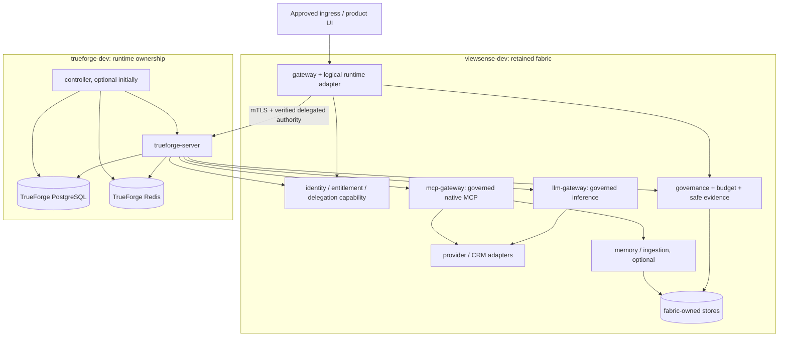

# ViewSense AI® TrueForge Namespace Integration

## Deployment decision

Use **two application namespaces per customer/environment cell**: one for the retained fabric and one for TrueForge. The fabric harness remains in its namespace and calls the private runtime Service across namespaces. It is not necessary to move fabric pods into the TrueForge namespace to connect them.

This is the **planned opt-in migration profile** for the [adoption decision](../03-trueforge-adoption-decommission.md). The existing base remains single-namespace `viewsense-dev`. This document is the explicit design for the additional namespaces allowed by the repository's environment-overlay rule; executable overlays, schema changes, policies and releases have not been added.

| Profile | Fabric namespace | Runtime namespace | Optional code-execution namespace |
|---|---|---|---|
| First development integration | `viewsense-dev` | `trueforge-dev` | `trueforge-sandbox-dev`, created only after sandbox qualification |
| Dedicated customer/environment | `viewsense-<cell>-<env>` | `trueforge-<cell>-<env>` | `trueforge-sandbox-<cell>-<env>`, optional |
| Parallel release evaluation | A fresh explicitly named fabric namespace | Its fresh paired runtime namespace | A fresh paired optional sandbox namespace |

Normalize and validate identifiers and total namespace length before rendering. Do not silently truncate two names into the same namespace. Pair names and immutable namespace UIDs in deployment inventory; verify context, customer/environment and ownership before mutation. Existing `viewsense-release-*` installations stay under their current installer contract until a versioned namespace-pair installer is implemented. No existing namespace is renamed or reset.

One pair initially represents one real customer tenant. Internal runtime `default` is only an implementation-local namespace within that isolated cell; it is not an externally selectable tenant. Multiple customer tenants in one runtime remain unqualified until explicit identity/storage/authorization tests pass. Namespaces reduce blast radius; the identity, data and network checks below remain mandatory.

## Workload and state placement



All target edges require implementation acceptance; they are not currently installed. Database arrows represent ownership-domain connections, not cross-service data sharing.

| Placement | Workloads/state | Rules |
|---|---|---|
| Fabric namespace | Edge, governance, identity adapters, LLM/MCP capability servers, selected memory/ingestion and credential-owning connectors | Retain existing state owners and compatible APIs; old orchestrator/agent kernel remain until their shutdown gates |
| Runtime namespace | TrueForge server and optional controller; runtime-only PostgreSQL/Redis endpoints | Fresh state and dedicated credentials; fabric never connects directly to runtime SQL/Redis |
| Optional sandbox namespace | Selected isolated execution backend and per-session sandboxes | No fabric/database/provider credentials or default access to application namespaces; separately qualify backend and policies |
| Infrastructure namespaces | Existing ingress, certificate/workload identity, CNI/mesh and telemetry controllers | Independently operated, least-privilege integrations; no CNI/mesh reinstall or cluster-admin UI permission |
| Model/data-owner placement | Selected internal inference and CRM systems | Separate approved service/cluster where required; only owning adapter can reach the data/provider endpoint |

Databases may be external managed services instead of pods, with the same logical ownership, separate users/databases, verified TLS, backups and exact egress. Do not place TrueForge tables in `agent-db` or permit the fabric to read runtime tables. The TrueForge controller may share runtime persistence as upstream requires; that does not grant fabric access.

## Releases, endpoints and packaging

Operate separate Helm releases for the fabric and runtime namespaces, coordinated by one versioned GitOps/deployment inventory in `aiops-fabric`. A conventional subchart inherits its release namespace; a single parent release is not a sufficient namespace-isolation design. Keep upstream chart/image versions pinned and use reviewed values plus a small tested render transformation or generic upstream extension only where required.

For the first profile, set the runtime fullname explicitly to `trueforge`, yielding the upstream helper's Service `trueforge-server`. The proposed fabric connection is:

```text
https://trueforge-server.trueforge-dev.svc.<cluster-domain>:8790/api/v1
```

`<cluster-domain>` is operator configuration, not an assumption that every cluster uses `cluster.local`. The serving certificate must include the exact configured DNS name. Port 8790 remains the Service and container port in this profile; enable the TLS listener without silently changing clients to port 443. Service DNS/addresses and trust are validated configuration, never browser- or model-selected destinations.

Runtime calls back to the selected fabric capabilities at:

```text
https://governance.viewsense-dev.svc.<cluster-domain>:8443/v1
https://identity.viewsense-dev.svc.<cluster-domain>:8443
https://llm-gateway.viewsense-dev.svc.<cluster-domain>:8443/v1
https://mcp-gateway.viewsense-dev.svc.<cluster-domain>:8443/<qualified-mcp-path>
```

The MCP path and agent inference subset are not implemented at those target boundaries yet. They must be frozen in machine-readable contracts during M03. Do not configure a native MCP client against the current fabric-owned `/v1/tools/call` JSON API. The runtime adapter owns joining exact paths and SDK configuration so `/api/v1` is not duplicated by a generated client.

Use ClusterIP Services. The public product entry stays with the fabric edge. The optional embedded TrueForge UI calls authenticated product/adapter APIs; raw runtime settings, history, turns, sharing, downloads and schedule endpoints are not publicly exposed through an unrestricted proxy. OIDC/MCP authorization callbacks require narrowly routed authenticated/state-validated paths when enabled; qualify their public URL and mTLS proxy behavior separately.

## Required runtime profile

| Setting / resource | Planned baseline |
|---|---|
| Runtime mode | Hosted, `STANDALONE=false`, PostgreSQL and Redis |
| Version | Pin examined/qualified chart and image digest; record SDK/core/UI compatibility and render transformation version |
| Server workload | Start one synthetic development replica; production count follows measured concurrency/SLO and state-service availability |
| Controller | Disabled for initial interactive pilot. Enable exactly one per runtime database after M06 schedule/machine-identity qualification |
| Authentication | Verified subject/tenant bridge with explicit trust/audience; no standalone/default-admin authentication or one shared employee identity |
| Transport | Verified TLS and workload identity on every application hop; exact service-identity authorization in addition to certificate validity |
| Service accounts | Distinct `trueforge-server` and `trueforge-controller`; no automatic API token mounts; explicit audience-projected tokens only if an approved workload-identity adapter needs them |
| Secrets | Per-workload trust/credentials; no vendor model/CRM keys in runtime manifests or DB; never use chart development passwords/placeholder service keys |
| State services | TLS/authentication, owner-only access; approved storage/backup/restore; choose Redis persistence from qualified stream/recovery semantics |
| Pod controls | Non-root, restricted security context, read-only root, bounded writable temporary space, quotas/limits, storage bounds and Pod Security admission |
| Network | Actual default-deny NetworkPolicies; scoped rules on both sides; application URL guard enabled as additional protection |
| Features | Synthetic text-only/local profile; sandbox, skills, web search, subagents, shared sessions and unattended business schedules disabled until qualified |
| Retention | Synthetic test profile explicit; live `retention: none` business data blocked until runtime storage/artifact acceptance |
| Telemetry | Internal collectors; metadata-only correlation; optional external analytics/error destinations disabled unless admitted |

Two upstream chart gaps require explicit handling: the examined server/controller templates use the same `serviceAccountName`, and share chart-level TLS mounts and much configuration. Before enabling the controller, the approved chart extension/render transformation must give it a distinct identity/certificate, expose only its required configuration, and be covered by render/identity tests. A values-file assertion alone does not implement that separation.

For the initial controller-disabled profile, still issue a unique server identity. Stock OIDC does not validate the proposed fabric delegation; select and qualify a small authenticator/resolver integration or a thin pinned core host. Native TLS helpers also do not automatically configure mTLS credentials for all model/MCP outbound transports. Define the approved outbound application/proxy identity path and prove it before enabling the connections; trusting a CA is not client authentication.

## Connection and authorization matrix

These are the new target edges. Existing internal provider/store/identity flows remain under their owner policies and are revised only when the corresponding component changes. Port/protocol are explicit TCP unless DNS says otherwise. Tokens/scopes below describe required new capability semantics, not currently shipped grants.

| ID | Source namespace/workload | Destination namespace/workload | Port | Authority and operation | Activation gate |
|---|---|---|---|---|---|
| N01 | Fabric `gateway` | Runtime `trueforge-server` | 8790 TLS | Distinct edge workload plus verified narrowed user/tenant/run authority; allow-listed runtime operations | M02; M01 probes synthetic/admin only |
| N02 | Runtime `trueforge-server` | Fabric `governance` | 8443 TLS | Policy/admission/reservation and safe evidence scopes; real subject/delegation and active revisions | M03 |
| N03 | Runtime `trueforge-server` | Fabric `identity` / approved delegation issuer | 8443 TLS | Workload-bound short-lived audience-specific exchange; cannot self-select tenant/subject or widen a grant | M02–M03 |
| N04 | Runtime `trueforge-server` | Fabric `llm-gateway` | 8443 TLS | Fresh payload/route/model-bound permit, budget and durable evidence; no vendor credential | M03; synthetic local provider first |
| N05 | Runtime `trueforge-server` | Fabric `mcp-gateway` | 8443 TLS | Native MCP discovery limited to approved tools; per-call action/argument/account/field delegation | M03 |
| N06 | Runtime `trueforge-server` | Runtime PostgreSQL | 5432 TLS | Runtime DB identity, runtime schema only | M01 |
| N07 | Runtime `trueforge-server` | Runtime Redis | 6379 TLS | Runtime Redis identity/ACL and approved command/key scope | M01 |
| N08 | Runtime `trueforge-controller` | Runtime server/PostgreSQL/Redis | 8790/5432/6379 TLS | Separate controller identity; exact internal schedule/build APIs and required persistence operations | M06; disabled initially |
| N09 | Approved telemetry collector | Runtime metrics endpoint | 8790 TLS | Scrape-only path and controlled namespace/workload, no access to ordinary APIs | M01/M04; path enforcement at proxy/app, not L3 policy |
| N10 | Selected workloads in either namespace | Approved cluster DNS endpoints | UDP/TCP 53 | DNS only; resolve approved services/upstreams; accommodate node-local DNS explicitly if installed | M01 |
| N11 | Runtime `trueforge-server` | Approved internal collector/identity discovery endpoints | Exact configured TLS port | Safe telemetry and verified identity discovery only; enumerate each destination, no wildcard public egress | When selected and tested |

The controller currently uses a static internal API key upstream. Production requires an audience/scoped workload authorization integration for its exact internal operations; a fresh Secret value alone does not satisfy that requirement. An isolated synthetic experiment using that existing upstream mechanism remains a documented development exception, with the controller normally disabled.

Model/MCP dispatch checks run on every call, including non-streaming summaries/compaction, deferred tools, retries, resumes and any later enabled child agent. Extra root capabilities alone do not cover these paths. Connector/server enforcement stays authoritative even when runtime selectors or user approval say a call may proceed.

Explicitly deny runtime → governance/memory/registry/legacy-agent databases, runtime → Oracle, runtime → public model APIs, fabric → runtime SQL/Redis, unapproved workloads → runtime server, sandbox → application namespaces, and unrelated namespace pairs. `mcp-gateway` may reach the memory gateway or CRM adapter only after its separate approved internal flow is added; no broad fabric-namespace trust is implied.

## Multi-namespace network and identity contract

The current `NetworkTopology` contract has one top-level namespace and flows containing workload names/ports. Its Istio generator derives all principals from that single namespace. Copying the same file to `trueforge-dev`, or adding a DNS name, cannot safely describe the proposed cross-namespace edges.

Implement a versioned topology contract that identifies each endpoint by namespace, workload, service account, protocol and port; binds a customer/environment namespace pair; and records selected Service destinations/trust domain. Preserve v1 behavior for the existing single-namespace profile. Generate both portable CNI policies and selected mesh principal policies from one canonical multi-namespace model. Version the schema, API status/plan, UI, fingerprints and tests together; do not hand-maintain divergent copies of the allowed graph.

For NetworkPolicy peers, namespace and pod selectors must occur in the **same peer item** to intersect them. The following is a documentation-only peer fragment for N01, not an installed policy:

```yaml
namespaceSelector:
  matchLabels:
    kubernetes.io/metadata.name: viewsense-dev
podSelector:
  matchLabels:
    app.kubernetes.io/name: gateway
    app.kubernetes.io/instance: viewsense
```

Render the instance value from the actual fabric release; the example fixes it only to illustrate the intersection. Separate list items would broaden the match. Apply source egress and destination ingress rules, select the actual server pod port, and validate the rendered chart's labels before activation. CNI policies select pods/namespaces, not service accounts or HTTP paths; mesh/application controls authorize the exact workload and operation. Kubernetes policies are additive, so an existing broad allow can undermine a new narrow rule. These selection semantics follow [Kubernetes NetworkPolicy documentation](https://kubernetes.io/docs/concepts/services-networking/network-policies/).

Retain STRICT transport and exact namespace/service-account principals when a mesh is selected. The policy model must distinguish `trueforge-server` from controller and unknown pods in the same namespace. For ambient mesh, preserve the reviewed HBONE policy requirements and verify denied encrypted application reads, not only TCP acceptance. Do not enroll a namespace into a mesh or modify cluster CNI as an implicit step of runtime installation.

## Secret, RBAC and trust lifecycle

Provision Secrets in the namespace of the consuming workload through the approved secret/certificate controller. Kubernetes Secrets are namespace-scoped. Distribute public trust bundles where needed; never copy leaf private keys between namespaces, share one server/controller certificate, grant cross-namespace Secret reads, or give fabric access to runtime database passwords. Separate certificate identities, key rotation and audience-scoped token rotation are required.

Application pods do not require Kubernetes API permissions merely to connect over Service DNS. Role/RoleBinding changes are limited to identified integrations. Installation automation needs explicitly scoped permissions for both owned namespaces; it is separate from runtime identity and has no browser-facing credential. The console displays API-owned state and deployment evidence; it does not apply arbitrary YAML or create namespaces.

## Fully internal execution and sandbox limit

The server, controller and state services have a supported Kubernetes deployment path through the [upstream chart](https://trueforge.dev/quickstart). Local models, connectors, governance and identity can be independently hosted in approved infrastructure. Package dependency images/charts, model/skill artifacts and trust assets for disconnected operation.

The public [sandbox guide](https://trueforge.dev/sandbox) documents Daytona. The local source additionally has a TrueFoundry runtime integration and an optional development sandbox chart, which is not proof of an independently qualified production Kubernetes sandbox. Start without code execution. A later self-hosted backend must pass isolation, credential/egress, session filesystem, artifact retention, cleanup, restart and load tests before `trueforge-sandbox-*` is created/enabled. Merely launching untrusted code in ordinary pods does not establish a safe sandbox.

## Installation and acceptance sequence

1. M00 records the namespace pair, approved context, workload/secret/storage owners and pinned artifacts. Back up existing state and verify restore without changing the running reference.
2. Implement the multi-namespace contract and policies first. Create the owned runtime namespace and default deny before starting runtime workloads; retain the existing fabric namespace and data.
3. Provision runtime-local identity, trust, state services and secret references. Render/apply the independent runtime release with controller and optional features disabled.
4. Run synthetic health/store checks and both positive/negative DNS, pod-IP and Service probes, including unknown/same-namespace identity denials. Record chart/profile/topology/image fingerprints.
5. Implement M02's identity/adapter and only its approved cross-namespace edges. Qualify transport/client identity, owner/session/resume/turn permissions and invalid delegation without real data.
6. Implement M03/M04 capability/retention/evidence controls and their exact callbacks. Existing legacy routes stay unchanged until route-specific cutover.
7. Run bounded M05 pilot, then follow the migration runbook for drain/cutover. Adding a working runtime never automatically shuts down existing fabric services.

No production capacity or availability guarantee is inferred from these namespace choices. Define and measure request/turn concurrency, token throughput, queue/drain budgets, database/Redis availability, storage growth, p95/p99 latency and recovery targets. A disconnected controller or Redis loss must have an explicit tested user-visible outcome.
