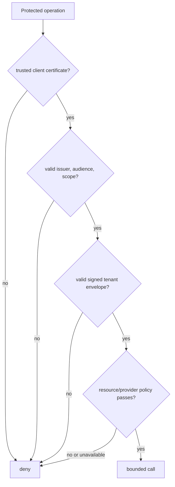

# ViewSense AI® Zero-Trust Security Model

## Security objective

Compromise of one component must not grant implicit access to another component, another tenant, provider credentials, or a different data plane. Controls are layered: network reachability, workload TLS identity, audience/scoped authorization, tenant/data policy, provider egress policy, and audit.

### TrueForge namespace boundary (synthetic development profile)

The [adoption decision](../03-trueforge-adoption-decommission.md) keeps fabric governance and
credential adapters authoritative while TrueForge executes agent turns in a separate namespace.
The [connection matrix](../20-deployment/03-trueforge-namespace-integration.md#connection-and-authorization-matrix)
requires exact workload identities, both-sided default-deny rules, audience/scoped delegation,
fresh subject/data policy and owner-only state services. Namespace membership and a valid client
certificate alone confer no operation authority. The fabric-owned topology-v2 renderer implements both-sided CNI rules for the development pair.
Mesh-v2 identity and production enforcement remain separate qualification work.

Stock TrueForge OIDC maps to internal tenant `default`. The development bridge binds one fixed
synthetic tenant per namespace pair and issuer-qualified runtime subjects; shared multi-customer
execution and production entitlement/dispatch delegation remain disabled. The examined chart shares server/controller service-account
and TLS configuration, so the controller remains disabled until supported upstream configuration supplies distinct identities.
All identity adaptations stay in the fabric tier; upstream patches are prohibited. Production cannot use its static controller API key as a substitute for scoped
workload authorization. The controller is disabled for the initial pilot.

Enforce policy on root, child, compaction, tool and retry paths; previews never become execution
tokens. Keep vendor/CRM credentials outside runtime state. Live no-retention facts remain blocked
until transcript/artifact/backup behavior is qualified. Decommissioning cannot fall back to a
legacy path that ignores the active grant/egress policy, and does not authorize PVC/archive disposal.

The owner separately authorized deletion of the three old development/evaluation namespaces
without backups. This exception is recorded in the [clean-state operation](../40-ops/03-clean-state-rebuild.md)
and does not authorize future customer data deletion. Short-lived static PKI, unbound certificate/
JWT identity and single-replica stores remain development limitations. No-retention, hard budgets,
immutable export and final business authorization are not supplied by this synthetic bridge.

The optional [standalone GUI preview](../../../deploy/trueforge-access.md)
is a separate localhost-only development tool using official upstream no-login mode. Its HTTP
loopback listener and disposable SQLite data are not an enterprise route or a Kubernetes security
exception. It receives no fabric credentials or host-directory mounts and must not be exposed
remotely. Its Docker bridge is not an egress-policy implementation. Integrated browser identity,
TLS termination and production user/tenant authorization remain unqualified.

```mermaid
flowchart LR
    Request["Request"] --> Net["NetworkPolicy reachability"]
    Net --> TLS["CA-validated mutual TLS"]
    TLS --> JWT["issuer + aud + scope + expiry"]
    JWT --> Envelope["signed tenant Trust Envelope"]
    Envelope --> Resource["tenant/owner database predicate"]
    Resource --> Provider["configured provider/egress boundary"]
    Provider --> Evidence["JSON log + safe evidence metadata"]
```

In the development reference, the certificate proves possession of a CA-issued client certificate;
the JWT supplies the application workload identity. Binding a SPIFFE ID from the certificate to the
token subject is a production integration, not current application behavior.

## Channel control-plane enforcement

Console workspace admission uses server-bound Admin/Operations/Sales/SIEM profiles. Non-admin
profiles deny configuration mutations, model tests and admin-only reads before downstream dispatch;
scoped playground POSTs are explicitly permitted. Separate
local credentials select separate fixed-tenant workload clients with profile-specific component grants.
The browser receives no credential or authority from selecting an identity or changing a page URL.
For SSO, only operator-approved mappings yield canonical `console.role.*` scopes; arbitrary role
claims fail closed for the console. The edge applies workspace ceilings to these scopes and named
POC workload subjects even if transport scopes are excessive. Existing unrelated headless clients
retain their capability scopes. Channel/business authorisation remains a separate policy decision;
the console registry cannot supply CRM grants. The local POC uses shared development client TLS
material; production per-workload identity and external account provisioning remain requirements.

The edge-to-governance hop is allow-listed using mTLS, an exact governance audience and distinct
`channels.*` / `authz.*` scopes. The edge qualifies delegated human references by a digest of the
verified issuer and subject, preventing cross-issuer reviewer identity collisions. Only the
configured gateway presenter may supply canonical identity assertions to governance decisions;
the signed delegated subject must match that qualified reference. Browser-supplied roles are
accepted only by an explicitly scoped non-executing simulation, never as business authority.
Fixed-tenant development clients cannot delegate another subject.

Draft edits cannot affect active policy. Independent approval precedes atomic activation; stale
revision writes and self-review deny. Emergency disables persist across later activation and
advance the revocation epoch. Decision consumers for tool/CRM execution are not shipped: the
returned decision explicitly grants no execution authority. Signed role snapshots older than
the grant bound deny; an authoritative entitlement refresh/revocation feed remains required for
production. Read-only/local-only fields in a catalog do not prove database or PII enforcement.
The pilot journal stores resource identifiers and change events, excluding claims and payloads;
independent immutable export and production database TLS remain outstanding.

## Target trust boundaries and controls

| Boundary | Authentication | Authorization | Containment |
|---|---|---|---|
| client → edge | enterprise OIDC and optional client mTLS | tenant/user RBAC, ABAC, quota | ingress/WAF and no direct internal exposure |
| edge → TrueForge | workload mTLS + native OIDC JWT | `runtime.invoke` issued by fabric | exact cross-namespace NetworkPolicy; fixed synthetic fixture only |
| fabric model transport → LLM gateway | workload mTLS + audience token | `llm.invoke` | no vendor credential in TrueForge; fixed fixture only |
| gateway → provider | workload mTLS + provider audience | `provider.invoke`, provider policy | dedicated provider network/namespace |
| OpenAI adapter → OpenAI | server-held API key + HTTPS | provider project/model limits | adapter-only Secret and constrained public egress |
| provider → database | database identity and TLS | owner schema/user only | only owning provider can reach store |
| MCP → enterprise system | connector workload identity | per-tool/action/data policy | egress allow-list and isolated credentials |

## Identity

Design contracts use **Authentication and Identity Provider (AuthN Provider)** and
**Authorisation Policy Provider (AuthZ Provider)** as separate replaceable capabilities, with an
Identity Entitlement Adapter for verified roles/current membership. Keycloak and OPA are examples.
Product-specific claims, administration credentials and policy syntax remain inside adapters;
framework roles and qualified channel grants remain governance-owned. A successful login never
substitutes for a resource decision. See the
[neutral provider contracts](../10-overall/08-channel-consoles-role-mapping.md#provider-neutral-authentication-and-authorisation).

Provider changes require reviewed trust/source mappings and explicit verified subject linkage;
matching usernames or `sub` strings across issuers cannot establish identity. Conforming AuthZ
providers must preserve deny precedence, complete-grant semantics and obligations. Unsupported
freshness/assurance, invalid decisions, unknown obligations and mandatory-provider outage deny;
never fall back to the development issuer or a permissive policy implementation.

Human identity federates to the enterprise IdP using OIDC Authorization Code + PKCE or workload-appropriate OAuth flows. Workloads receive renewable, short-lived identities through SPIFFE/SPIRE, service mesh, or cloud workload identity. Application tokens have exact `aud`, narrow scopes, expiry, unique ID, and issuer. Shared bearer tokens, namespace trust, and long-lived API keys are prohibited.

The development issuer uses client credentials and RS256 plus a generated CA to make these properties testable. It is not an enterprise IdP and must not be promoted. At the edge, the external OIDC verifier pins an HTTPS issuer and JWKS URL, exact audience, supported signature algorithms, required scopes, subject, and configured tenant claim. Keycloak is one compatible IdP, not a mandatory control-plane component. JWKS/IdP unavailability fails authentication closed.

SPIRE is a cluster workload-identity authority, not an application library or proof of authorization.
Production installs its server/agent lifecycle separately, maps each service account to a unique
SPIFFE ID, rotates SVIDs, and presents them through an SDS-capable proxy or service mesh. ViewSense AI®
still requires exact token audience/scopes and tenant policy after mTLS succeeds.

The shipped development manifests use separate service certificates and credentials, disable
service-account token mounts, and require TLS for application APIs. PostgreSQL connections in the
development base use password authentication and NetworkPolicy but are not TLS-enabled; production
must supply database TLS verification, rotated credentials, and encrypted storage before acceptance.

## Tenant, Trust Envelope, and authorization

The edge derives tenant from verified claims. Tenant and business context are signed claims, never an unsigned transport header. Trust Envelope v1 binds tenant, delegating workload, subject, purpose, classification, request correlation, audience, scopes, and expiry. Only registered delegators may request tenant-bound downstream tokens; fixed-tenant clients cannot change tenant. Receivers reject legacy tenant headers, missing envelopes, audience mismatch, inconsistent top-level/envelope tenants, and unsupported versions.

Production uses standards-based token exchange or equivalent workload delegation while retaining the ViewSense AI® envelope schema. Each hop obtains a new audience token rather than forwarding a human token or mutable context header. Data queries include tenant and owner/purpose predicates. Production adds policy decisions for classification, legal basis, retention, model class, connector action, and residency both before retrieval and after candidate retrieval.

Provider admission may consult OPA through its Data API. The bundled OPA profile runs a policy
sidecar in the governance pod; policy input contains provider metadata and requested constraints,
not credentials or payloads. Timeout, malformed response, non-success response, missing result, and
explicit deny all fail closed. OPA does not replace API authorization or workload identity.

## Provider and evidence trust

Provider passports are untrusted assertions until signature, provenance, evaluation, ownership, expiry, residency, and policy checks succeed. Admission is time-bound and revocable. An admitted provider receives no credentials until workload identity and egress policy also allow the connection.

Evidence APIs accept payload-minimized metadata only. Append-only API semantics do not make the reference PostgreSQL database an immutable audit store; production exports to an independently controlled integrity and retention system.

## MCP threat model

MCP servers and returned content are untrusted. Controls include exact HTTPS host allow-lists, signed/approved server descriptors, schema validation, bounded payload/time, side-effect classification, human approval for consequential actions, response content isolation, SSRF/DNS rebinding protection, separate credentials, and immutable invocation audit. A catalog record is not execution approval.

## AI-specific threats

### Planned channel and CRM trust boundary

The [channel design](../10-overall/07-input-output-channels.md) adds tenant-bound Input membership,
Output/action policy and account/field entitlement enforcement. A Sales label, Teams room name or
bot application token is never proof of human membership or CRM access. Verify sender mapping and
transport replay protections at entry; bind grants to current subject, route/revision, purpose,
expiry and data policy at every hop. Recheck revocations before tool execution, resumed work and
delivery. Current scoped tokens and Trust Envelope v1 do not implement these channel grants.

The isolated CRM connector holds only read access to owner-approved Oracle views/procedures over
encrypted, authenticated transport. Apply trusted tenant/account predicates and field restrictions
before joins, aggregation and model exposure. Reject arbitrary SQL, tool/URL substitution and
caller-widened account filters; use bound parameters and bounded approved templates. CRM text is
untrusted data, not executable instructions. Validate response facts against tool evidence.

Prevent reply exfiltration: bind delivery to the verified sender/session; block restricted results
in shared conversations with unauthorised recipients or deliver an access-controlled reference.
Disable CRM memory persistence in the first slice. Negative tests must cover forged channels,
cross-tenant/account access, cursor scope, SQL/prompt injection, revoked decisions, policy outage,
unauthorised room participants, forged callbacks/replies, read-to-write escalation and PII canaries.
Connector-only credentials and live allowed/denied network probes are promotion gates. All controls
in this subsection remain planned; this documentation change grants no runtime access.

### Common AI threats

The [qualified role/grant model](../10-overall/08-channel-consoles-role-mapping.md#effective-authorisation-and-enforcement)
requires exact issuer/tenant/client-role-source mapping, Input entry and a complete Output grant
for the requested route/action/accounts. Broad scopes cannot bypass it, including direct MCP
calls. Multiple roles must not combine one grant's action with another's account scope. Enforce
bounded authoritative role freshness, monotonic emergency revocation and independent review for
privilege expansion; existing POC token-expiry behaviour does not implement those controls.

The [PII/company-boundary design](../10-overall/09-enterprise-ai-governance-egress.md#example-no-pii-may-leave-the-company-boundary)
requires inspection inside the approved boundary before any external dispatch, plus an endpoint/
payload-bound decision verified against actual adapter wire data. Inspect prompt/history and
retrieved/tool data, not just CRM field projections. Apply the same controls to embeddings, tools,
workflows, retries and telemetry. Unknown/uncertain classification blocks external transfer or
uses a separately approved local route. Redaction/pseudonyms alone cannot prove anonymisation.
Source labels impose a floor; role access cannot declassify data or override enterprise ceilings.

Production acceptance adds role-source collision, grant-combination, stale-entitlement and preview
impersonation denials, actual-wire PII canaries, malformed/expired egress permits, post-translation
payload changes, policy/detector/evidence failure and direct-egress bypass probes. Payload inspection,
hard-budget reservations and these runtime checks remain planned; documentation or existing
NetworkPolicy/HTTPS alone cannot establish containment.

- Prompt injection: retrieved/tool content is marked as data, tools are authorized independently of model output, and high-risk actions require deterministic policy or approval.
- Data exfiltration: outbound providers are chosen by data policy; payload logging is off by default; egress is deny-by-default.
- Cross-tenant retrieval: tenant predicates, provider-level isolation, negative tests, and post-retrieval policy filters.
- Cost/resource exhaustion: input/output/tool-loop limits, quotas, deadlines, concurrency controls, and cancellation.
- Model/provider substitution: signed configuration, capability/residency validation, immutable image digests, and audited route decisions.

## Secrets and cryptography

Production secrets originate in Vault or a cloud secret manager, arrive through workload identity, rotate automatically, and are never present in Git or images. Certificates are short-lived and automatically renewed. Databases, backups, and object storage use enterprise-managed encryption keys. Algorithms and issuers are configuration with a tested rotation/overlap procedure.

The development OpenAI key is entered through a non-echoing terminal prompt and piped to a
namespaced Kubernetes Secret without appearing in command arguments or repository files. Only the
adapter pod references that Secret. Application logs never include request bodies, authorization
headers, upstream error bodies, or the key. Production replaces this manual Secret with external
secret synchronization, provider-side project restrictions, rotation, usage alerts, and immediate
revocation procedures.

## Supply chain

CI generates SBOMs, scans dependencies/images/IaC, signs artifacts and provenance, and admits only trusted digests. Pods use restricted security contexts. Provider and MCP adapter additions require threat modeling, conformance tests, and review of their network and secret permissions.

## Required negative tests

Release evaluation namespaces use independent CA/signing/client/database material and retain
default-deny policy. The Helm test workload has exact namespaced HTTPS egress to its declared
test targets. Ingestion is allowed into the memory gateway because it owns that documented call;
other undeclared application edges remain denied. Parallel isolation probes temporarily grant
only an exact source/target namespace, pod identity label and port, prove the transport control,
remove the grants and re-prove denial. Independent mTLS/tenant authorization still applies.
See the [release simulation guide](../../../releases/parallel-environments.md).

- missing/expired token, wrong audience, wrong scope, and untrusted client certificate;
- caller-supplied tenant substitution and cross-tenant memory search;
- missing/malformed Trust Envelope, fixed-tenant delegation attempt, and legacy tenant header;
- expired/revoked/unevaluated provider admission and sensitive evidence metadata;
- disallowed MCP URL, DNS/IP/redirect SSRF cases, and undeclared tool;
- direct orchestrator-to-provider/database network attempts;
- provider credential absence in callers;
- policy/identity unavailability fails closed for protected operations.
- OIDC wrong issuer/audience/algorithm, missing tenant/scope, stale key, and JWKS outage;
- OPA timeout/malformed/deny and SPIFFE ID/SVID rotation or spoof failures;
- future runtime approval authority, stale action/policy replay, unauthorized resume/cancel and budget exhaustion; the retired manual-agent scopes/API are not an acceptance path.
- OpenAI key absent/revoked, upstream 401/429/timeout/malformed response, caller model override,
  upstream URL/redirect manipulation, direct non-adapter egress, and credential absence from all
  gateway/orchestrator pod specifications and logs.

## Local AI development console boundary

The loopback GUI uses a fragment bootstrap credential exchanged for an HttpOnly SameSite session,
strict Host/Origin checks, same-origin JSON and an anti-CSRF header. Its fixed development tenant
comes from the console workload identity; users cannot supply tenant headers or service credentials.
Internal console → adapter/memory and memory → embedding calls use mTLS, audience/scoped tokens and
signed delegation. Model selection uses an opt-in `provider.admin` API; the GUI cannot set arbitrary
upstream URLs, download weights, run shell commands or read provider databases.
Selected-model previews at `/v1/model-tests` also require `provider.admin` and opt-in model
management. The adapter checks the installed inventory and declared capability before inference;
normal inference routes reject caller model substitution. Previews never modify saved defaults or
memory profiles, and test success does not constitute production admission.

Plain HTTP to Ollama is permitted only in explicit development mode for a literal loopback host.
Kubernetes/production adapters require approved HTTPS hosts and egress, trusted TLS and configured
upstream credentials/identity. Decision model probabilities never authorize tool actions or bypass
access policy. POC GUI SSO and mapped roles are implemented; HA sessions, workload rotation and audited configuration promotion remain
production gaps. See [console design](../10-overall/06-local-ai-console.md).

## Headless access-management boundary

Role/membership administration belongs to the enterprise IdP's authenticated APIs and authorization
policy to the policy owner's decision/lifecycle APIs. GUI removal must not affect either.
The development issuer's fixed grants file is not an implemented user/role management service.
The local API test workload has its own client certificate, fixed signed tenant and scoped grants;
it never uses browser cookies or reads a service database. Model-favored answers are evidence,
not access authorization. See the [headless API matrix](../design_01.md#platform-wide-headless-api-requirement).

## Enterprise SSO and certificate administration redesign

Provider configuration is an operator control, not a caller-selected issuer or discovery URL.
Access tokens require pinned signature algorithm, issuer, audience, expiry, subject and tenant.
External role claims map through an explicit allowlist to platform scopes; unrelated IdP roles
grant nothing. JWKS caching is bounded and unknown keys refresh; failures deny access. PKCE/state/
nonce bind browser login to one short-lived, single-use session. Browser tokens/client secrets
stay server-side; sessions expire with the access token and no local launch-key bypass is allowed
when SSO is enabled. Role changes take effect at the next access-token issuance/expiry.

`certificates.read` and `certificates.renew` are separate operator privileges. Inventory is a
platform administrative surface restricted to configured namespaces, not tenant-selectable
resource access. Renewal accepts a resource version and only changes the Issuing status condition
on an approved namespaced Certificate; stale versions fail with 409. There is no Secret, private
key, arbitrary URL/path, issuer mutation, namespace mutation or deployment restart API. The
certificate service account has Certificate read and status patch permissions only. Dedicated
NetworkPolicy permits its Kubernetes API connection and only authorized harness callers.

Expiry and renewal audit logs contain resource identity, expiry, outcome and request correlation;
never key material or bearer tokens. cert-manager availability, incomplete inventory and expired
certificates are visible failures. Existing CNI denial regression remains a production blocker.

The POC certificate Role further restricts status patch to `viewsense-managed-canary`; the API's
renewable-name allowlist, approval label and non-CA check must all agree. Adding a managed leaf
requires an operator to update both RBAC and the API allowlist. External certificate-only bridge
credentials are separate from local workload tokens. No credential/key material reaches the GUI.
The public HTML landing page permits top-level cross-site GET navigation after validated OIDC
callback; cross-site API/mutations remain denied and the callback requires bound single-use state.
HTTPS browser clients use Secure cookies and a registered origin; HTTP is development loopback only.

## Networking trust boundary

The mesh provider issues renewable transport identities bound to exact Kubernetes ServiceAccounts.
Default-deny mesh authorization is additive to CNI policy and application scopes/tenants. Privileged
CNI/ztunnel tooling runs in system namespaces; applications retain restricted Pod Security. Ambient
HBONE requires scoped port 15008 policy; inner authorization must be proven through data transfer,
not only TCP connect. No prompt/body logs or automatic model-write retries are introduced. See the
[networking design](../20-deployment/02-modular-networking-mesh.md).

## Release automation credentials

The release workflow consumes only reviewed `main` source and an immutable docs commit, with
strict manual-input validation and commit-pinned actions. Only `workflow_dispatch` can start it;
legacy trigger-file edits, pushes, tags and pull requests do not request release execution. It
rejects other branches/repositories. Application build jobs use read-only `GITHUB_TOKEN`. The
request job requests contents-write because GitHub lists drafts only for identities with push
access; its API calls only read releases. The upload job also requests contents-write to create
application tags and a release draft. Draft lookup is authenticated and paginated, and final
verification uses the release ID. Duplicate matches fail before a new draft is created. A separate
`RELEASE_DOCS_TOKEN` is scoped to Contents read/write on the docs repository for private checkout
and its matching tag. Checkout credentials are not persisted; tokens are never release assets.
Both source bindings and checksums are checked before tags or draft writes. Existing tag conflicts,
non-404 API failures, different attachments and published-release mutation fail closed. This does
not implement signed provenance, production admission or Kubernetes credentials/deployment.

## Release preview operator access

The optional host GUI attaches only to a checksum-verified release and an explicitly selected
owned evaluation namespace. It copies the existing smoke TLS/client credentials to a private
temporary host directory and removes them on exit. Only fixed loopback HTTPS forwards are accepted;
the browser cannot choose a namespace, workload identity or upstream URL. Existing fixed-tenant,
audience/scoped tokens, mTLS, session, Host/Origin and CSRF checks remain required. Preview routes
are restricted to ingestion, memory and mock inference; writes are limited to ingestion and memory.
No issuer grants or policies are broadened.
The host operator needs Kubernetes Secret-read and port-forward permissions; production human
identity/delegation and renewable workload credentials remain separate work.

The release response preview uses the smoke client's existing gateway audience and `api.invoke`
scope. The browser cannot substitute a model, tenant, upstream or persistence flag; the console
sets `remember: false` and preserves the existing downstream trust envelope. No grant is added.

## Playground execution boundary

Sales/SIEM now use the end-user playground and cannot read administrative channel catalogs. Only `playground.use` admits chat through the edge. Governance accepts role context only from the verified edge presenter and checks its operator-owned tenant/role/model policy. It durably records safe decision metadata before generation; policy/evidence outage denies. External/unknown destinations always deny. The internal generation adapter requires a gateway token, `playground.generate`, an exact approved model and the fixed message layout. Optional Internal AI assessment never grants permission. No business tool or CRM entitlement is implied. See the [playground policy design](../10-overall/10-user-playground-policy-engine.md).
