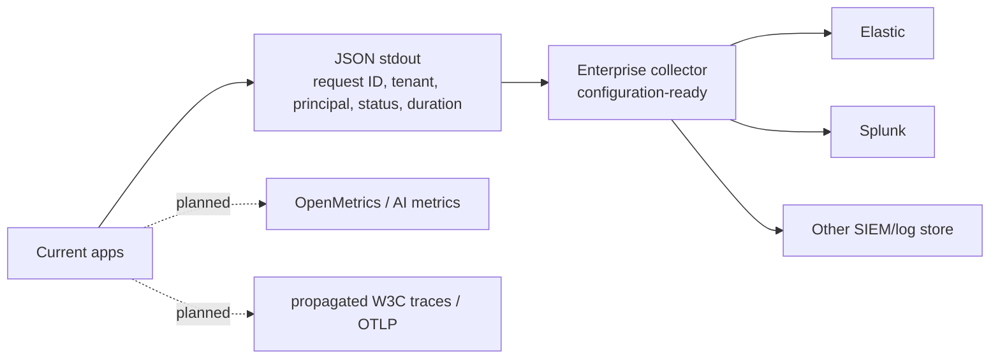
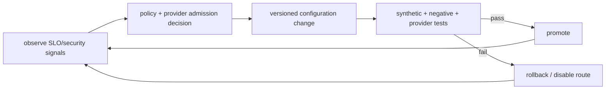

# ViewSense AI® Day-2 Operations and SRE

## Planned TrueForge migration operations

The [migration runbook](02-trueforge-migration-runbook.md) governs baseline/restore inventory,
synthetic runtime qualification, route-specific cutover, drain, safe rollback or route disable,
legacy shutdown and source cleanup. It accompanies the [retained-repository decision](../03-trueforge-adoption-decommission.md).
No operation has been executed by that design. Track the fabric/runtime namespace pair and their
independent artifact/configuration/state owners. Code removal, workload shutdown and persistent-data
disposal are distinct operations with separate evidence. Existing operating procedures below
continue to apply to the current reference until a qualified route is migrated.

## Observability: current and target



The implemented middleware emits one JSON object per request and propagates `X-Request-ID`.
It records an inbound `traceparent` value but the service client does not yet forward it. The
reference does not expose OpenMetrics or native OTLP. Production requires propagated traces,
tenant pseudonymization, route/provider and retry fields, RED/USE plus AI metrics, and a collector.
Prompt, completion, memory, and tool bodies remain excluded from baseline logs.

## Console access profiles

The local console provisions separate Admin, Operations, Sales and SIEM credentials. Operations
has read-only Overview/Certificates/Identity/Channels access; certificate renewal and policy
publication require an appropriately scoped Admin identity. Sales/SIEM use the Channel playground and approved AI destination list; they cannot inspect administrative catalogs.
Credential files and their role/client bindings stay in private local state; restart after an
operator configuration change to invalidate browser sessions. Back up governance data independently
of these development credentials. Console role visibility supplies no CRM execution grant.

### Local POC sign-in and launch credentials

Run the following commands from the `aiops-fabric` implementation checkout. If the local harness
is not running, start it in a terminal and leave that terminal open:

```bash
make console
```

The launcher provisions the private credential files on first start and reuses them on subsequent
starts. Open the console at `http://127.0.0.1:8787/`. In a separate terminal, retrieve only the
credential for the intended POC identity:

| POC identity | Command from the implementation checkout |
|---|---|
| ViewSense Admin | `cat .viewsense/local-ai/console-access-key` |
| Operations | `cat .viewsense/local-ai/console-operations-access-key` |
| Sales | `cat .viewsense/local-ai/console-sales-access-key` |
| SIEM | `cat .viewsense/local-ai/console-siem-access-key` |

1. Sign out if another identity is already signed in.
2. Select the matching **POC identity** on the sign-in page.
3. Paste the command output into **Launch credential**, then sign in.
4. Confirm the role shown in the header and the permitted navigation links. Operations has five
   workspaces; Sales and SIEM have only Input Channels (playground) and Output Channels (AI destinations). ViewSense Admin has
   all workspaces.

A credential for one identity cannot sign in as another. A missing credential file usually means
the harness has not provisioned this checkout; start it and check that the terminal is in the
correct implementation directory. An authentication failure can indicate a mismatched identity
or stale credential; retrieve the matching file again and retry. These are local development
credentials, not enterprise AuthN provider passwords. Keep their output out of shared logs,
screenshots and tickets. Enterprise SSO uses an approved provider mapping instead.

For read-only verification of all four profiles against the running local harness:

```bash
.venv-console/bin/python scripts/test-console-roles.py
```

See the [Channel console operating guide](../../../fabric/governance/channel-console.md) for
the role matrix, policy workflow and the distinction between console visibility and business
capabilities.

## SLOs and dependency budgets

Define SLOs separately for edge/control overhead, memory, each model route, and each MCP class. End-to-end alerts use multi-window error-budget burn. A provider outage must identify the dependency instead of presenting as generic orchestrator failure. Route changes and degraded no-memory operation are visible events.

Optional direct Ollama diagnostics retain bounded model deadlines and safe errors. They are
separate from native TrueForge runtime configuration and the fabric console's capability tests.
Real-provider quality, load and protocol qualification remain acceptance gates.

## Release safety

An explicit manual dispatch can request packaging and a GitHub draft from reviewed `main` source.
Operators enter the version and docs commit in the Run workflow form; no enabled-flag edit is
required. Pushes and merges never request a build. It pins docs, runs validation before building both architectures, verifies clean paired
source/checksums and never moves existing version tags. A failed upload job can reuse its retained
build artifact and add only missing matching draft attachments; publication remains explicit.
Completed versions are skipped. The legacy trigger file is ignored by CI.
Draft discovery uses the authenticated release list and verification uses a release ID. A draft
creation URL followed by a published-tag HTTP 404 can indicate failed verification after successful
upload; inspect the existing draft before retrying. Rerunning an old Actions run uses its original
source, so an uploader correction must be run against the retained artifacts using corrected code.
Repository token/policy configuration and remote-run evidence are prerequisites. This workflow
does not deploy or prove live CNI/model quality; use the
[trigger and recovery guide](../../../releases/installation.md#manually-build-a-release).

The 1.0.1 evaluation distribution supports fresh release-specific namespace installation,
Helm smoke tests, CNI probes and owned namespace delete/recreate. The release-owner scripts
record paired source commits, build checksummed per-architecture downloads and upload a GitHub
Release draft. See the [release guide](../../../releases/installation.md). Parallel blue/green
environments use the [replacement and traffic-switching plan](../../../releases/parallel-environments.md).
An evaluation reset destroys its state; production cutover must reconcile state, workload
trust and sessions, drain requests/work and define a data-safe fallback before old resources retire.

- immutable signed image digests and GitOps promotion;
- contract tests against every configured adapter;
- expand/migrate/contract database changes with rollback compatibility;
- canary by non-sensitive synthetic tenant, then explicit pilot tenants;
- rollback on security regression, error-budget burn, latency, or output-quality gate;
- configuration rollout and application rollout independently reversible.

## Backup and disaster recovery

Each state owner defines RPO/RTO, encryption, retention, legal hold, restore order, and integrity verification. PostgreSQL uses PITR plus regular full backups. Vector records retain enough canonical source/embedding metadata to reindex. MCP catalog backups exclude retrievable secrets. Restore tests run monthly in an isolated environment; regional/cluster failover is exercised quarterly for required tiers.

The selected runtime database is a separate state owner. Restore it through its owner before resuming work; hold all restored
runs paused until version/idempotency reconciliation completes, and never infer that a side effect
must be repeated merely because an event is absent. Mem0 backup/export, Keycloak realm recovery,
SPIRE trust-bundle recovery, OPA bundle rollback, and workflow recovery remain owned by their
selected product operators and must be tested with the ViewSense AI® conformance suite.

## Incident playbooks

- suspected cross-tenant retrieval: stop affected route, preserve audit evidence, revoke identities, assess all provider copies;
- compromised MCP connector: disable catalog entry, block egress, revoke connector credentials, inspect invocation history;
- provider credential leak: revoke at provider, rotate secret source, invalidate pods/tokens, check usage audit;
- token runaway: cancel request/workflow, enforce tenant stop-loss, quarantine route;
- model quality/safety regression: pin previous provider/model policy, preserve evaluation evidence, notify owners.

The retained OpenAI adapter takes an explicitly deployed server-controlled model from its Helm/environment configuration. The old single-namespace provider-switch launchers/default file are removed; hosted real-model enablement remains gated by protocol, identity, PII, budget, evidence and retention acceptance. Rollback uses a qualified profile or disables the affected route; it does not reapply the obsolete base.

## Capacity and cost

Review GPU saturation, batching, KV-cache pressure, database index health, queue depth, connector external quotas, and tenant cost weekly. Enforce per-tenant concurrency, token, memory-storage, and tool budgets. Cost-based routing is evaluated only after capability, security, residency, and SLO constraints.

## Operational readiness gate

### Planned business-channel operations

For the [Sales/CRM channel route](../10-overall/07-input-output-channels.md#failure-deployment-and-operational-requirements),
assign Sales rule ownership, CRM data/query ownership and platform route/connector on-call. Measure
resolution, query, generation and delivery latency separately under one bounded request deadline.
Agree freshness and completeness objectives and cap Oracle scans/concurrency; no numeric production
SLO is claimed by the design. Monitor channel/route/tool revision, denial, timeout, stale source,
schema drift, truncation and delivery failure without SQL or CRM payloads in standard telemetry.

Disable the route on suspected leakage, revoke connector access and preserve safe evidence. Roll
back policy/rule/mapping revisions independently. Back up catalog metadata through governance/MCP
owners, then revalidate admission and bindings before restoring traffic; CRM owns Oracle recovery.
Long scans require cancellable durable operations and current authorisation at delivery. Test
credential rotation, source outage, query cancellation, load limits, evidence completeness and
route disable/rollback before promotion. These operations are planned; no channel controller,
production metrics, reliable evidence export or CRM acceptance ships from this design revision.

### Common readiness requirements

The [role console design](../10-overall/08-channel-consoles-role-mapping.md) adds immutable reviewed
policy revisions and emergency deny epochs. Restore role/mapping/grant metadata with tenant-bound
references, preserve revocations and revalidate IdP entitlements before traffic. Monitor freshness
violations, mapping drift, source/feed outages and failed/denied activations; the first Sales slice
requires the declared 60-second role-assertion bound. External identity changes and framework policy publish
are separate operations; compare effective test identities without logging access tokens.

The [AI egress/cost design](../10-overall/09-enterprise-ai-governance-egress.md) requires inspection,
decision and final adapter enforcement metrics, safe PII/deny counts, budget reservations/usage and
complete evidence correlation. Policy/detector/mandatory audit outage blocks protected dispatch.
Back up the budget ledger through governance; restore pending reservations and reconcile uncertain
calls before resuming traffic. Provider/model rollout requires conformance, quality, PII/residency,
cost and fallback gates. Rollback cannot lower privacy ceilings or erase charges/revocations.
These runtime controls and production evidence remain planned, independently of UI availability.

No production provider is enabled until it has ownership/on-call, dashboard and alerts, SLO, capacity test, failure-mode test, security review, data-flow record, backup/restore where stateful, credential rotation, and rollback/disable instructions.

Provider readiness is represented by an expiring passport plus evaluation/admission records. The
reference governance API evaluates admission, but gateways do not yet consult admission state when
routing and no expiry alert controller is shipped. Production must add that reconciliation/enforcement
loop, alert before expiry, block revoked/expired routes, back up governance state, and export evidence
to an independently administered immutable sink.

Database-owning services use bounded startup retries because Kubernetes readiness ordering does not
guarantee that a newly reachable database is accepting connections. Exhaustion fails startup and is
visible through JSON logs and readiness. Development rollouts restart services sequentially to avoid
an all-service surge on a small cluster; production availability strategy is defined by its overlay,
capacity budget, disruption budget, and tested rollback.

Trust Envelope failures are separated into missing context, unsupported version, tenant inconsistency, delegation denial, expired token, wrong audience, and insufficient scope. They are security signals and must not trigger fallback to an unsigned header or a less-restricted provider.

Product readiness is read from `fabric/product-catalog.json`: `validated` has repository evidence,
`configuration-ready` has an executable ViewSense AI® integration boundary but needs the selected
environment, and `planned` is declaration-only. Render every profile with `make profile-check`.
Never report a profile as installed merely because Helm accepts its values.

## Operational control loop



## TrueForge integration and retained memory operation

Open **TrueForge integration** (`?page=ai`) in the fabric console to inspect the local preview's
version, reachability and configured models/connectors/skills/sandbox/web search. Configure these
in the native TrueForge interface. Refresh the fabric page; it also refreshes every 15 seconds
while visible. An empty inventory is unconfigured; unavailable/denied means observation failed.
Configured does not prove provider health or fabric admission. Never copy provider credentials
into the fabric console. See the [console ownership contract](../10-overall/06-local-ai-console.md).

The standalone preview and secured hosted runtime have different state. Hosted settings remain
not observed; use `make k8s-test` for the fixed secured synthetic route. The earlier model dropdowns,
save-default controls and direct generation/decision test lab are retired. **Fabric capability
tests** retains ingest/store/search/backfill and labels that these do not execute TrueForge agents.

Memory profiles remain owned by the memory provider. After a deliberate operator profile change,
use the bounded owner backfill until `remaining=0`; older vectors are retained. Incomplete profile
coverage returns 409. A TrueForge chat-model change does not migrate knowledge vectors. The
isolated launcher preserves valid PKI/credentials/database state on ordinary restart. Ctrl+C
stops only its processes; pgvector data remains. See the
[detachable API harness contract](../10-overall/06-local-ai-console.md#detachable-local-api-harness).

## SSO and certificate operating model

Operate Keycloak and cert-manager independently. Use pinned upstream releases for the POC and
upgrade after provider/API acceptance tests. IdP configuration is loaded at process start from a
private operator file; roll the edge and optional console together for mappings/issuer changes.
Preserve the development launch mode when SSO is not configured; enabling SSO disables launch-key
authentication. No IdP outage fallback to the development issuer is permitted.

Certificate inventory exposes not-before/not-after, renewal time, readiness, management source
and expiry severity. Periodic structured logs record expiry-state changes and incomplete scans;
an authenticated OpenMetrics endpoint enables external alerting. A renewal response is 202
accepted, not rotation complete: poll the Certificate revision/readiness, then perform a controlled
workload restart and TLS handshake verification. CA trust rotation is a staged overlap process.

The POC deliberately retains static service PKI and adds cert-manager managed canary issuance/
renewal. Production requires an approved CA/issuer, root backup/offline custody, trust-manager or
equivalent trust distribution, workload reload automation, durable audit export and HA IdP storage.
Do not uninstall cert-manager as rollback: its CRDs own resources. Disable harness integration
and leave issued Secrets/Certificates intact while planning migration.

The [SSO/certificate POC guide](../../../deploy/integrations/keycloak.md) documents startup,
separate pod/PVC lifecycle, forwards with pod-rollout reconnection, private operator credentials,
API scopes, integration rollback and production gaps. Expiry warning is seven days, critical is
24 hours and expired is zero. Suite selection generates a plan and does not apply Kubernetes.
The POC source inventories explicitly distinguish local AI and Kubernetes environments.

## Networking operations

Use the [networking guide](../../../deploy/integrations/networking.md) for separate-cluster
startup, provider upgrades, recovery tests and replacement. Networking inspection and plans have
versioned APIs; operator/GitOps deployment owns cluster changes. The GUI cannot run installers.
Read the actual cluster identifier, topology hash, check timestamp and completeness before relying
on evidence. Results expire after ten minutes and never claim continuously monitored health.
The acceptance suite pairs denied paths with successful controls, resolves DNS separately, transfers
real bytes, observes mesh identities on database traffic, tests unavailable services and restarts
a workload/proxy. Failed or interrupted runs publish failed evidence. Production alert routing,
load-based latency budgets, trust rotation, HA and durable telemetry remain separate gates.
Istio owns its workload certificates; the certificate inventory does not yet integrate mesh-issued
ephemeral certificates. Plaintext Cilium metrics are disabled in the provider profile until an
authenticated collector is approved; Hubble relay uses TLS and no public telemetry UI is enabled.

## Release preview lifecycle

A workstation operator can attach the source-checkout GUI to one owned evaluation namespace
using `make release-console`; see the [release guide](../../../releases/installation.md#attach-the-host-side-release-preview-gui).
It starts only loopback port-forwards and a host GUI, retaining existing namespace state and
workload grants. Ctrl+C stops those processes and removes temporary credentials. A namespace
reset requires reattachment. Service health in this GUI is live mTLS reachability through a
Kubernetes debugging path; headless smoke and CNI-negative tests remain independent gates.
The old development namespace and local Ollama harness have separate recovery lifecycles.

## Operating the channel policy pilot

Track governance catalog availability separately from connector admission/health. Draft revision,
active revision and revocation epoch are visible in each workspace. Validate references, freeze
a snapshot, inspect the before/after diff and obtain an independent authorised reviewer before
activation. A conflict requires refreshing/reviewing current state. Emergency disable applies
immediately to subsequent decisions and cannot be undone by publication in this slice.

`channel_policy_state` stores the bounded pilot journal (500 events) and up to 100 immutable
candidates per tenant; the service refuses a new candidate at capacity. Independent archival,
production retention and recovery automation remain promotion work. Include this table in the
governance database backup and restore the catalog, active snapshot, candidates and disabled set
together. Run the local sample acceptance and verify retained revisions after restart. Decision
latency/freshness SLOs and authoritative role-refresh outages require later runtime acceptance.

## Playground operation and recovery

The [Channel operating guide](../../../fabric/governance/channel-console.md#end-user-playground)
contains the user flow, operator-owned model/tenant/role policy, optional Internal AI assessment
and startup instructions. No external destination can be enabled by the current playground policy.
Use a generation-capable installed chat model; TEV sensitivity decisions and EmbeddingGemma
embeddings are separate capabilities. Model/policy changes require a harness restart and new
acceptance; existing launch/workload credentials and database state are retained.

If policy or evidence storage is unavailable, generation stops. Restore the governance database
before retrying. If Internal AI is unavailable, restore its approved runtime/model; never introduce
an automatic external fallback. Back up the operator policy and governance evidence independently
of credentials. This evidence is not an immutable external audit sink. Decision IDs appear in the
user panel and JSON request metadata for correlation; payloads remain excluded from service logs.
