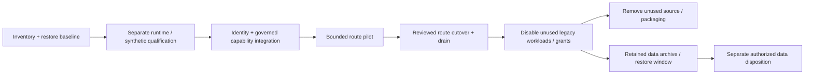

# Agent Runtime Migration Runbook

## Status and ownership

This is the general operating procedure for the [adoption/decommission plan](../03-trueforge-adoption-decommission.md)
and [namespace design](../20-deployment/03-trueforge-namespace-integration.md). The separately
[authorized clean-state rebuild](03-clean-state-rebuild.md) has executable deployment and
qualification commands and supersedes backup/preservation requirements only for the named
old development/evaluation namespaces. Future production migrations still require these gates.

The platform operator owns context/namespace/release changes; application owners own public contracts and client migration; governance/security owners own policy/identity/egress; data owners own memory/CRM/archive retention; the repository owner performs manual Git publication. A single person may hold several roles in development, but independent policy review rules remain in effect.

## Lifecycle



## Before implementation or deployment

Create an operation record in the chosen controlled evidence system containing source commits, artifact digests, contract versions, namespace names/UIDs, context, customer/environment, active policy revision/deny epoch and accountable owners. Use runtime-generated observation times rather than fixed example timestamps.

Inventory the exact clients of `/v1/responses`, `/v1/agent-runs`, memory and tools: console, headless applications, smoke jobs, schedules, scripts, release bundles and any external integration. Record payload/remember/owner semantics, error handling, idempotency, retention and deprecation requirements. An unused-looking source package is not evidence of no external callers.

Record all state owners and backup/restore paths: governance snapshots/reviews/disables, registry, memory/embedding profiles, legacy agent runs/events, private configuration/identity bindings and future runtime sessions/turns. Export through owner-approved APIs/tools; application peers must not join or copy live databases directly. Verify restore into isolated storage without changing the running environment or promoting development credentials.

## Bring up the namespace pair

The new profile adds `trueforge-dev` beside existing `viewsense-dev`, with independently owned releases. No CNI swap, implicit cluster-context switch, namespace reset, existing Secret rotation or legacy service uninstall is included. The runtime uses fresh PostgreSQL/Redis state and identities; it does not import the legacy agent database schema.

Install default deny and trust before workloads, then qualify DNS/Service/pod-IP paths and exact workload authorization. Record both a known-allowed control and each denied attempt; unavailable DNS, wrong certificates or absent listeners must be distinguishable from an enforced network denial. Check unknown pods within each namespace and an unrelated namespace/cell, not only cross-namespace access.

Keep the runtime controller disabled. Qualify identity delegation, model/MCP server protocols and no-retention storage separately. A healthy runtime/SQL/Redis stack does not satisfy business execution gates.

## Pilot and cutover

| Step | Required condition | Operator action / recorded result |
|---|---|---|
| P1 synthetic qualification | M01–M04 pass for selected features | Exercise synthetic prompts/facts and controlled receivers; record zero unauthorized dispatch, no-retention and failure evidence |
| P2 business scope | Data/Sales owners approve canonical facts, read-only rules and account scope | Enable one reviewed local route, without CRM writes/outreach or broad export |
| P3 route preparation | Current grants/admission, authoritative entitlement freshness and delivery rules pass | Pin route/backend/config revision and feature ceiling; set request/token/tool/concurrency budgets |
| P4 in-flight inventory | Every active conversation/run has an owner and backend | Drain old work; retain backend binding for existing IDs; refuse unsafe cross-runtime resume |
| P5 cutover | Compatibility, evidence, SLO and rollback/disable gates pass | Change the server-owned route revision for new work atomically; clients cannot choose a legacy bypass |
| P6 observation | Declared representative workload/failure scenarios completed | Check safe errors, latency, resource/storage growth, usage/reservations, deny/evidence completeness and support impact |
| P7 legacy eligibility | Every consumer of the candidate component migrated/deprecated | Mark D-register row eligible for shutdown, with owner and evidence references |

Do not create a second backend call after an upstream timeout unless idempotency/reconciliation proves it is safe. Lost responses and interrupted streams are uncertain operations, not evidence that nothing executed. No real prompt is automatically shadowed into both runtimes. Cancellation aborts future work and attempts in-flight cancellation; it cannot reverse an already performed business action or charge.

## Failure and rollback decisions

| Failure | Required behavior |
|---|---|
| Runtime unavailable before creation | Safe bounded error/operation outcome; no silent legacy or external-model fallback |
| Creation response lost | Reconcile durable idempotency mapping and upstream resource before retry; never start a second independent run blindly |
| Stream disconnect | Reauthorize subscription and resume from supported cursor/state; do not infer safe replay of tool side effects |
| Policy/admission/entitlement/mandatory inspection unavailable | Block new dispatch; preserve safe denial/failure evidence and existing revocation state |
| Budget service or mandatory evidence unavailable | Block new protected dispatch; retain pending reservations/outcomes for reconciliation |
| Membership/route/provider revoked during pause | Recheck on resume, next call and delivery; deny remaining work even if an older snapshot allowed it |
| Storage retention cannot be guaranteed | Disable the affected route; do not persist sensitive payloads as a troubleshooting workaround |
| Redis/database failure | Use the qualified recovery contract; preserve uncertainty; verify run status, subscriptions and controller behavior after restoration |
| Runtime upgrade regression | Roll back only to a tested implementation/config compatible with current schemas and security policy; otherwise disable route |
| Legacy data restoration needed | Restore owner-approved archive into isolated compatible storage; do not reconnect a retired permissive endpoint to new traffic |

The existing orchestrator is not a safe fallback for new business-channel routes because it lacks the complete new policy chain. Retain old code/state for recoverability without automatically routing new protected requests through it. Rollback restores application/configuration versions where compatible; database downgrade requires separate rehearsed migration support. Monotonic emergency denies cannot be reverted by restoring an old policy snapshot.

## Shutdown checklist for each component

Use the D-register in the adoption plan. Each component requires its own completed record; a successful Sales route does not authorize removal of every legacy response or agent consumer.

1. Confirm all clients and scheduled jobs migrated or reached their published deprecation gate; prove no active or resumable work depends on the component.
2. Freeze old writes and new starts using server-owned controls. Drain under a bounded deadline, record terminal/uncertain operations and preserve an authorized read/export path where required.
3. Verify archive integrity and isolated restore, retention/legal hold and rollback limitations. Capture configuration and owned-schema versions without secrets/payloads in ordinary logs.
4. Disable the workload/release module. Revoke its unused tokens/clients, workload/database credentials and allow rules; remove exposure and monitoring targets that falsely imply it is serving.
5. Update catalog maturity, health/status, GUI links and runbooks to show the actual replacement. An archived run remains identifiable as legacy, not fabricated as a TrueForge turn.
6. Remove source only after dependency/build/release checks pass. Remove corresponding imports, environment variables, image/module selections, deployment resources, ports, probes, service accounts, grants, scripts, smoke targets and obsolete source-structure tests together.
7. Keep approved data/backups/archives through their retention window. PVC, namespace, backup or archive deletion requires its own data-disposition decision; a code-cleanup task does not imply that approval.

Never remove the shared registry, governance or memory store under the legacy agent/orchestrator shutdown. Never use namespace deletion to remove one retired service when retained services share that namespace. Helm pruning must be reviewed for StatefulSet/PVC/Secret side effects before applying the cleanup.

## Release, observability and recovery acceptance

Each migrated distribution records both independently pinned releases, images and the fabric adapter/configuration digest; runtime SDK/UI compatibility; topology/trust fingerprints; contract/policy revisions; required certificates/Secret names; and owner-specific backup versions. Include both namespace inventories in offline packaging. Do not mutate published historical release snapshots to describe the new topology.

Monitor metadata-only request/trace/run/turn correlation, policy/admission denies, budgets and uncertain charges, tool outcomes, token use, active/draining work, stream reconnects, storage growth, evidence export backlog, identity expiry, database/Redis health and controller liveness when enabled. Set SLOs and alert ownership from representative measurements. Raw prompts, tool payloads and customer facts remain excluded from baseline logs, dashboards and evidence.

Live acceptance covers allowed/denied cross-namespace paths; spoofed identity and cross-user history; forged/expired/payload-modified delegation; compaction and child-call policy coverage; tool/schema changes; concurrency/budget/evidence failure; row/field/cursor restrictions; no-retention artifacts/backups; membership change before delivery; server/controller loss; restore; and rolling upgrade/drain. A chart render cannot prove these outcomes.

Before marking source removal complete, run implementation unit/lint, baseline and migration-profile rendering, package/offline asset checks, strict docs build, deployed smoke and positive/negative security tests on the selected enforcing CNI/mesh. Record actual command results and environment limitations in conformance. Migrate behavior-oriented tests to the replacement before retiring legacy assertions.

## Completion record

```text
Component / D-register reference: <component>
Source / artifact / contract baseline: <references>
Affected callers migrated: <inventory and evidence>
Active legacy work: <count and reconciliation>
Replacement acceptance: <contract/security/operations evidence>
State owner / archive / restore / retention: <references>
Workload / credentials / flows disabled: <resources and evidence>
Source / packaging cleanup: <changed areas>
Rollback or route-disable behavior: <qualified procedure>
Data disposal: <separate decision or retained>
Design Sync Report: <paired-change handoff and actual validation>
```
