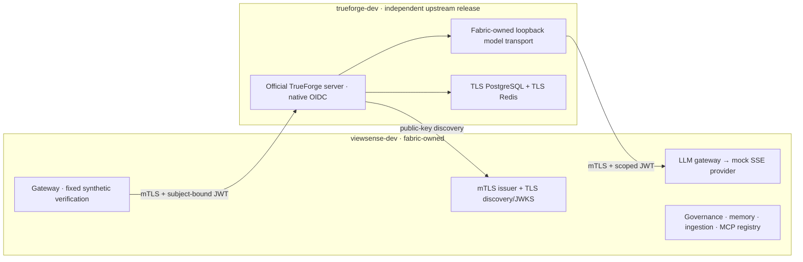

# Clean-State Fabric and Runtime Rebuild

## Authorization and disposition

The owner chose to retain `aiops-fabric`, discard the separate `keepview_harness` proposal,
decommission overlapping legacy execution and start with empty development application state.
The final instruction explicitly waived backups. The operation therefore made **no backups**
and provides no restore path for the discarded data. This is an environment-specific exception
to the general migration runbook, not a production data-disposal policy.

| Previous namespace | Action | Replacement |
|---|---|---|
| `viewsense-dev` | Deleted with original UID precondition, including disposable stores and identities | Fresh `viewsense-dev` for retained fabric |
| `viewsense-release-1-0-1-blue` | Deleted with original UID precondition | No replacement evaluation slot |
| `viewsense-release-1-0-1-green` | Deleted with original UID precondition | No replacement evaluation slot |

The selected context is `k3d-cks`. Unrelated namespaces, cluster controllers, cert-manager and
other applications are outside the reset. The private local operation receipt records original
namespace UIDs and data disposition in ignored `.viewsense/rebuild/decommission.json`.
Do not rerun namespace deletion as part of ordinary deployment.

## Retired implementation

Removed the legacy `viewsense_orchestrator` and manual `viewsense_agent_runtime` packages,
the manual-run schema, `agent-db`, and associated workload/service-account/manifests, credentials,
grants, flow edges, Compose services and Helm/catalog entries. Updated launchers, release service
inventories, console descriptions and tests to remove running-service claims for these components.

Authenticated `POST /v1/responses` now returns HTTP **410 Gone**. The old agent-run service is
absent. Callers receive an explicit breaking-contract retirement; TrueForge sessions are not
presented as compatible manual checkpoints. Published historical release bundles and documentation
remain historical artifacts and are not edited in place.

Identity, governance/channel policy, memory/embedding, ingestion, LLM and MCP adapters,
certificates, console and deterministic test providers remain fabric capabilities. They are not
removed merely because upstream offers similarly named features. Existing local SSO/Ollama and
control-plane capabilities do not imply production runtime qualification.

## Running architecture and strict upstream boundary

**Never customize TrueForge.** Its source, generated files, internals and chart templates remain
untouched. No fork, patch, monkey-patch, copied internals or customized upstream image is allowed.
All adaptations live in `aiops-fabric`, using supported external APIs, SDKs and documented values.
An unsupported requirement keeps its affected feature disabled. The reusable
[guardrail prompt](../../../prompts/governance/design-sync-guardrail.prompt.md) and both repositories'
agent instructions enforce this condition for future work.



Official chart: `0.3.0`. Official image tag: `0.3.0-ebbf6c0`, pinned to
`sha256:1f48226676dda332140ab9bdbf60f3e8a0a8dd52bfd89a416121a806e6f682a9`.
The assessed checkout commit is a separate source baseline; it is not claimed to be the build
commit of this image. No TrueForge checkout changes were made. The development host runs the
official amd64 image through its existing emulation support; native multi-architecture release
qualification remains required before broader rollout.

The controller stays disabled. Fabric supplies stock OIDC discovery/JWKS and short-lived tokens;
gateway subjects are issuer-qualified, while a separate temporary bootstrap identity configures
the model provider through the supported settings API. Runtime OIDC's internal `default` tenant
means this profile is one fixed synthetic tenant per namespace pair, not a shared multi-customer
runtime. No unsigned user/role header controls runtime authority.

The fabric model transport is a separate loopback-only sidecar added through the chart's supported
`extraContainers`/volume settings. It holds an internal transport key and a fabric workload
credential, accepts the fixed fixture only and calls the LLM gateway with mTLS/scoped JWT. The
pinned runtime advertises a built-in local clock tool; the bridge recognizes only that definition
and strips all tool definitions before the deterministic mock call. Unexpected tools fail closed.
Text parts are normalized and all outgoing prompt/model fields are reconstructed from constants;
other runtime message content is never forwarded. The gateway observes the existing turn until
completion, without retrying turn creation. No
vendor credential or private CA/signing root is installed in TrueForge. Local development PKI
and signing material remain private generated state and are unsuitable for production.

## Reproducible development workflow

From the implementation checkout, use the existing development Python environment with
`requirements-dev.txt` installed, Docker, Helm, kubectl and k3d:

```bash
make k8s-deploy
make k8s-test
```

The deployment checks the selected context, renders private resources and supported upstream
values, builds only the fabric image, imports development images, installs default deny before
workloads and applies the independent official Helm release. Generated credentials/manifests are
ignored under `.viewsense/rebuild` with restrictive local permissions. Never publish this directory.
The script does not delete namespaces or migrate existing data.

Topology v2 identifies endpoints by namespace/workload and records the expected service account.
Generated CNI rules intersect namespace and pod selectors in the same peer, restrict DNS to
cluster DNS and permit explicit directed ports. Service-account metadata does not itself enforce
CNI identity; application mTLS/JWT and separate least-privilege Kubernetes identities remain
required. API token automounts are disabled. Mesh-v2 generation is future work.

Qualification creates a temporary restricted smoke pod and temporary bootstrap Secret, runs
retained fabric smoke and the fixed upstream session/turn, then removes both temporary resources.
It checks runtime JWT/mTLS enforcement, caller-payload rejection and private database denials.
The policy test also checks permitted and denied paths between live fabric services. Relabeling
the qualification pod as untrusted checks denial to the same identity/runtime listeners that
just passed positive controls; runtime owner isolation is checked with a different subject. A failed
check must be investigated; a healthy pod or rendered manifest is insufficient evidence.

## Enabled scope and remaining work

`POST /v1/runtime-check` requires `runtime.verify`, accepts only `{}`, creates a fixed synthetic
session and executes one mock model turn. The response identifies synthetic execution and
`business_execution: false`. Ordinary durable runtime storage is acceptable for this explicit
fixture; sensitive user/business content remains disabled. There is no legacy fallback.

Before customer execution, complete production AuthN/entitlement and per-call delegation,
native governed MCP transport, supported real model/tool protocol tests, fresh deterministic
authorization/admission, PII wire inspection, hard budget reservation, durable safe evidence,
idempotent creation/reconciliation, no-retention storage/deletion, authorized delivery, cancellation,
reconnect/drain/recovery and upgrade tests. Disable child agents, compaction, sandbox, web search,
shared sessions and unattended schedules until separately qualified.

Development has single replicas, short-lived static certificates and local-path storage. HA,
managed secret/certificate rotation and reload, backup/restore for newly created state, quotas,
SLOs, telemetry and paired offline release packaging remain production work. Upstream startup
errors may include connection URLs; production collection must redact credentials before export
and must be qualified without modifying upstream. Historical mesh and release-evaluation tools
do not certify the new namespace pair.

Validation results belong in the coordinated Design Sync Report and implementation conformance;
business-readiness claims must not be inferred from synthetic success.

## Open the native TrueForge GUI

The canonical [Open TrueForge guide](../../../deploy/trueforge-access.md) owns all access,
prerequisite, start/status/stop and troubleshooting instructions. `make trueforge-ui` opens the
native GUI at `http://localhost:8791` using the official unmodified standalone image and temporary
separate data. Hosted port 8790 remains mTLS/OIDC protected; integrated browser login is planned.

This operation's preview validation confirmed the native Settings → Models screen, health version
`0.3.0`, official image digest, non-root/read-only container and localhost-only publication.
No real model or fabric credentials were imported. See the
[cleanup record](04-cleanup-record.md) for subsequent removal of obsolete launchers and walkthroughs.

## Verified development evidence

The completed development workflow passed `make k8s-deploy` and `make k8s-test` on `k3d-cks`.
All eleven retained fabric Deployments, three fabric databases, the official runtime Deployment
(two containers) and its PostgreSQL/Redis stores are ready. The controller is absent. The two
old blue/green namespaces, agent PVCs and legacy workload/service-account/grant references are
absent; the final audit found no remaining ViewSense/TrueForge cluster-scoped RBAC objects or
PV claim references to retired environments. Unrelated namespace/PV owners remain intact.

Acceptance passed retained ingestion/memory/MCP/governance smoke, the fixed upstream model turn,
native OIDC invalid-token denial, missing-client-certificate denial, caller-body rejection and
unshared cross-subject session denial. Smoke cannot reach either fabric governance storage or
runtime PostgreSQL. Relabeling that same pod as untrusted denies its previously reachable
identity and runtime listeners. Fabric CNI probes allow gateway → governance, ingestion → identity
and ingestion → memory, while denying governance → ingestion, gateway → ingestion and
ingestion → MCP. Temporary qualification pod and bootstrap Secret are removed after testing.

All **231 unit/design/catalog/security tests**, containerized lint (including the new runtime
scripts), base Kustomize rendering, every Helm profile render/lint, JavaScript syntax and Git
whitespace checks passed. Strict publication builds passed for `latest`, `v1.0.2` and `v1.0.1`.
The stale local Zensical launcher shebang was bypassed using the existing environment interpreter;
no dependency launcher or historical release snapshot was modified. TrueForge's working tree is
clean. No staging, commit or push was performed.

```text
Design Sync Report
- Change Classification: major
- Design Docs Updated: conformance, adoption/decommission, namespace/deployment/network/security,
  architecture/components, roadmap/agentic, module guides, clean-state record and guardrail prompt
- Code Areas Updated: gateway/runtime bridge, development identity/discovery, mock SSE/LLM transport,
  topology schema/generator, deployment/qualification, packaging/catalog/console references and tests
- Architecture Delta: independent unmodified upstream runtime; all adaptation in aiops-fabric;
  authorized no-backup development reset and explicit legacy API retirement
- Tests/Evidence: 231 tests; lint; Helm profiles/Kustomize; strict three-version docs build;
  live fixed turn, authentication/subject isolation, database/untrusted-pod and CNI denial probes
- Known Production Gaps: business policy/PII/budget/evidence/retention, native MCP and real model
  protocols, idempotent creation/recovery, production identity/rotation, HA/restore/mesh-v2/offline packaging
- Sync Status: PASS for documented development scope; customer/production execution remains disabled
```
