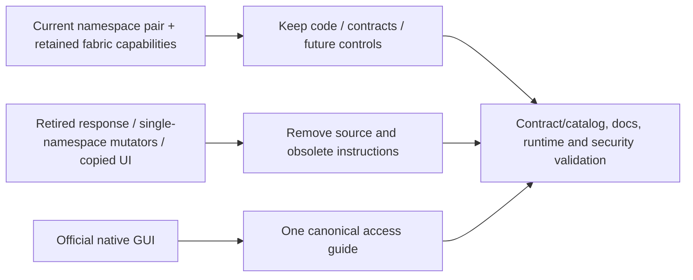

# TrueForge Access and Legacy Cleanup Record

## Scope and ownership

This major coordinated cleanup follows the owner's request to document TrueForge access and
remove unused implementation/documentation. It keeps `aiops-fabric` as the customization tier,
preserves the future enterprise designs, and leaves TrueForge strictly unmodified. No additional
namespace, PVC, local business data, provider credentials or published Git tag is deleted here.
The earlier authorized no-backup development reset remains a separate operation record.



## Canonical access instructions

[Agent runtime access](../../../deploy/trueforge-access.md) owns prerequisites, commands, ports, temporary
data lifetime and troubleshooting. Home, quick start, technical/module guides and deployment/ops
entry points link there. Navigation exposes it under Get started. The operation record retains
the original preview validation rather than another full copy of instructions.

The native GUI is the official standalone image at `http://localhost:8791`, started with
`make trueforge-ui`. It is separate temporary state. The hosted runtime remains mTLS/OIDC
protected in `trueforge-dev`; integrated browser identity remains unimplemented. No documentation
should promise that a plain 8790 port-forward gives a working hosted browser login.

## Removed implementation and assets

| Removed area | Reason | Retained boundary / replacement |
|---|---|---|
| Console `POST /api/tests/response`, forwarding allow-list and response test controls | Called the retired `/v1/responses` route and displayed a dead execution path | Console ingestion/memory/search; hosted fixed-turn acceptance; native upstream GUI |
| Single-namespace OpenAI enable/update/disable scripts and their model-reader helper | Reapplied the old base/overlay or switched a route outside the qualified namespace-pair profile | Credential-owning OpenAI adapter, protocol/security tests and optional fabric Helm profile |
| Development OpenAI Kustomize overlay and duplicated `config/models.env` | Only consumed by those removed mutators/default synchronization test | Explicit server-controlled model in retained adapter/profile configuration |
| Copied-default synchronization test and Docker test-image config copy | Tested/packaged the removed duplicate default file | Runtime adapter missing-model and protocol/credential security tests remain |
| Single-namespace CNI/mesh bootstrap, apply and test scripts plus `networking-*` Make targets | Targeted the older POC and could not represent or safely qualify the current namespace pair | Topology-v2 schema/generator and live CNI probes; v1 management/mesh planner retained separately |
| Generated `artifacts/status-preview/index.html` | Copied executable console UI included retired manual-agent claims; no maintained generator/caller | Live fabric console and native official GUI |
| Synthetic status screenshot gallery, historical release-preview screenshots and one unreferenced channel-heading image | Demonstrated stale execution/component layouts and duplicated current guidance | Current operating/test guides; retained live management/channel evidence still referenced by active guides |

Compiled bytecode directories for the previously retired orchestrator/manual-kernel packages are also removed.
Catalog source paths/readiness and documentation navigation are updated with removals. No deleted
installer is silently redirected to a broader mutation. The current test suite verifies the removed
console endpoint is absent and cannot forward a request. The public gateway's authenticated HTTP
410 retirement marker remains for clear contract failure; the old manual-run API is not revived.

## Removed or replaced documentation

The accumulated conformance journal is replaced by a current topology, maturity table, route
inventory and production-gap map. Historical test counts and POC walkthroughs remain in Git and
published release snapshots. Current quick start/test/technical guides remove retired response and
manual-agent curl recipes, obsolete certificate paths, old four-database claims, deleted installers
and misleading GUI instructions. Runtime/component/agentic/API designs describe the actual external
runtime boundary and preserve future guardrails without advertising removed manual checkpoints.

## Retained capabilities and future principles

Retain identity/AuthN/AuthZ, workload trust, governance/channel review/deny epochs, provider admission,
safe evidence, memory/embedding profiles, ingestion, credential adapters, native-MCP design,
certificates, optional local AI/SSO/control-plane console, provider-neutral networking contracts,
release/offline packaging foundations and future workflow/sovereign-cell designs. They supply
enterprise responsibilities that TrueForge does not replace. Retained optional POC assets and
profiles require their own qualification; they are not implicitly active in the namespace pair.

The native GUI preview receives no fabric credentials and shares no hosted data. No upstream
source, generated assets, chart templates, runtime hooks or images are customized. Unsupported
business/production requirements keep their affected features disabled until solved in fabric
through supported boundaries. See the [adoption gates](../03-trueforge-adoption-decommission.md)
and [enterprise controls](../60-enterprise/01-enterprise-integration-controls.md).

## Validation and handoff

Run required unit/lint, catalog/profile/Kustomize, strict documentation/link checks and live hosted
smoke/security acceptance for the coordinated change. Verify the native GUI launcher still reports
the same localhost-only official image and the upstream checkout remains clean. Record actual
results in the final Design Sync Report. Leave all edits unstaged/uncommitted for the repository
owner; no Git history or published release snapshots are rewritten by this cleanup.

## Approved worker recovery and verified results

The cleaned image deployment completed. The first live regression run passed the fixed turn,
JWT/mTLS/subject checks and other denials, but unexpectedly allowed ingestion → MCP. Inspection
showed the worker's `KUBE-ROUTER-FORWARD` chain was empty and pod firewall hooks were missing.
Both Service and direct same-node pod-IP access reproduced the bypass; declared policies were
correct. This was a cluster enforcement failure, not evidence that the unwanted edge was allowed.

Because the shared worker also hosts cert-manager, Elastic, n8n and other applications, the owner
explicitly approved restarting only `k3d-cks-worker-0`. After restart, the worker had pod-policy
hooks, both nodes were Ready and all **24 nonterminal worker pods** were Ready. No namespace,
PVC, data or unrelated provider configuration was deleted. The standalone GUI stayed running.
The full integration suite then passed, including same-node ingestion → MCP denial. The original
failure remains part of this evidence; a controller restart is operational recovery, not a source
fix or proof of production-wide CNI reliability. Per-node enforcement monitoring remains required.

Validation passed **230 unit/design/catalog/security tests**, containerized lint, every Helm
profile, base Kustomize, JavaScript syntax, Git whitespace checks and strict documentation builds
for `latest`, `v1.0.2` and `v1.0.1`. One redundant default-file test was removed with its unused
configuration file. Retained adapter/security tests remain. Link and fenced-Make-target audits
found no missing relative targets or removed commands presented as executable instructions.
Normal `make docs-build` and the release-publication regression test also pass. The ignored local
Zensical CLI launcher had a shebang for the checkout's old location; it was repaired to the current
virtual-environment interpreter, without changing the maintained publishing toolchain. The current
native preview reports its running localhost URL; TrueForge's checkout remains clean.

```text
Design Sync Report
- Change Classification: major
- Design Docs Updated: canonical TrueForge access, quick start/technical/test guides, current
  conformance and runtime/component/API/agentic designs, networking/operations, catalogs,
  release/current artifact guidance, publishing and cleanup record
- Code Areas Updated: removed obsolete console response path, seven legacy installer/helpers,
  provider overlay/default, copied UI, old Make targets and obsolete packaging/test references;
  networking/catalog metadata aligned; native preview launcher retained
- Architecture Delta: one access guide; current external unmodified-runtime boundary;
  retained enterprise capabilities and future controls; incompatible single-namespace mutators retired
- Tests/Evidence: 230 tests; lint; Helm/Kustomize/JS; strict three-version docs build;
  link/command audit; approved worker recovery; complete hosted/security regressions passed
- Known Production Gaps: integrated browser identity, governed real models/native MCP, business
  PII/budget/evidence/retention/recovery and per-node CNI monitoring; preview is separate temporary data
- Sync Status: PASS for documented development/cleanup scope
```

## TrueForge management ownership cleanup

The fabric AI page now presents the connected native preview and safe read-only inventory from
supported TrueForge settings APIs. Models/providers, connectors, skills and runtime behavior are
configured in TrueForge. The duplicated model selectors, configuration saves, direct chat/decision/
embedding previews and console RAG workflow are removed, together with their browser proxy routes.
The browser console's direct Ollama grant is removed on local bootstrap. The independent API client,
memory embedding contract, controlled-egress adapters and separately scoped channel pilot remain.
The console code change did not delete provider configuration or stored vectors. The separately
approved temporary preview reset below discarded the preview's independent state.

Fabric capability tests are explicitly memory/ingestion tests, not runtime execution. Upstream
configuration changes/removals appear on refresh; failures clear the inventory. Preview observation
is fixed-loopback development-only and Admin-only, with minimized fields and no credentials or
upstream bodies exposed. The hosted runtime remains separately not observed. Hosted interactive
identity and administrative observation are pending, with all customization confined to fabric.

Validation of this management change passed 239 repository tests, lint, JavaScript syntax, base
Kustomize, strict three-version docs builds and release-publishing regression. Live four-role
console admission passed. A uniquely named synthetic provider created through the pinned native
settings API appeared in fabric as minimized provider/model metadata. No inference was invoked.
The pinned 0.3.0 API has no provider-delete route. The owner explicitly approved resetting only
the temporary preview to remove the synthetic provider. The ownership-checking launcher removed
the labelled preview container/network and recreated them using the same pinned official image.
Health passed; model providers, connectors, skills, sessions and agents were empty. Sandbox and
web-search settings returned their unconfigured 404 responses. Fabric read-back reported reachable
with every configuration collection empty. The localhost-only binding and non-root/read-only
runtime were verified. Kubernetes resources and fabric stores were untouched; no upstream source,
chart, image customization or database editing was used.

The first namespace-pair redeploy timed out because both nodes had disk-pressure scheduling
taints. Pressure cleared automatically and all fabric deployments recovered, without operator
image/data cleanup or node restarts. A fresh deploy and full hosted synthetic/auth/isolation/CNI
suite then passed. The optional local memory smoke failed safely because its independent Ollama
embedding dependency was not listening on 11434; process health alone did not certify that route.
This failure is not a TrueForge inventory failure and no mock/silent fallback was substituted.

### Design impact and paired handoff

| Implementation area | Canonical design section |
|---|---|
| Console TrueForge reader and safe metadata projection | Management console: implemented read-only integration; conformance route inventory |
| Removed model editor/test facades and retained capability lab | Management ownership/GUI workflow; overall system boundaries |
| Local launcher and reduced browser model grant | Detachable harness and security boundary; Day-2 operation |
| Source, role, live runtime and documentation evidence | Test guide; this cleanup record |

Working-tree handoff baselines are implementation `e36e183` and documentation `580b4dc`.
Edits remain unstaged/uncommitted for the owner's manual paired commits. No upstream TrueForge
source, image or chart template was changed. The isolated QA console was stopped after matching
its exact process, working directory and listening port; the actual management console is running
with the final code. The independent preview was reset under the owner's explicit approval and
verified healthy with empty configuration, sessions and agents.

```text
Design Sync Report
- Change Classification: major
- Design Docs Updated: management ownership, conformance, overall architecture, current status,
  operations/cleanup, enterprise controls, GUI access, quick start, validation and navigation
- Code Areas Updated: console read-only TrueForge adapter, UI/routes, launcher browser grant,
  retained capability tests and role/security regression helpers
- Architecture Delta: runtime configuration belongs to unmodified TrueForge; fabric reads
  minimized live preview metadata instead of maintaining another runtime model editor/test loop
- Tests/Evidence: 239 tests; lint/JS/Kustomize; strict three-version docs and publication regression;
  live read-back and four-role admission; recovered deploy and hosted synthetic/auth/isolation/CNI pass
- Known Production Gaps: hosted management/browser identity, governed real-model/native MCP
  execution and enterprise acceptance; optional local embedding smoke blocked by offline Ollama
- Sync Status: PASS for the implemented development scope; approved preview cleanup complete
```
