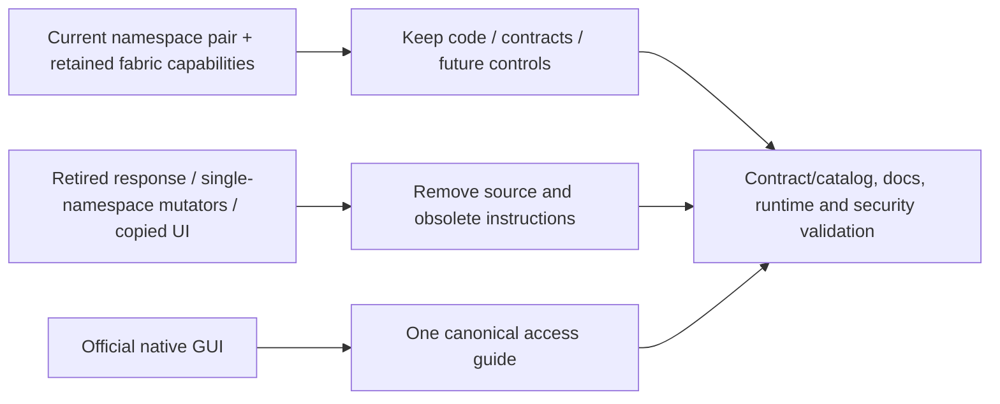

# TrueForge Access and Legacy Cleanup Record

## Scope and ownership

This major coordinated cleanup follows the owner's request to document TrueForge access and
remove unused implementation/documentation. It keeps `aiops-fabric` as the customization tier,
preserves the future enterprise designs, and leaves TrueForge strictly unmodified. No additional
namespace, PVC, local business data, provider credentials or published Git tag is deleted here.
The earlier authorized no-backup development reset remains a separate operation record.

## Canonical access instructions

[Open TrueForge](../../../deploy/trueforge-access.md) owns prerequisites, commands, ports, temporary
data lifetime and troubleshooting. Home, quick start, technical/module guides and deployment/ops
entry points link there. Navigation exposes it under Get started. The operation record retains
the original preview validation rather than another full copy of instructions.

The native GUI is the official standalone image at `http://localhost:8791`, started with
`make trueforge-ui`. It is separate temporary state. The hosted runtime remains mTLS/OIDC
protected in `trueforge-dev`; integrated browser identity remains unimplemented. No documentation
should promise that a plain 8790 port-forward gives a working hosted browser login.

## Removed implementation and assets

| Removed area | Reason | Retained boundary / replacement |
|---|---|---|
| Console `POST /api/tests/response`, forwarding allow-list and response test controls | Called the retired `/v1/responses` route and displayed a dead execution path | Console ingestion/memory/search; hosted fixed-turn acceptance; native upstream GUI |
| Single-namespace OpenAI enable/update/disable scripts and their model-reader helper | Reapplied the old base/overlay or switched a route outside the qualified namespace-pair profile | Credential-owning OpenAI adapter, protocol/security tests and optional fabric Helm profile |
| Development OpenAI Kustomize overlay and duplicated `config/models.env` | Only consumed by those removed mutators/default synchronization test | Explicit server-controlled model in retained adapter/profile configuration |
| Copied-default synchronization test and Docker test-image config copy | Tested/packaged the removed duplicate default file | Runtime adapter missing-model and protocol/credential security tests remain |
| Single-namespace CNI/mesh bootstrap, apply and test scripts plus `networking-*` Make targets | Targeted the older POC and could not represent or safely qualify the current namespace pair | Topology-v2 schema/generator and live CNI probes; v1 management/mesh planner retained separately |
| Generated `artifacts/status-preview/index.html` | Copied executable console UI included retired manual-agent claims; no maintained generator/caller | Live fabric console and native official GUI |
| Synthetic status screenshot gallery, historical release-preview screenshots and one unreferenced channel-heading image | Demonstrated stale execution/component layouts and duplicated current guidance | Current operating/test guides; retained live management/channel evidence still referenced by active guides |

Compiled bytecode directories for the previously retired orchestrator/manual-kernel packages are also removed.
Catalog source paths/readiness and documentation navigation are updated with removals. No deleted
installer is silently redirected to a broader mutation. The current test suite verifies the removed
console endpoint is absent and cannot forward a request. The public gateway's authenticated HTTP
410 retirement marker remains for clear contract failure; the old manual-run API is not revived.

## Removed or replaced documentation

The accumulated conformance journal is replaced by a current topology, maturity table, route
inventory and production-gap map. Historical test counts and POC walkthroughs remain in Git and
published release snapshots. Current quick start/test/technical guides remove retired response and
manual-agent curl recipes, obsolete certificate paths, old four-database claims, deleted installers
and misleading GUI instructions. Runtime/component/agentic/API designs describe the actual external
runtime boundary and preserve future guardrails without advertising removed manual checkpoints.

## Retained capabilities and future principles

Retain identity/AuthN/AuthZ, workload trust, governance/channel review/deny epochs, provider admission,
safe evidence, memory/embedding profiles, ingestion, credential adapters, native-MCP design,
certificates, optional local AI/SSO/control-plane console, provider-neutral networking contracts,
release/offline packaging foundations and future workflow/sovereign-cell designs. They supply
enterprise responsibilities that TrueForge does not replace. Retained optional POC assets and
profiles require their own qualification; they are not implicitly active in the namespace pair.

The native GUI preview receives no fabric credentials and shares no hosted data. No upstream
source, generated assets, chart templates, runtime hooks or images are customized. Unsupported
business/production requirements keep their affected features disabled until solved in fabric
through supported boundaries. See the [adoption gates](../03-trueforge-adoption-decommission.md)
and [enterprise controls](../60-enterprise/01-enterprise-integration-controls.md).

## Validation and handoff

Run required unit/lint, catalog/profile/Kustomize, strict documentation/link checks and live hosted
smoke/security acceptance for the coordinated change. Verify the native GUI launcher still reports
the same localhost-only official image and the upstream checkout remains clean. Record actual
results in the final Design Sync Report. Leave all edits unstaged/uncommitted for the repository
owner; no Git history or published release snapshots are rewritten by this cleanup.
