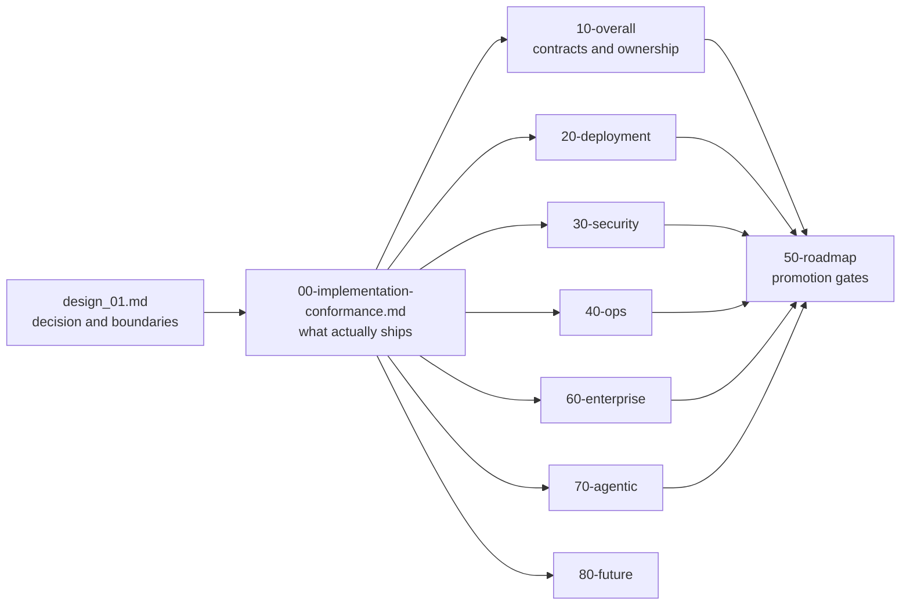

# ViewSense AI® High-Level Design

For native GUI access, run `make trueforge-ui` and open `http://localhost:8791`. This is a separate temporary standalone preview; see [Open TrueForge](../../deploy/trueforge-access.md) for lifecycle, certificate errors and hosted-runtime limits.

This directory is the canonical architecture set for ViewSense AI®. Read the index, then the executable
conformance map before using a target-state document as an implementation claim.

The selected next change retains `aiops-fabric` and adopts TrueForge as its execution runtime.
Start with the [adoption/decommission plan](03-trueforge-adoption-decommission.md), then the
[namespace design](20-deployment/03-trueforge-namespace-integration.md) and
[migration runbook](40-ops/02-trueforge-migration-runbook.md). The namespace pair and fixed synthetic probe are implemented; the owner-authorized clean-state reset
retires legacy execution. Business/production migration gates remain open. See the
[operation record](40-ops/03-clean-state-rebuild.md). `keepview_harness` is not required.

All design and product documentation is owned by `aiops-fabric-docs`. The code
repository's root README and agent instructions point here; module guides,
operations/test guides, governance prompts, and screenshots must also be authored
in this documentation repository. See the
[repository instructions](../../engineering/repository-instructions.md#documentation-ownership)
for paths and the coordinated design-sync workflow.

- [Architecture index](design_01.md) — includes the mandatory
  [platform-wide headless API requirement](design_01.md#platform-wide-headless-api-requirement)
  and capability/API/gap matrix.
- [Networking and mesh design](20-deployment/02-modular-networking-mesh.md) — replaceable CNI,
  strict workload transport and headless networking management.
- [Implementation conformance](00-implementation-conformance.md)
- [TrueForge source assessment](02-trueforge-keepview-assessment.md) — source-based reuse and
  enterprise-control gaps; its separate-project proposal is superseded by the adoption plan.
- [TrueForge adoption and decommission](03-trueforge-adoption-decommission.md) — retained repository,
  keep/adapt/remove register, ordered backlog and acceptance gates.
- [TrueForge namespace integration](20-deployment/03-trueforge-namespace-integration.md) — separate
  fabric/runtime releases, workload identities, API connections and versioned network-policy requirements.
- [TrueForge migration runbook](40-ops/02-trueforge-migration-runbook.md) — cutover, drain, rollback,
  legacy shutdown, source cleanup and separate data disposition.
- [Input and Output Channels](10-overall/07-input-output-channels.md) — planned business routing,
  Tool-Sense module integration, and the Sales → CRM-Logistics1 Oracle opportunity use case.
- [Channel consoles and role mapping](10-overall/08-channel-consoles-role-mapping.md) — planned
  Input/Output pages, framework role grants, product-neutral AuthN/AuthZ contracts and identity mappings.
- [Enterprise AI governance and data egress](10-overall/09-enterprise-ai-governance-egress.md) —
  platform position, company-boundary/PII checks, canonical adapters, model swaps and cost/audit gates.
- [Release automation and recovery](../../releases/installation.md#manually-build-a-release)
  — draft discovery permissions, release asset selection and recovery without rebuilding artifacts.
- [Project status and local AI integration plan](01-project-status-and-local-ai-plan.md) — current
  capabilities, missing local inference/embedding integrations, and delivery acceptance gates.
- [Local AI console and provider design](10-overall/06-local-ai-console.md) — component management,
  suite planning, separate AI/identity/certificate/observability workspaces, Tev1 decisions, real
  embeddings, pgvector migration and live RAG tests. See the
  [SSO and certificate operating guide](../../deploy/integrations/keycloak.md) for the separate
  Keycloak pod, certificate operator and detachable console startup.

Architecture changes are major changes under `docs/prompts/governance/major-change-policy.md`. They require synchronized code, contract, security, deployment, and operations updates.

The canonical deployment target is Kubernetes. Docker Compose is a developer harness and cannot be used as evidence that Kubernetes isolation, probes, storage, or policy controls work.

Enterprise SSO, observability/SIEM, governance, lifecycle, resilience, and integration requirements are consolidated in `60-enterprise/01-enterprise-integration-controls.md`.

Agent execution, governed data ingestion/chunking, and n8n or other workflow-engine integration are defined in `70-agentic/01-agent-runtime-ingestion-workflows.md`.

Trust Envelopes, provider passports, evaluation admission, safe evidence, future A2A interoperability, and sovereign cells are defined in `80-future/01-sovereign-control-evidence-fabric.md`.

Cloud model integration is represented by a credential-owning provider adapter, never by placing
vendor keys in the edge, orchestrator, or generic LLM gateway. The OpenAI reference path and its
development/production egress distinction are described across the runtime, security, deployment,
and operations documents above.

The Input/Output console control-plane pilot now ships reviewed governance catalogs and
non-executing policy/Sales previews. See the [channel console guide](../../fabric/governance/channel-console.md)
and current conformance section before interpreting the broader execution target designs.

- [User playground and Internal AI policy engine](10-overall/10-user-playground-policy-engine.md) — end-user chat, approved AI destinations and the local-only runtime boundary.
