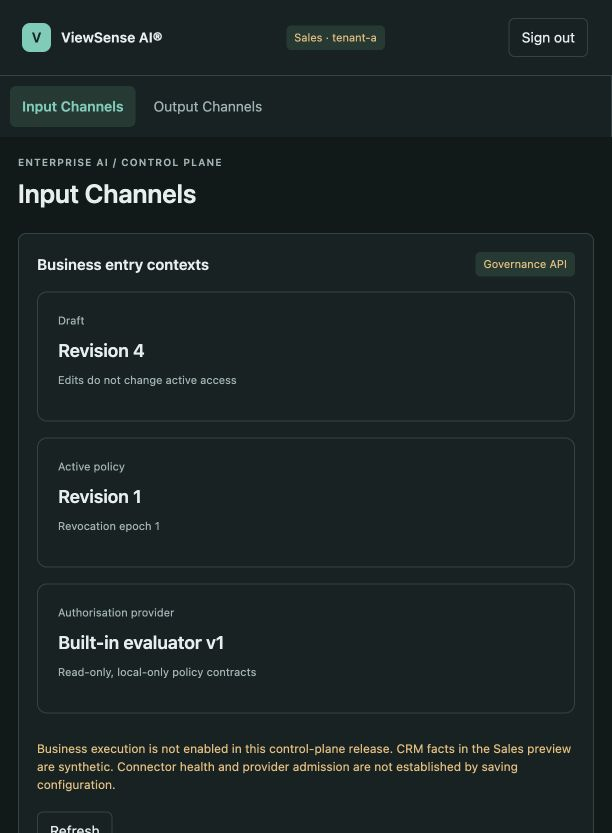
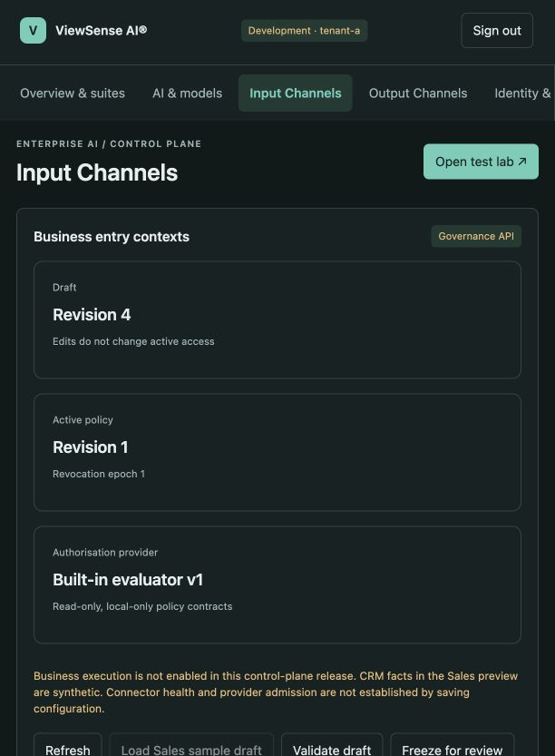

# Channel console and policy pilot

The optional management GUI has **Input Channels**, **Output Channels**, and **Identity & access**
workspaces. All administration is available through the governance API and explicit edge/console
facades. Governance owns the policy state; the browser stores no grants and evaluates no policy.
This release implements the control plane. Business tool/CRM execution remains disabled.

## Console roles in the POC

| Console role | Visible workspaces | Authority |
|---|---|---|
| ViewSense Admin | Overview & suites, AI & models, Networking, Observability, Certificates, Identity & access, Input Channels, Output Channels, Model test lab, Test history | Existing administration scopes; independent review remains separately provisioned |
| Operations | Overview & suites, Certificates, Identity & access, Input Channels, Output Channels | Read only; no renewal, deployment-plan generation, model tests or policy mutations |
| Sales | Input Channels, Output Channels | Read only |
| SIEM | Input Channels, Output Channels | Read only |

Choose a POC identity at sign-in and supply its matching launch credential. The identity selector
does not grant a role: the server authenticates the selected credential against operator-owned
configuration. The existing `console-access-key` remains the Admin credential. Additional files
are `console-operations-access-key`, `console-sales-access-key` and `console-siem-access-key`, all
under the private `.viewsense/local-ai/` state directory. Do not distribute the Admin key to other
POC users. `console-identities.json` binds each identity to a separate fixed-tenant workload client;
these clients have only their profile's component grants. Credentials stay on the server and are
never returned by a catalog API. Stop/restart the harness after changing operator configuration;
restart invalidates browser sessions while retaining policy data.

For startup, per-role credential commands, sign-in steps and login troubleshooting, see
[Local POC sign-in and launch credentials](../../design/high-level/40-ops/01-day2-operations-sre.md#local-poc-sign-in-and-launch-credentials).

`GET /api/session` returns canonical `roles`, `role_labels`, narrowed `scopes` and `workspaces`.
`GET /api/console-roles` shows the role matrix inside Identity & access for Operations and Admin.
Navigation, overview links and initial background requests obey that matrix. Forbidden page URLs
fall back to Overview for Operations or Input Channels for Sales/SIEM. Direct requests to a
forbidden console API or any non-admin mutation return 403 before downstream dispatch. Read-only
channel pages hide mutation and synthetic-preview controls and disable resource fields.

For enterprise SSO, configure the AuthN adapter's approved `role_scopes` mapping to emit
`console.role.viewsense-admin`, `console.role.operations`, `console.role.sales` or
`console.role.siem`, plus the intended transport scopes. Role names in an arbitrary unapproved
claim or a browser field provide no workspace access. Recognised console roles combine their
workspace ceilings; transport scopes must independently permit the requested component operation.
Unmapped SSO users see no workspaces. Legacy headless scope contracts remain compatible; the new
console policy does not reinterpret arbitrary existing API clients as console users. The edge
also applies the ceiling to verified console-role scopes and named POC workload subjects.

Console roles govern platform workspace admission. They do not create CRM entitlements, framework
role mappings, Input entry bindings or Output grants. Sales/CRM execution still requires its own
complete business grant, and remains disabled in this pilot. The role registry is shipped code
plus operator configuration; dynamic console role editing and enterprise account provisioning are
not implemented. The SIEM profile here is a Channel viewer, not a telemetry-export credential.

### Role acceptance

Unit acceptance checks all four workspace matrices, direct API denial, non-admin write denial,
credential/role spoof rejection, approved signed OIDC mappings, narrowed permissions and edge
denial even when a named POC identity accidentally has an excessive transport scope. Live GUI
acceptance includes role sign-in, hidden admin links, read-only fields and forbidden URL fallback.

Read-only live acceptance against the provisioned local harness:

```bash
.venv-console/bin/python scripts/test-console-roles.py
```

This checks all four profiles, direct read/write denial, credential promotion rejection and absence
of launch/workload credentials in service logs. It stores metadata-only evidence in private local
state and signs out its test sessions. The latest coordinated revision passed all **203** repository
tests. GUI checks verified all four identities, Sales forbidden-URL fallback, disabled resource
fields, Operations identity/catalog/certificate access and Admin navigation. Local screenshots:



[Operations role/catalog view](../../assets/screenshots/channel-console/operations-role-gui.png).

## Workspaces and ownership

| Workspace | Configuration |
|---|---|
| Input Channels | Business entry contexts, purposes/surfaces, Input bindings, routes and derived Output grant relationships |
| Output Channels | Application/data boundaries, connector references, named actions/fields, profiles, Output grants and routes |
| Identity & access | Authentication providers, authorisation provider metadata, framework roles and qualified external identity mappings |

An Input binding permits entry; an Output grant permits explicit actions under one role, route,
Input and account/field policy. Read-only profiles never imply every read action. User/group
assignments remain in the chosen identity system. Keycloak is an example AuthN integration.
Product claims are configured in an adapter, not in channel or role forms.

Each workspace shows the draft revision, active revision and revocation epoch. Connector
configuration (`sample` or `unconfigured`) is distinct from observed health/admission. No live CRM
health is reported in this slice. Configuring a connector reference does not install a connector.

## Draft, review and publication

1. Create or edit resources. Save changes to the draft only. IDs are stable tenant-scoped keys.
2. Validate references and Input/Output/profile ceilings. The server rejects duplicate qualified
   mappings and incomplete references at freeze/validation.
3. Freeze the consistent draft revision and inspect the before/after diff.
4. An independently provisioned reviewer approves the frozen revision with a review note. Anyone
   who edited or froze that candidate cannot approve it. Review evidence cannot be overwritten.
5. Activate the reviewed current revision atomically. Later draft edits leave that snapshot intact.

Each `PUT` requires `If-Match: <whole-draft-revision>`. Missing headers return 428; stale writes or
activation return 409. Refresh and review after a conflict. Freeze of the same revision is
idempotent. Profiles and grants are immutable inside an active snapshot, whose revision qualifies
all resource references. This slice has no delete, role inheritance or rollback endpoint.
Emergency disable is audited and immediately advances the epoch; publication cannot clear it.
A replacement resource requires a new reviewed ID rather than silently undoing the emergency deny.

Operator scopes are tenant-wide in this first slice:

| Scope | Authority |
|---|---|
| `channels.read` / `channels.admin` | Read / draft-edit or disable Input, Output and route resources |
| `authz.read` / `authz.admin` | Read / draft-edit role, mapping, binding, profile and grant resources; freeze/activate |
| `authz.review` | Independent review; requires catalog read scopes to inspect the candidate |
| `authz.simulate` | Non-executing synthetic previews; requires both catalog read scopes |
| `authz.decide` | Internal verified identity delegation; accepted only from the gateway presenter |

The combined console workspace requires both catalog read scopes. The local development operator
has edit/preview permissions, without reviewer permission. A separate `policy-reviewer` identity
is provisioned for direct API acceptance. Distinct development identities exercise the mechanism;
they are not evidence of production organisational separation of duties. No UI assigns memberships
in an external identity system or accepts pasted tokens.

## Implemented headless contracts

Machine-readable assets are `channel-policy-v1`, `identity-assertion-v1`, `channel-selection-v1`,
`channel-decision-request-v1`, `channel-decision-response-v1`, `channel-preview-request-v1` and
`oidc-provider-v2` schemas. Governance OpenAPI also describes each typed resource update.

| Owner API | Operations |
|---|---|
| `/v1/channels/input`, `/v1/channels/output` | GET bounded draft list; PUT `/{identifier}`; POST `/{identifier}:disable` |
| `/v1/framework-roles`, `/v1/idp-role-mappings`, `/v1/input-role-bindings` | Same resource list/update/disable operations |
| `/v1/output-capability-profiles`, `/v1/output-role-grants`, `/v1/channel-routes` | Same resource list/update/disable operations |
| `/v1/access-policy-draft` | GET draft, active snapshot, frozen/reviewed candidates, disabled set and safe journal |
| `/v1/access-policy-draft:seed` | POST sample draft into an empty catalog only |
| `/v1/access-policy-revisions:validate` | POST reference/ceiling validation |
| `/v1/access-policy-revisions` | POST freeze with `expected_revision` |
| `/v1/access-policy-revisions/{revision}:review` | POST independent review with `expected_revision` and `note` |
| `/v1/access-policy-revisions/{revision}:activate` | POST atomic activation with `expected_revision` |
| `/v1/authorization:simulate`, `/v1/authorization:sales-example` | POST synthetic identity preview / fixture opportunities |
| `/v1/authorization:decide`, `/v1/authorization:access` | POST trusted-edge assertion decision / own-access projection |
| `/v1/authorization-providers` | GET selected evaluator contract/configuration and catalog reachability |

Explicit edge facades preserve the management paths and scopes. The edge's
`POST /v1/authorization:decide` accepts only selection fields and derives identity from a verified
token; it never accepts caller-selected roles. `GET /v1/auth/channel-access` returns only permitted
active route/action summaries. The console uses `/api/` equivalents and forwards `If-Match` under
session/CSRF protection. Lists are bounded to 200 objects per family, without paging in this pilot.
Request payloads are bounded to 256,000 bytes. The state retains up to 100 immutable candidates and a
500-event pilot journal; independent archival and immutable/WORM export remain production work.

## AuthN adapter compatibility and freshness

V1 provider files and legacy transport `roles` / `role_scopes` remain compatible. V2 adds an
explicit version and approved named source extraction, for example:

```json
{
  "version": "2",
  "id": "enterprise-identity",
  "kind": "oidc",
  "label": "Enterprise authentication",
  "issuer": "https://identity.example.invalid",
  "jwks_url": "https://identity.example.invalid/jwks",
  "audience": "viewsense-api",
  "allowed_scopes": ["api.invoke"],
  "role_sources": {
    "application-roles": {"claim": "entitlements.application", "revision": 1}
  }
}
```

This is an example, not a configured provider. Extraction occurs after signature/issuer/audience
validation. Business roles need not appear in the legacy scope allow-list. The mapping matches
provider, issuer, audience, source ID/revision and exact external value. Malformed, duplicate,
unbounded or missing required source assertions reject authentication. No fuzzy role matching or
cross-provider username linkage is performed.

The assertion age derives from the verified token's issuance time, never from the request or a
cache read. The built-in evaluator requires age strictly below the grant bound (at most 60
seconds). Older/expired/future assertions deny. Authoritative membership refresh/revocation feeds
are not implemented, so this is snapshot freshness, not immediate membership removal. External
AuthZ engines and their semantic conformance remain planned. Every decision includes narrowed
account/field/local-model/result/retention/reply obligations and `execution_authority: false`.

## Synthetic Sales acceptance

Start `make console` (or separate `make harness` and `make gui`). In **Input Channels**, choose
**Load Sales sample draft**, validate it and open **Policy preview and Sales example**. Run
**Give me sales opportunities · sample** to inspect ClientA API qualification, ClientB finite
licence headroom and ClientC conditional Linux migration review. No discount is invented and an
unlimited licence pool produces no licence upsell. Restricting fields suppresses examples that
need prohibited facts; the route result limit bounds the returned items.

Change the action to a write/contact/export, the Input to Support, the external role/source/issuer,
or the assertion age to an expired value and verify denial. Compare draft and active snapshots.
The synthetic subject form is admin preview only; ordinary identities cannot impersonate it.

Opt-in live acceptance against the local sample catalog:

```bash
.venv-console/bin/python scripts/test-channel-console.py
```

The test refuses to mutate a non-sample policy. It checks session/CSRF, previews, independent
review using a separately provisioned development identity, activation and concurrent edit
conflicts. It leaves the sample active snapshot and a later draft revision for inspection.
Restart the harness and verify these revisions remain in PostgreSQL. Local model tests are
separate: use the test lab for installed `tev1:0.8b` and `embeddinggemma-2:270m`; neither model makes
authorisation decisions. Model previews do not change defaults until explicitly saved.

## Verified local evidence

The initial pilot acceptance used the installed `tev1:0.8b` and `embeddinggemma-2:270m` models.
TEV1 returned a bounded decision probability; EmbeddingGemma returned 768-dimensional vectors.
These model results do not establish factual correctness or authorisation. Live API acceptance
passed, and restart checks retained active revision 1, draft revision 4, epoch 1 and independent
review evidence. Synthetic memory retrieval, owner isolation, history/log safety and retained
memory after restart also passed. All 191 repository tests and lint passed.

The browser exercised Input/Output resource editing, provider/mapping inspection, denied and stale
assertion previews, visible stale-edit conflict and the three conditional opportunity examples.
The narrow console layout keeps the workspace navigation horizontally scrollable. The screenshots
are development fixtures, not live customer data:



[Full Sales preview](../../assets/screenshots/channel-console/sales-preview-gui.png) and
[EmbeddingGemma GUI result](../../assets/screenshots/channel-console/embeddinggemma-gui.png).

The existing Cilium `viewsense-network` cluster passed end-to-end smoke and all network path probes.
The existing `k3d-cks` cluster unexpectedly allowed the denied orchestrator → MCP path; its network
isolation remains unverified and needs installation-level investigation before promotion.

## Production promotion

Real Oracle/CRM credentials, schema/query mappings, account entitlements and tool bindings remain
application-owner integrations. Teams identity/reply binding, narrowed execution delegation,
direct-tool enforcement, authoritative role refresh, external AuthZ equivalence, runtime PII
inspection/final-wire checks, hard budgets and independent immutable execution evidence remain
acceptance gates. Existing legacy inference paths do not acquire these guarantees from a catalog.
Explicit `channel_context` requests to the edge fail safely until execution is enabled.
